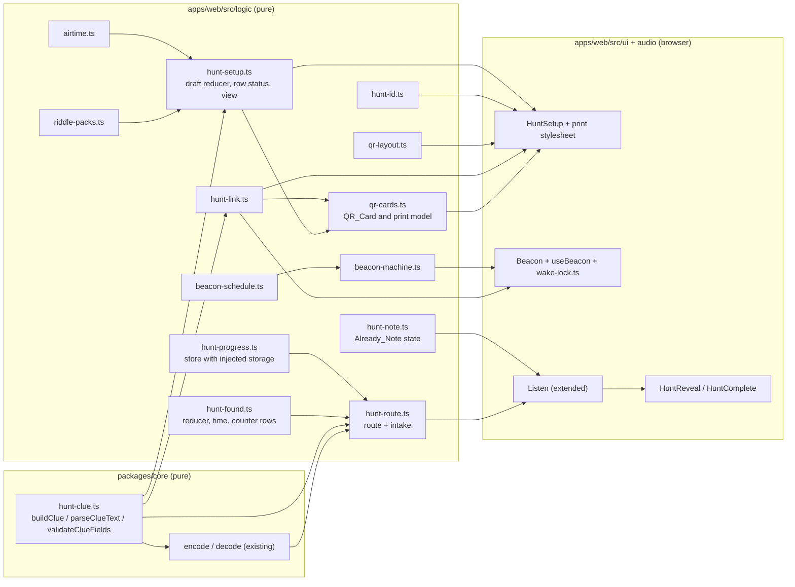
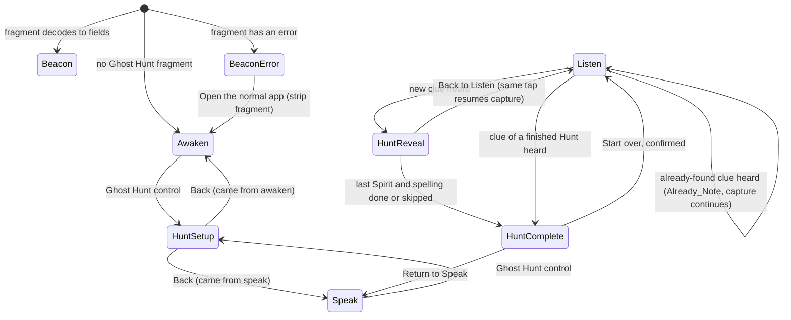
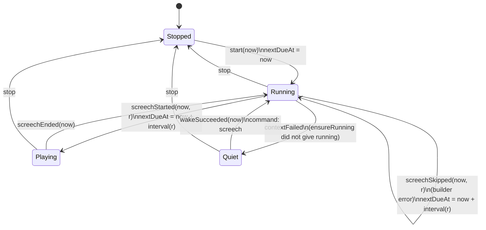

# Design Document

## Overview

Ghost Hunt adds a party game to the Spirit_Box_App. A host fills in 3 to 7 Spirits on a laptop, optionally adds an Opening_Riddle and a Hide_At note per Spirit, and prints or shows one Setup_QR per Spirit. A phone that scans a Setup_QR opens the app with the Spirit's data in the URL fragment, becomes a Beacon, and screeches a `hunt-clue` Packet every 15 to 20 seconds. Players walk around on the Listen_Screen. A heard clue is spelled on the Ouija board and a Spirit_Counter goes up. A clue of a Spirit that was already found only shows an inline Already_Note, so the Player stays on the Listen_Screen. The last Spirit ends the Hunt.

The design adds no protocol type and no new audio code. It reuses what exists:

| Existing piece | Where | How Ghost Hunt uses it |
|---|---|---|
| `hunt-clue` Packet type, `SIZE_CAP` (140), `encode()`, `decode()`, text body | `packages/core` (`types.ts`, `constants.ts`, `text-body.ts`, `codec.ts`) | The clue is a `{ type: 'hunt-clue', text }` Payload. Core already encodes it as strict UTF-8 text with no compression. |
| `unlockAudio`, `ensureRunning`, `isRunning`, `currentContext` | `apps/web/src/audio/session.ts` | Beacon start tap, keep-alive before each screech, "Tap to wake the beacon". |
| `loadEngine(sampleRate)`, `playWaveform(ctx, wave)` | `audio/engine.ts`, `audio/transmit.ts` | Every screech. The engine cache is keyed by the sample rate read from the context. |
| `KIIMeter` | `ui/components/KIIMeter.tsx` | The only distance cue. The Follow_Line points the Player to it. Ghost Hunt adds no audio analysis. |
| `spellShown`, `OuijaBoard` | `logic/ouija.ts`, `ui/components/OuijaBoard.tsx` | Hunt_Reveal spelling. |
| `holdStep`, `useHold`, `HOLD_DURATION_MS` | `logic/hold-machine.ts`, `ui/hooks/useHold.ts` | Hold-to-stop on the Beacon_Screen. |
| `dedupeStep` (5 s window) | `logic/dedupe.ts` | Suppresses repeats of identical bytes within 5 seconds. |
| `screenState`, `flowReducer`, `quietState`, `describeEncodeError`, `useMotion`, `CrtFrame`, `ToggleCluster`, `.hit`, `.btn` | `logic/`, `ui/` | Routing, flow, quiet rules, error wording, motion, theme. |

### Findings that shape the design

1. **The wire format needs only a text layout.** Core's `encodeBody` already accepts `hunt-clue` text, rejects empty text and lone surrogates, and `decodeBody` returns it unchanged. Ghost Hunt defines a text layout and a build/parse pair in Core (`hunt-clue.ts`). `codec.ts` does not change.
2. **Packet budget.** A Packet is 3 header bytes plus the body. With the layout below the body is `8 + nameBytes + 1 + clueBytes`, so `Clue_Packet_Size = 12 + nameBytes + clueBytes` and `nameBytes + clueBytes <= 128`. The Airtime_Function (`ceil(0.7 + 0.0614 * bytes)`) gives 10 s for a full 140-byte Packet, so a screech takes up to about 10 seconds and the 15 to 20 second Beacon_Interval leaves a gap of at least 5 seconds. The built-in packs stay at 90 bytes or less (4 s to 7 s of airtime) so Players do not have to stand close for long.
3. **Hide_At and Opening_Riddle are host-only.** They live in the draft and in the print model only. The Clue_Builder and Link_Encoder take `ClueFields`, which has no field for either, so they cannot reach a Packet or a Setup_Link by construction.
4. **The Setup_Link is sized by percent-encoding, not by the packet.** Percent-encoding turns each non-ASCII byte into `%XX`. The link for a full clue can reach about 460 characters with a 40-character base URL. See "Dense QR codes" below, which measures this and shows it still scans.
5. **`Listen` stops capture on a decoded result today. An `already` clue must not stop it.** The Hunt route is evaluated before the existing `screenState` path, and only `new`, `complete` and garbled hunt clues reach the code that stops listening. An `already` clue only updates a small Listen-side state (the Already_Note).
6. **The Hunt_Reveal is a separate screen** that reuses `OuijaBoard` and `spellShown`. `Reveal.tsx` is left as it is, because it plays Haunting Sounds that requirement 10.20 forbids on the Hunt_Reveal.
7. **`--screen-max` is 430 px.** The Hunt_Setup_Screen is for a laptop, so it overrides the container width at 1280 px (a wider `.screen-wide` class) and stays single-column at 390 px.
8. **`qrcode` is already a dependency of `apps/web`** (`^1.5.4`, with `@types/qrcode`). It exposes `QRCode.create(text, { errorCorrectionLevel })`, which returns the module matrix. The design draws that matrix itself as an inline SVG so it controls the pixel size on screen and keeps the code sharp at any size on paper.

### Dense QR codes (measured)

A full clue makes a dense code. I measured it with the installed `qrcode` 1.5.4, using a 38 to 100 character base URL and fields chosen to make the link as large as possible (ASCII punctuation, accents, emoji and CJK, with name plus clue at the 128-byte limit).

| Case | Link length | EC level L | EC level M | EC level Q |
|---|---|---|---|---|
| Lowercase ASCII, full | 206 | v9 (53 modules) | v10 (57) | v13 (69) |
| Punctuation, full | 411 | v12 (65) | v14 (73) | v17 (85) |
| Emoji or CJK, full, base 38 chars | 456 to 462 | v12 (65) | v14 (73) | v17 (85) |
| Emoji, full, base 100 chars | 542 | v14 (73) | **v16 (81)** | v19 (93) |

`qrcode` switches between numeric, alphanumeric and byte segments, and `%XX` runs encode compactly, so the worst case stays at version 16 with level M. Add 4 quiet modules per side and the widest code is 89 modules across.

Requirement 6.4 sets two rules that work together: at least 3 CSS px per module at a whole number of device pixels, and a displayed size of at least 160 px. 89 modules at 3 px is 267 px, which fits a 390 px phone (about 340 px usable). A version 10 code (65 modules with the quiet zone) is drawn larger, up to 8 CSS px per module, so it stays above 160 px.

I also rasterised the version 14 and 16 codes with the app colours (`#050806` on `#e9e4d4`, 4-module quiet zone) and decoded them with `jsQR`. Levels L, M and Q decode at 2, 3, 4 and 6 px per module. Fractional scaling (2.5 px per module) failed in my test, which is why the design draws at integer device pixels. Properties 11 and 12 make this a permanent test.

### Mockup deviations and rule notes

- The QR uses dark modules on a light (bone white) square. The theme says near-black background, but a QR needs a light quiet zone. The code sits in a light "card" and the rest of the screen stays on the theme. The print stylesheet switches the page to black on white.
- The Beacon_Screen shows the Clue_Text while running (7.8), so a person who picks up the phone can read the clue.

## Architecture

All parsing, building, state and timing logic is a pure function. Browser work (timers, wake lock, audio, storage, SVG output, print) lives in thin hooks and components.



### Screen flow

The Beacon is not part of the Speak/Listen flow. `App` computes a start route once from `location.hash` before the first render. That keeps the flow reducer's send/listen exclusion rules unchanged. The setup screen and the two result screens join the flow reducer because they are reached from it. An `already` clue is not a screen change: it never reaches the flow reducer.



Flow changes (all additive, `flow.ts`):

- `Screen` gains `'hunt-setup' | 'hunt-reveal' | 'hunt-complete'`.
- `FlowState` gains `huntReturn: 'awaken' | 'speak'` and `hunt: HuntNavIntake | null`, where `HuntNavIntake` is a `HuntIntake` of kind `new` or `complete` (see `hunt-route.ts`). The `already` kind has no place in the flow state.
- `FlowEvent` gains `openHuntSetup`, `closeHuntSetup`, `huntReceived` (carries a `HuntNavIntake`), `huntRevealDone`, `huntBack` (target `speak | listen`) and `huntRestart`.
- `openHuntSetup` is allowed from `awaken` and `speak` and needs no mic status (3.1). While `transmitting` or `listening` it does nothing, so the exclusion rules stay as they are.
- `huntReceived` behaves like `received`: it sets `listening: false` (capture was stopped by Listen) and routes to `hunt-reveal` for `new`, or straight to `hunt-complete` for `complete` (14.9).
- A heard `already` clue dispatches nothing. `listening` stays `true` and the screen stays `listen` (10.8).
- Existing `Screen` consumers (`App` switch, `quietState`) get the new cases. `quietState` gets one optional input `beaconActive` (default `false`) that forces quiet, so the Beacon plays no Haunting Sound (7.10) and the existing quiet-state property test is unchanged.

### The wire layout

```
Payload text = HUNT_ID(6) INDEX(1) TOTAL(1) NAME US CLUE
US = U+001F (unit separator)
```

- `HUNT_ID` is 6 characters of the Hunt_Alphabet, `INDEX` and `TOTAL` are single digits (1 to 7 and 3 to 7).
- `NAME` has no control characters (sanitised), so the first `US` after the 8-character header is always the name/clue separator, and `CLUE` may hold any character except control characters.
- Fixed-width header fields avoid two separators and save 2 bytes. The Core `contact` body already uses `U+001F` as a separator (`revealValue` in `Reveal.tsx`), so the convention is the same.
- Hide_At and Opening_Riddle have no place in this layout (3.18).
- Example: `K7M2QX` `3` `5` `The Cold Photocopier` `US` `Paper is born where it is warm. Look behind it.` is 8 + 20 + 1 + 48 = 77 bytes of body, 80 bytes of Packet.

### Beacon timing



The next due time is always `start of the previous screech + interval`, never `previous due time + interval`. A phone that was asleep therefore sends exactly one screech when it wakes and never a burst (8.9). A screech that is still playing when the next is due delays it until `screechEnded`, then the next tick (every 250 ms) fires it (8.8).

## Components and Interfaces

### Core: `packages/core/src/hunt-clue.ts` (new)

```ts
export const HUNT_ALPHABET = '23456789ABCDEFGHJKMNPQRSTUVWXYZ'; // 31 characters
export const HUNT_ID_LENGTH = 6;
export const SPIRIT_TOTAL_MIN = 3;
export const SPIRIT_TOTAL_MAX = 7;
export const SPIRIT_NAME_MAX_BYTES = 24;
export const CLUE_SEPARATOR = '\u001f';

export interface ClueFields {
  readonly huntId: string;
  readonly index: number;
  readonly total: number;
  readonly name: string;
  readonly clue: string;
}
/** Accepts anything, so invalid input reaches validation instead of the type checker. */
export type ClueFieldsInput = { readonly [K in keyof ClueFields]: unknown };

/** Control characters (0..31, 127) become one space each, then trim. Non-strings give ''. */
export function sanitizeClueText(value: string): string;

/**
 * Field rules only, no size check. Returns the normalised fields (sanitised name and clue).
 * Checks in the order huntId, total, index, name, clue and returns the first failure as
 * `invalid-payload` with `field` set. Pure, never throws.
 */
export function validateClueFields(input: ClueFieldsInput): Result<ClueFields>;

/** validateClueFields, then the layout, then Core encode(). `too-large` carries the length. */
export function buildClue(input: ClueFieldsInput): Result<Uint8Array>;

/** The text part only. Used by buildClue and by tests. */
export function buildClueText(fields: ClueFields): string;

/** Strict inverse of buildClueText. Any non-string, bad layout or non-canonical field gives `invalid-body`. */
export function parseClueText(text: unknown): Result<ClueFields>;
```

Rules and decisions:

- **Size** is checked last (1.12). `buildClue` calls `encode({ type: 'hunt-clue', text })`. Core returns `too-large` with the length, and `buildClue` passes that error through unchanged (1.11).
- **Name length** is measured in UTF-8 bytes with `encodeUtf8Strict` from `utf8.ts`. A lone surrogate in the name or clue gives `invalid-payload` on `name` or `clue`, not Core's generic `text` field, so the host sees which field to fix.
- **Name error message** carries the measured value and the limit, for example `Spirit name is 31/24 bytes`.
- **`parseClueText` is strict (1.13).** After splitting it re-validates every field and also requires each field to be canonical (`sanitizeClueText(field) === field`). Core's own bodies are strict in the same way ("accepts only what `encodeBody` produces"). This also keeps `buildClueText(parse(t)) = t` for any text the parser accepts.
- **Exports.** `index.ts` exports the constants, `ClueFields`, `ClueFieldsInput`, `sanitizeClueText`, `validateClueFields`, `buildClue`, `buildClueText` and `parseClueText`. The file imports only `result.ts`, `utf8.ts`, `codec.ts` and `constants.ts`, so `static-scan.test.ts` keeps passing (1.15).

### Web logic (`apps/web/src/logic`, all new files, no React, no audio API)

**`airtime.ts`**

```ts
export const LONG_CLUE_THRESHOLD_BYTES = 100;
/** ceil(0.7 + 0.0614 * packetBytes). Returns 0 for a non-finite or negative input. Never throws. */
export function airtimeSeconds(packetBytes: number): number;
export function longClueNote(packetBytes: number): string | null; // 'Long clue: players must stay close for about N s.'
```

`longClueNote` returns text only when `packetBytes` is above 100 (the caller has already established it is at most 140). Reference points: 26 bytes gives 3 s (reference 2.3 s), 53 bytes gives 4 s (4 s), 140 bytes gives 10 s (9.3 s), each within the 1-second tolerance of 4.13.

**`hunt-id.ts`**

```ts
export type HuntIdResult =
  | { readonly ok: true; readonly id: string }
  | { readonly ok: false; readonly reason: 'not-enough-bytes' };
/** Largest multiple of 31 below 256 is 217. Bytes of 217 or more are skipped (no modulo bias). */
export const HUNT_ID_REJECT_FROM = 217;
export function huntIdFromBytes(bytes: ArrayLike<number>): HuntIdResult;
```

The caller (`HuntSetup`) fills a `Uint8Array(24)` with `crypto.getRandomValues`. A 24-byte array has a 217/256 chance per byte, so running short is about 1 in 10^9, and the function reports it instead of looping.

**`hunt-link.ts`**

```ts
export type LinkError = { readonly param: 'url' | 'hunt' | 'spirit' | 'total' | 'name' | 'clue' | 'fragment'; readonly message: string };
export type EncodeLinkResult =
  | { readonly ok: true; readonly link: string }
  | { readonly ok: false; readonly error: CodecError | LinkError };
export function encodeSetupLink(baseUrl: string, fields: ClueFieldsInput): EncodeLinkResult;

export type DecodeFragmentResult =
  | { readonly kind: 'none' }                       // start normally, no message (5.11)
  | { readonly kind: 'fields'; readonly fields: ClueFields }
  | { readonly kind: 'error'; readonly error: LinkError };
export const MAX_FRAGMENT_LENGTH = 2048;
export function decodeSetupFragment(fragment: string): DecodeFragmentResult;
```

- `encodeSetupLink` validates with `validateClueFields`, requires an absolute `http` or `https` base, strips any existing fragment from the base, and writes the five parameters in the fixed order. `name` and `clue` use a local `percentEncode` that encodes every UTF-8 byte except `A-Za-z0-9-._~`. `encodeURIComponent` leaves `! ' ( ) *` alone, so the module does not use it. Its input type has no Hide_At or Opening_Riddle (5.1).
- `decodeSetupFragment` strips one leading `#`, rejects more than 2048 characters, splits on `&`, splits each part at its first `=`, keeps only the five known keys (case-sensitive), and decodes `name` and `clue` with `decodeURIComponent` inside `try`. `+` stays `+`. `spirit` and `total` must match `/^[0-9]+$/`. `hunt` must be exactly 6 alphabet characters. Duplicates and missing keys give an error naming the parameter. Then it calls `validateClueFields`, so the host and the Beacon use one set of rules. It checks field rules only and not packet size (5.9). The Beacon runs `buildClue` and shows the `too-large` message (7.13).
- `none` is returned when the fragment holds none of the five keys.

**`hunt-found.ts`**

```ts
export interface FoundEntry { readonly index: number; readonly name: string }
export interface FoundState {
  readonly huntId: string;
  readonly total: number;
  readonly found: readonly FoundEntry[];   // ascending by index, no duplicates
  readonly firstFoundAt: number | null;
  readonly completedAt: number | null;
}
export function emptyFoundState(fields: Pick<ClueFields, 'huntId' | 'total'>): FoundState;
export function foundReducer(state: FoundState, fields: ClueFields, nowMs: number): FoundState;
export function timeTakenSeconds(state: FoundState): number;
export function formatTimeTaken(seconds: number): string;        // 'M:SS'
export interface CounterRow { readonly index: number; readonly name: string | null } // null = unknown
export function counterRows(state: FoundState): readonly CounterRow[];
export function counterHeading(state: FoundState): string;       // 'Spirits found: X of Y'
```

`foundReducer` returns the input object unchanged when the Hunt_ID or total differs, the index is already found, or the Hunt is complete. Otherwise it returns a new state with the entry inserted in order, `firstFoundAt` set when the list was empty, and `completedAt` set when `found.length === total`. It never mutates its input. `formatTimeTaken` returns `M:SS` for whole seconds with no cap on minutes.

**`hunt-progress.ts`**

```ts
export interface StorageLike {
  getItem(key: string): string | null;
  setItem(key: string, value: string): void;
  removeItem(key: string): void;
}
export const PROGRESS_KEY_PREFIX = 'screech.hunt.';
export function serializeFoundState(state: FoundState): string;
export function parseFoundState(text: string, expectedHuntId: string): FoundState | null;
export interface ProgressStore {
  load(huntId: string): FoundState | null;            // null = nothing valid saved
  save(state: FoundState): { readonly persisted: boolean };
  clear(huntId: string): { readonly cleared: boolean };
}
export function createProgressStore(storage: StorageLike | null): ProgressStore;
```

- The store keeps an in-memory `Map` as well. `load` prefers a valid stored value and falls back to memory. `save` writes memory first, then storage inside `try`; `persisted: false` drives the "progress will be lost" note (12.6). `clear` removes memory, then storage inside `try` (12.10).
- `parseFoundState` validates every field (types, ranges, name bytes, ascending unique indices, `completedAt` only when full, `firstFoundAt` set when `found` is not empty). Anything else returns `null`. `load` never deletes or rewrites unreadable text (12.5).
- The stored JSON is `{ v: 1, huntId, total, found: [[index, name]], first, done }`. It holds no clue text, Hide_At or Opening_Riddle (12.11).
- The app passes `window.localStorage` inside `try`, or `null` when access throws.

**`hunt-route.ts`**

```ts
export type HuntRoute =
  | { readonly kind: 'none' }                        // not a hunt packet: use screenState
  | { readonly kind: 'garbled' }                     // hunt-clue text did not parse (10.7)
  | { readonly kind: 'clue'; readonly fields: ClueFields };
export function huntRoute(result: Result<DecodedPacket>): HuntRoute;

export type HuntIntake =
  | { readonly kind: 'new'; readonly fields: ClueFields; readonly before: FoundState; readonly state: FoundState; readonly persisted: boolean }
  | { readonly kind: 'already'; readonly fields: ClueFields; readonly storedName: string }
  | { readonly kind: 'complete'; readonly fields: ClueFields; readonly state: FoundState };
export type HuntNavIntake = Exclude<HuntIntake, { readonly kind: 'already' }>;
export function huntIntake(store: ProgressStore, fields: ClueFields, nowMs: number): HuntIntake;
```

`huntRoute` returns `none` for a multipart `hunt-clue` Packet, so the existing ignore path stays in force (10.2). `huntIntake` loads the saved state (or `emptyFoundState`) and applies `foundReducer`.

- `complete`: the loaded state already had `completedAt` (14.9). Nothing is saved.
- `already`: the index was found and the Hunt is not complete. `storedName` is the name stored at the first find. Nothing is saved and the store is not written to (10.8).
- `new`: the state changed. It is saved before the function returns. `before` lets the UI tell whether this find completed the Hunt (`state.completedAt !== null && before.completedAt === null`).

Saving happens before the screen changes, so the write finishes inside the 500 ms budget (10.4, 12.1).

**`hunt-note.ts`** (Listen-side Already_Note state, pure)

```ts
export interface AlreadyNote {
  readonly index: number;
  readonly total: number;
  readonly name: string;           // name stored at the first find
  readonly clue: string;           // held in memory only, for the Read_Again_Control
  readonly clueShown: boolean;
  readonly announceId: number;     // changes only when a different note replaces this one
}
export interface NoteState { readonly note: AlreadyNote | null; readonly nextId: number }
export type NoteEvent =
  | { readonly type: 'already'; readonly fields: ClueFields; readonly storedName: string }
  | { readonly type: 'readAgain' }
  | { readonly type: 'clear' };           // new, complete, garbled, or listening stopped
export const EMPTY_NOTE: NoteState;
export function noteReducer(state: NoteState, event: NoteEvent): NoteState;
export function noteText(note: AlreadyNote): string;   // 'Already found · Spirit N of M · <name>'
```

- `already` for the same `(huntId, index)` as the current note returns the state unchanged, including `clueShown` and `announceId` (10.15). For a different index it replaces the note, sets `clueShown: false` and takes the next `announceId` (10.16).
- `readAgain` sets `clueShown: true` on the current note and does nothing when there is none (10.9).
- `clear` returns `EMPTY_NOTE`. Listen sends it for a `new` or `complete` intake, a Codec_Error from the parser, and whenever listening stops (10.16, 10.17). The held clue text never reaches the Progress_Store or any other storage.
- The reducer holds the Hunt_ID of the note in the note itself (`huntId` field, omitted above for brevity), so a packet from another Hunt with the same index replaces the note.

**`hunt-setup.ts`** (host-side draft, pure reducer)

```ts
export type CustomMarks = { readonly name: boolean; readonly hideAt: boolean; readonly clue: boolean };
export interface SetupRow {
  readonly name: string;
  readonly hideAt: string;
  readonly clue: string;
  readonly custom: CustomMarks;
}
export interface SetupDraft {
  readonly total: number;                        // 3..7, default 5
  readonly opening: string;                      // Opening_Riddle
  readonly openingCustom: boolean;
  readonly rows: readonly SetupRow[];            // length 7, always; rows beyond total are the stash
  readonly appliedPack: PackId | null;           // Applied_Pack
  readonly pendingPack: PackId | null;           // overwrite awaiting confirm
  readonly packNote: boolean;                    // "pack text was not filled again" note (3.14)
}
export type RowField = 'name' | 'hideAt' | 'clue';
export type SetupAction =
  | { type: 'setTotal'; total: number }
  | { type: 'edit'; row: number; field: RowField; value: string }
  | { type: 'editOpening'; value: string }
  | { type: 'choosePack'; pack: PackId }
  | { type: 'confirmPack' } | { type: 'cancelPack' };
export function setupReducer(draft: SetupDraft, action: SetupAction): SetupDraft;
export function initialDraft(): SetupDraft;
export function fillPack(draft: SetupDraft, pack: PackId, total: number): SetupDraft; // criterion 3.7
export function customCountToOverwrite(draft: SetupDraft): number;                    // for the confirm text (3.10)

export function measureText(value: string): number; // code points after sanitizeClueText
export const HIDE_AT_MAX = 40;
export const OPENING_MAX = 200;

export type RowStatus =
  | { kind: 'ok'; size: number; label: string; longNote: string | null }
  | { kind: 'too-large'; length: number; label: string }       // 'Too heavy to cross over (<n>/140 bytes)'
  | { kind: 'invalid'; field: string; label: string };
// ok label: '<size>/140 bytes · about <N> s'
export function rowStatus(huntId: string, draft: SetupDraft, row: number): RowStatus;
export interface SetupView {
  readonly statuses: readonly RowStatus[];      // length = total
  readonly limitProblems: readonly string[];    // 'Hide at is 52/40 characters' (names the row), 'Opening riddle is 230/200 characters'
  readonly summary: string | null;              // lowest-index row problem, or the incomplete rows
  readonly canMakeLinks: boolean;
}
export function setupView(huntId: string | null, draft: SetupDraft): SetupView;
```

- **Rows.** The draft always keeps 7 rows, so "keep removed rows in memory" (3.4) costs nothing: `setTotal` only changes `total`.
- **Custom_Text marks.** `edit` and `editOpening` set the mark when the trimmed value is not empty and clear it when it is empty (3.9). Pack fills clear the marks of every field they write (3.11).
- **`choosePack`.** If no field that `fillPack` would write (name, Hide_At and clue of rows `1..total`, and the opening) holds Custom_Text, it fills at once and records the pack as `appliedPack`. Otherwise it sets `pendingPack` and changes nothing else. The UI shows the confirmation with `customCountToOverwrite` (3.10). `confirmPack` fills, clears the marks and records the pack (3.11). `cancelPack` clears `pendingPack` only (3.12).
- **`fillPack(draft, pack, M)`** gives rows `1..M-1` the name, Hide_At and clue of entries `1..M-1`, gives row `M` the name and Hide_At of entry `M` and the pack's finale as its clue, sets the opening, and leaves rows after `M` as they are (3.7).
- **`setTotal`.** It changes `total`. Then, if `appliedPack` exists and no name, Hide_At or clue of any of the 7 rows and not the opening holds Custom_Text, it runs `fillPack` for the new total (3.13) and clears `packNote`. If `appliedPack` exists and some field does hold Custom_Text, it leaves every row unchanged and sets `packNote` (3.14). With no `appliedPack` it only changes `total`, so the stash is restored by simply showing the rows again (3.4).
- **Measure.** `measureText` is `[...sanitizeClueText(value)].length`, which counts code points after control characters become spaces and the text is trimmed (3.15). The sanitiser is the Core one, so the host and the Packet use one rule.
- **`rowStatus`.** One `buildClue` call per row, the same call the Beacon makes (4.9). For `ok` it adds the Airtime to the label and the Long_Clue_Note when the size is above 100 (4.2, 4.15, 4.16). A size of exactly 140 is `ok` with the normal label (4.3).
- **`setupView`.** `canMakeLinks` is false when `huntId` is `null` (random source failed, 2.11), any row is not `ok`, any Hide_At is over 40 or the opening is over 200 (3.16, 3.19, 4.6, 4.7). The summary names the lowest-index row with a problem. The limit messages have the form `Hide at is <length>/40 characters` (with the row's Spirit_Index) and `Opening riddle is <length>/200 characters`. None of these functions changes any typed text (4.10).

**`riddle-packs.ts`**

```ts
export type PackId = 'office' | 'home' | 'classroom';
export interface PackEntry { readonly name: string; readonly hideAt: string; readonly clue: string }
export interface RiddlePack {
  readonly opening: string;                     // 1..200 characters
  readonly entries: readonly PackEntry[];       // exactly 7
  readonly finale: string;                      // used as the clue of the last Spirit
}
export const RIDDLE_PACKS: Readonly<Record<PackId, RiddlePack>>;
```

Authoring rules, all checked by tests:

- Text is ASCII only. The name is 1 to 24 UTF-8 bytes, the Hide_At is 1 to 40 characters, the opening is 1 to 200 characters.
- Clue k leads to the Hide_At of entry k+1, the opening leads to the Hide_At of entry 1, and the finale says the Hunt is over and where to return. A test cannot check this, so it is a review item.
- Every entry clue and the finale build a Packet of at most 90 bytes with the name of any entry of the same pack, any valid Hunt_ID and any index and total (3.8). The Packet is `12 + nameBytes + clueBytes`, so `longestName + longestClueOrFinale <= 78`. A budget of names up to 18 bytes and clues up to 60 bytes meets it.

**`qr-cards.ts`** (pure model for the on-screen QR_Card and the Print_Page)

```ts
export interface QrCardModel {
  readonly index: number;
  readonly total: number;
  readonly title: string;              // 'Spirit N of M'
  readonly name: string;
  readonly huntId: string;
  readonly hideAtLine: string | null;  // 'Hide at: <Hide_At>' or null when the Hide_At is empty
  readonly link: string;
  readonly alt: string;                // 'Spirit N of M, <name>'
}
export interface PrintModel {
  readonly opening: string | null;     // null when the Opening_Riddle is empty
  readonly cards: readonly QrCardModel[];   // ascending by index
}
export function buildPrintModel(huntId: string, draft: SetupDraft, baseUrl: string): PrintModel | null; // null when links cannot be made
```

The Hunt_Setup_Screen and the Print_Page render the same `PrintModel` (one DOM, see "Print page" below), so the printed codes can never differ from the codes on screen (6.16). The Hide_At line is trimmed with `sanitizeClueText` and appears only when not empty after that (3.21, 6.12). The base URL is the page origin and path with query and fragment removed (6.2).

**`qr-layout.ts`**

```ts
export const QR_QUIET_MODULES = 4;
export const QR_MIN_CSS_PX_PER_MODULE = 3;
export const QR_MAX_CSS_PX_PER_MODULE = 8;
export const QR_MIN_CSS_SIZE = 160;
export interface QrLayout {
  readonly fits: boolean;
  readonly modulePx: number;      // integer device pixels per module
  readonly sizePx: number;        // (moduleCount + 2 * quiet) * modulePx, device pixels
  readonly cssSize: number;       // sizePx / dpr
}
export function layoutQr(moduleCount: number, availableCssPx: number, devicePixelRatio: number): QrLayout;
```

`modulePx = floor(min(available / (n + 8), 8) * dpr)`. `fits` is true when `modulePx / dpr >= 3` and `cssSize >= 160`. When it is false, `modulePx` is still the largest value that fits the width, so the UI can show the link as text and a message without overflowing (6.6). Every module is a whole number of device pixels, even on a 2.625 dpr phone.

**`beacon-schedule.ts`**

```ts
export const BEACON_MIN_MS = 15000;
export const BEACON_MAX_MS = 20000;
export function beaconInterval(random: number): number;   // floor(15000 + r * 5001) clamped to 20000; bad r gives 15000
export function countdownSeconds(nextAtMs: number, nowMs: number): number; // ceil(diff / 1000) clamped to 0..20
```

`floor(15000 + r * 5001)` for `r` in `[0, 1)` gives 15000 to 20000 inclusive and is monotonic. Using 5001 makes 20000 reachable. `countdownSeconds` clamps values above 20 to 20 and non-finite input to 0.

**`beacon-machine.ts`**

```ts
export type BeaconState =
  | { readonly kind: 'stopped' }
  | { readonly kind: 'running'; readonly nextDueAt: number; readonly playing: boolean; readonly quiet: boolean };
export type BeaconEvent =
  | { type: 'start'; now: number }
  | { type: 'tick'; now: number }
  | { type: 'visible'; now: number }
  | { type: 'screechStarted'; now: number; random: number }
  | { type: 'screechSkipped'; now: number; random: number }
  | { type: 'screechEnded'; now: number }
  | { type: 'contextFailed' }
  | { type: 'wakeSucceeded'; now: number }
  | { type: 'stop' };
export type BeaconCommand = 'screech' | null;
export function beaconStep(state: BeaconState, event: BeaconEvent): { state: BeaconState; command: BeaconCommand };
```

`tick` and `visible` return `'screech'` only when the state is `running`, not `playing`, not `quiet` and `now >= nextDueAt`. `wakeSucceeded` clears `quiet` and returns `'screech'` at once (9.8). Every other event returns `null`. After `stop`, every event except `start` is ignored. The machine reads no clock; the hook passes `Date.now()`.

### Audio and hooks

**`audio/wake-lock.ts`** wraps `navigator.wakeLock` and returns a small controller:

```ts
export type WakeStatus = 'unsupported' | 'held' | 'released' | 'rejected' | 'idle';
export interface WakeController {
  acquire(): Promise<WakeStatus>;          // 'held' | 'rejected' | 'unsupported'
  release(): Promise<void>;
  onChange(cb: (status: WakeStatus) => void): () => void;   // browser release events
}
export function createWakeController(nav?: Navigator): WakeController;
```

**`ui/hooks/useBeacon.ts`** owns the beacon loop:

- Holds `BeaconState` in a ref plus a render-state mirror. A 250 ms `setInterval` reads `Date.now()` and calls `beaconStep(tick)`. A `visibilitychange` listener calls `ensureRunning()` and `beaconStep(visible)`.
- On command `'screech'`: `await ensureRunning()`, then check `isRunning()` within 1000 ms (9.6). On failure it sends `contextFailed`. Otherwise it builds the Packet with `buildClue(fields)`. A builder error sends `screechSkipped` and shows the message (8.11). On success it reads `audio.context()` (so the sample rate is read now, 9.12), calls `getEngine()`, encodes at the existing `TRANSMIT_VOLUME`, calls `playWaveform`, sends `screechStarted`, and sends `screechEnded` when `handle.finished` settles.
- Start tap: the handler's first statement is `audio.unlockAudio()` (7.5), raced against a 3000 ms timer (7.6). On success it dispatches `start`, then `wake.acquire()`. Stop (`holdStep` fired) dispatches `stop`, calls `handle.stop()` on a playing screech (cutting it off within 500 ms, 7.12) and `wake.release()`.
- The wake control's tap handler calls `unlockAudio()` first (9.7). On success it sends `wakeSucceeded`, which returns the immediate screech command.
- It returns `{ phase, countdownSeconds, screeching, wake: WakeStatus, quiet, error }` for the screen.

### React UI

| Component or screen | File | Notes |
|---|---|---|
| `HuntSetup` (screen) | `ui/screens/HuntSetup.tsx` | `.screen.screen-wide`. Opening_Riddle input and large display at the top, total stepper (3 to 7), pack buttons, one row per Spirit (name, Hide_At and clue inputs, `ByteCounter`, QR_Card with `SetupQr`, copy button), Hunt_ID with a regenerate button, Print button. Every input has a visible label that names the field and the Spirit_Index (3.23). |
| `ByteCounter` | `ui/components/ByteCounter.tsx` | Shows `RowStatus.label` and, when present, the Long_Clue_Note in bone white. The error state adds a visible "Too heavy" or "Fix this clue" text as well as blood red. `aria-live="polite"` on the label, not on the whole row. |
| `PackConfirm` | `ui/components/PackConfirm.tsx` | Inline confirmation step with the count from `customCountToOverwrite`, a confirm control and a cancel control, each 44 px or more. |
| `QrCard` | `ui/components/QrCard.tsx` | Renders one `QrCardModel`: `SetupQr`, "Spirit N of M", name, Hunt_ID and the "Hide at:" line when present. Used on screen and in print. |
| `SetupQr` | `ui/components/SetupQr.tsx` | `QRCode.create(link, { errorCorrectionLevel: 'M' })`, draws the matrix as an inline `<svg>` (one `<path>` for the dark modules, `shape-rendering="crispEdges"`, `viewBox` in modules including the quiet zone) sized by `layoutQr`, with `role="img"` and the `alt` of the model. On a throw, or `fits: false`, shows the link as selectable text and a plain-words message. It redraws when `link` changes, so a stale code is replaced within one frame (6.3). |
| `Beacon` (screen) | `ui/screens/Beacon.tsx` | Heading `BEACON · Spirit N of M`, name, Hunt_ID, start control, then clue, countdown or "Screeching now", wake text, volume text, hold-to-stop key built on `useHold`. Name and clue are React text nodes, so nothing is parsed as HTML (7.3). |
| `BeaconError` | `ui/screens/BeaconError.tsx` | Plain-words error and "Open the normal app" (strips the fragment with `history.replaceState`, no reload). |
| `AlreadyNote` | `ui/components/AlreadyNote.tsx` | Inline note rendered by `Listen` above `KIIMeter`. A `role="status"` `aria-live="polite"` element holds `noteText`, keyed by `announceId`, so it is announced once and a repeat of the same Spirit does not remount it. Below it is the "Read clue again" control (44 px or more) and, after activation, the Clue_Text as plain text (outside the live region). Text wraps, nothing is truncated. |
| `HuntReveal` (screen) | `ui/screens/HuntReveal.tsx` | For a `new` find only. Name and "Spirit N of M" first, then `OuijaBoard` driven by `useSpelling`, a skip control, then `SpiritCounter` and the Follow_Line, the progress-not-saved note, and the clear control with a confirm step. Plays no sound. |
| `HuntComplete` (screen) | `ui/screens/HuntComplete.tsx` | "Hunt complete" in phosphor green, `M:SS`, Spirit list, Hunt_ID, "Spirits found: Y of Y", Return to Speak, Start over with confirm. |
| `SpiritCounter` | `ui/components/SpiritCounter.tsx` | Renders `counterHeading` and `counterRows`. Found entries use a filled shape and the name, unfound use an unfilled shape and "unknown". Names wrap (`overflow-wrap: anywhere`). One text value for assistive technology, no per-name live announcements. |
| `useSpelling` | `ui/hooks/useSpelling.ts` | The same timer logic `Reveal` uses (`performance.now`, 40 ms tick, `spellShown`), without the Haunting Sound calls. |

**Follow_Line.** `HuntReveal` shows the static text "Follow the K-II meter. More lights, closer spirit." as one line under the `SpiritCounter` once the counter appears. It has no animation, colour change or sound (13.13). The K_II_Meter itself is unchanged and is the only distance cue.

**Listen extension.** `Listen` gets a `useReducer(noteReducer, EMPTY_NOTE)`. `onPacketBytes` first calls `huntRoute(decode(bytes))`:

- `none`: the existing `screenState` path runs unchanged, so every non-hunt Packet (and every multipart `hunt-clue`) behaves as before.
- `garbled`: dispatch `clear`, then take the existing garbled path (stop listening, garbled screen).
- `clue`: compute the hex key and run `dedupeStep(shown, key, now())`, the same module-level map. A repeat of identical bytes within 5 seconds is ignored with no store call and no note change (10.13). After 5 seconds the Packet is handled again, so a Beacon repeat is not hidden (10.12). Then `huntIntake(progressStore, fields, now())`:
  - `already`: dispatch `{ type: 'already', ... }`. Do not stop capture, do not change the screen, play nothing. The store was not written.
  - `new` or `complete`: dispatch `clear`, stop listening and dispatch `huntReceived`.

`Listen` dispatches `clear` in the same place that stops listening (including unmount), so the note and the held clue text are discarded on every stop (10.17). The note renders above `KIIMeter` and the layout wraps at 320 px (10.22).

**Resume within 1000 ms (10.11).** The "Back to Listen" tap handler in `HuntReveal`, and the confirmed "Start over" handler in `HuntComplete`, call `audio.unlockAudio()` as their first statement and pass the promise to `Listen` through a small module-level handoff (`queueListenStart(promise)`, consumed once by `Listen`'s mount effect, which then runs the same `begin(unlocking)` that the retry button uses). The mic is opened in that chain exactly as the existing retry path does, so no new gesture rules apply. The handoff does not apply to `already`, because the Player never leaves `Listen`. `Listen` shows no Already_Note after resuming, because the note state starts empty.

**Repeats during a result screen.** Listen stops capture when it shows the Hunt_Reveal or the Hunt_Complete_Screen, so a repeat cannot arrive while either is on screen (10.10, 10.21). Those criteria hold by construction and are covered by one component test each.

**Startup route.** `main.tsx` is unchanged. `App` reads `decodeSetupFragment(location.hash)` once:

- `fields` and `buildClue` ok: `<Beacon>`. `buildClue` too-large: `<BeaconError>` with "Too heavy to cross over (<n>/140 bytes)".
- `error`: `<BeaconError>` with the plain-words message.
- `none`: the existing flow.

`useHauntBridge` receives `beaconActive` so the Haunting Sound player is quiet.

### Print page

The Hunt_Setup_Screen and the Print_Page are one DOM. A `@media print` block in `styles/hunt.css` restyles it, so the printed cards are the cards on screen (6.16).

- **Content.** The Opening_Riddle block (`.hunt-opening`, only when not empty) comes first, then one `QrCard` per Spirit in ascending index order. Each card holds the QR, "Spirit N of M", the Spirit_Name, the Hunt_ID and, when the Hide_At is not empty, "Hide at: <Hide_At>" (6.12, 6.13).
- **Hidden in print.** Every control, input, byte counter, pack and total control, summary and message: `display: none`. The print stylesheet shows no control (6.14).
- **Colours.** `background: #fff; color: #000` on the page and cards, QR modules `#000` on white. The dark theme, CRT frame and scanline overlays are switched off in print (6.14).
- **Page breaks.** `.qr-card { break-inside: avoid; page-break-inside: avoid; }` keeps each card whole on one page (6.15). The opening riddle uses `break-after: avoid` so it is not stranded alone on page one.
- **Opening riddle size.** At least 24 CSS px on screen and in print (3.17, 6.13).
- **QR size on paper.** The SVG is vector, so it scales without blur. The print rule sets each QR to 60 mm square (about 0.67 mm per module for the 89-module worst case), above common scanner limits.
- **Print control.** A button with a 44 px target calls `window.print()` inside `try`. It is disabled whenever `canMakeLinks` is false (6.11). If the call throws, or the browser does not offer a print dialog, the screen shows "Printing failed. Use your browser's print command." and keeps every QR and typed value (6.17).

## Data Models

```ts
// Core
interface ClueFields { huntId: string; index: number; total: number; name: string; clue: string }

// Web draft (never persisted, never transmitted beyond name and clue)
interface SetupRow { name: string; hideAt: string; clue: string; custom: { name: boolean; hideAt: boolean; clue: boolean } }

// Stored in localStorage under 'screech.hunt.<huntId>'
interface StoredFoundState {
  v: 1;
  huntId: string;
  total: number;                       // 3..7
  found: [index: number, name: string][];   // ascending, unique, name 1..24 bytes
  first: number | null;                // ms since epoch of the first find
  done: number | null;                 // ms since epoch of completion
}
```

Limits and derived numbers:

| Value | Limit | Source |
|---|---|---|
| Hunt_ID | 6 chars, 31-character alphabet, about 8.9 x 10^8 IDs | 2.1 |
| Spirit_Total | 3 to 7 | 1.7 |
| Spirit_Name | 1 to 24 UTF-8 bytes after sanitising | 1.9 |
| Hide_At | 0 to 40 characters (code points after sanitising), host only | 3.15, 3.16 |
| Opening_Riddle | 0 to 200 characters (same measure), host only | 3.15, 3.16 |
| Packet | `12 + nameBytes + clueBytes <= 140` | 1.2, 1.11 |
| Built-in pack Packet | at most 90 bytes | 3.8 |
| Long_Clue_Threshold | 100 bytes | 4.15 |
| Airtime | `ceil(0.7 + 0.0614 * bytes)` seconds | 4.12 |
| Setup_Link fragment | at most 2048 characters (about 430 at full size) | 5.12 |
| Setup_QR | version 16 or lower at level M for a base URL up to 100 characters | measured above |
| Beacon_Interval | 15000 to 20000 ms | 8.1 |

Persisted data holds the Hunt_ID, total, found indices with names, and two timestamps. It holds no clue text, Hide_At or Opening_Riddle (12.11). The Setup_Link carries the name and clue in the URL fragment only, which browsers do not send to servers (Assumption 1). The Hide_At and Opening_Riddle exist only in the host's draft and on the printed page.

## Correctness Properties

*A property is a characteristic or behavior that should hold true across all valid executions of a system-essentially, a formal statement about what the system should do. Properties serve as the bridge between human-readable specifications and machine-verifiable correctness guarantees.*

Reflection on the prework: the builder round trip (1.2, 1.3, 1.5), the size bound and determinism stay separate because each has a different generator and failure mode. The two decoder properties (totality and shared validation) merge into the fragment-decoding property. The reducer's "no double count", "bound", "input unchanged" and "mismatch ignored" merge into the found-reducer property. The two schedule properties (range and monotonic) merge into the beacon-interval property. The pack-structure, ASCII and limit checks merge into one pack-texts property, and the 90-byte check stays separate because it needs generated IDs and indices. The Hide_At and Opening_Riddle length rules merge into one measure-and-limit property. The Already_Note reducer rules merge into one property. UI timing, layout, theme and gesture criteria are not properties and are covered by example and smoke tests in the Testing Strategy.

### Property 1: Clue round trip

*For any* valid Clue_Fields whose Packet fits in 140 bytes, `parseClueText(decode(buildClue(f)).payload.text)` returns Clue_Fields equal to `validateClueFields(f)`, which equals `f` when `f` has no control characters and no leading or trailing whitespace in the name or clue. The decoded Packet has type `hunt-clue` and is not multipart.

**Validates: Requirements 1.2, 1.3, 1.5, 16.1**

### Property 2: Builder is total and bounded

*For any* input, including wrong types, empty or oversized names, control characters and lone surrogates, `buildClue` returns either a Packet of 1 to 140 bytes or a CodecError, and never throws. When the Packet exists its length equals `12 + utf8(name) + utf8(clue)` for the sanitised fields, and when the computed length is above 140 the result is `too-large` with that exact length and no Packet.

**Validates: Requirements 1.1, 1.2, 1.6, 1.7, 1.8, 1.9, 1.10, 1.11, 16.2**

### Property 3: Control characters never survive

*For any* name and clue strings, every code point in 0 to 31 and 127 is replaced by a single space and the result is trimmed before validation, so the parsed fields contain no control character and equal `sanitizeClueText` of the input.

**Validates: Requirements 1.4, 1.5**

### Property 4: First failing field is reported

*For any* Clue_Fields with one or more invalid fields, `buildClue` and `validateClueFields` return exactly one error whose `field` is the first failing field in the order `huntId`, `total`, `index`, `name`, `clue`, and `too-large` is returned only when all five fields are valid.

**Validates: Requirements 1.12**

### Property 5: Builder is deterministic

*For any* Clue_Fields, two calls to `buildClue` return byte-for-byte identical Packets (or identical errors).

**Validates: Requirements 1.16, 8.12, 16.4**

### Property 6: Parser is total and strict

*For any* value of any type, `parseClueText` returns Clue_Fields or a CodecError with code `invalid-body`, never throws and never returns partial fields. It rejects any text whose name or clue is not in sanitised form. *For any* text it accepts, `buildClueText` of the result equals that text.

**Validates: Requirements 1.13, 1.14, 16.3**

### Property 7: Hunt_ID generation

*For any* array of bytes, `huntIdFromBytes` returns a 6-character string of Hunt_Alphabet characters or a `not-enough-bytes` error, never throws, returns the same result for the same array, and its output equals the reference result of skipping every byte of 217 or more and mapping each remaining byte `b` to `HUNT_ALPHABET[b % 31]`.

**Validates: Requirements 2.2, 2.4, 2.5, 2.6, 2.7, 16.12**

### Property 8: Setup link shape and escaping

*For any* valid Clue_Fields and any absolute http or https base URL (with or without a query and fragment), `encodeSetupLink` returns the base without its fragment followed by `#hunt=…&spirit=…&total=…&name=…&clue=…` in that order, where the name and clue values contain only `A-Za-z0-9-._~` and `%XX` sequences. *For any* fields the builder rejects on a field rule, it returns the same error.

**Validates: Requirements 5.1, 5.2, 5.3, 5.4**

### Property 9: Setup link round trip

*For any* valid Clue_Fields whose Packet fits in 140 bytes, any base URL, any order of the five parameters, and with or without a leading `#`, `decodeSetupFragment` of the fragment returns `fields` equal to `validateClueFields(f)`.

**Validates: Requirements 5.5, 5.6, 16.6**

### Property 10: Fragment decoding is total, deterministic and consistent

*For any* string, including mutations of valid fragments (a missing key, a duplicated key, malformed percent-encoding, an oversized fragment), `decodeSetupFragment` returns `none`, `fields` or `error`, never throws, returns the same result for the same input, and returns `fields` only when `validateClueFields` accepts those values. A fragment with none of the five keys returns `none`.

**Validates: Requirements 5.7, 5.8, 5.9, 5.10, 5.11, 5.12, 5.13, 5.14, 16.7**

### Property 11: A full-size Setup QR scans

*For any* valid Clue_Fields (generated to favour the longest links: names of 24 bytes, clues filling the 128-byte budget, ASCII punctuation, accents, emoji and CJK) and any base URL up to 100 characters, rendering the Setup_Link with `QRCode.create` at level M, at the module size chosen by `layoutQr` for a 340 CSS px width at device pixel ratios 1, 2 and 3, with a 4-module quiet zone and the app colours, then decoding the pixels with `jsQR`, returns exactly the original link.

**Validates: Requirements 6.1, 6.4**

### Property 12: QR layout is crisp, large enough and fits

*For any* module count from 21 to 177, available width of at least 160 CSS px and device pixel ratio from 1 to 4, `layoutQr` returns an integer `modulePx`, a `sizePx` equal to `(n + 8) * modulePx`, a `cssSize` no larger than the available width, and `fits` true exactly when `modulePx / dpr >= 3` and `cssSize >= 160`. For the version 16 code (81 modules) at 340 CSS px, `fits` is true at device pixel ratios 1, 2 and 3.

**Validates: Requirements 6.4, 6.6, 15.2**

### Property 13: Airtime

*For any* finite `packetBytes` of at least 0, `airtimeSeconds` equals `ceil(0.7 + 0.0614 * packetBytes)`, is an integer, and does not decrease as `packetBytes` increases. *For any* value that is not a finite number of at least 0, it returns 0 and does not throw. The values for 26, 53 and 140 bytes are within 1 second of 2.3, 4 and 9.3.

**Validates: Requirements 4.12, 4.13, 4.17, 16.14**

### Property 14: Built-in pack texts are valid

*For any* pack in `RIDDLE_PACKS`, the pack has exactly 7 entries, one opening and one finale. Every text in it is ASCII only. Every name is 1 to 24 UTF-8 bytes, every Hide_At is 1 to 40 characters, every clue is at least 1 character, and the opening is 1 to 200 characters.

**Validates: Requirements 3.5, 3.8, 16.13**

### Property 15: Built-in clues fit in 90 bytes

*For any* pack, any entry name of that pack, any clue of that pack (each entry clue and the finale), any valid Hunt_ID, any Spirit_Total from 3 to 7 and any Spirit_Index from 1 to the Spirit_Total, `buildClue` returns a Packet of at most 90 bytes.

**Validates: Requirements 3.8, 16.13**

### Property 16: Filling a pack for a total

*For any* draft, pack and total M from 3 to 7, `fillPack` gives rows 1 to M-1 the name, Hide_At and clue of entries 1 to M-1, gives row M the name and Hide_At of entry M and the pack's finale as its clue, sets the opening to the pack's opening, leaves rows after M unchanged, clears the Custom_Text marks of the fields it wrote, and the finale is the clue of row M and of no other row from 1 to M.

**Validates: Requirements 3.7, 3.11, 16.15**

### Property 17: Pack choice never destroys typed text without confirmation

*For any* draft, `choosePack` with no Custom_Text in the fields it would write fills them at once and records the Applied_Pack. `choosePack` with at least one such Custom_Text field changes no row or opening and sets `pendingPack`. `cancelPack` then leaves every row, the opening and the Applied_Pack unchanged, and `confirmPack` fills as in Property 16 and records the pack. `customCountToOverwrite` equals the number of those fields that hold Custom_Text.

**Validates: Requirements 3.9, 3.10, 3.11, 3.12**

### Property 18: Total change keeps and restores rows

*For any* draft with no Applied_Pack and any totals `a` and `b` from 3 to 7, applying `setTotal(a)`, `setTotal(b)` and `setTotal(a)` leaves all 7 rows equal to the draft's rows, and `edit` never changes a row other than the one named. Typing a non-empty value sets that field's Custom_Text mark and emptying it clears the mark.

**Validates: Requirements 3.3, 3.4, 3.9**

### Property 19: Total change re-applies or leaves the pack

*For any* draft with an Applied_Pack and any new total, if no name, Hide_At or clue of any of the 7 rows and not the opening holds Custom_Text then `setTotal` returns the same rows and opening as `fillPack` of that pack for the new total; otherwise it leaves every row and the opening unchanged and sets `packNote`.

**Validates: Requirements 3.13, 3.14, 16.15**

### Property 20: Hide_At and Opening_Riddle measure and limits

*For any* Hide_At and Opening_Riddle strings (including control characters, surrounding whitespace and characters above U+FFFF), `measureText` equals the number of code points of the sanitised, trimmed text. *For any* draft where a Hide_At measures above 40 or the opening measures above 200, `setupView` reports `canMakeLinks: false`, one message in the form `Hide at is <length>/40 characters` (naming the row) or `Opening riddle is <length>/200 characters`, and the draft's text is unchanged. Values at exactly 40 and 200 do not block.

**Validates: Requirements 3.15, 3.16**

### Property 21: Hide_At and Opening_Riddle never reach the Packet or the link

*For any* two drafts that differ only in Hide_At values or the Opening_Riddle, every row's `buildClue` Packet is byte-for-byte identical, every `encodeSetupLink` result is identical, and every row status label (including the byte count and airtime) is identical.

**Validates: Requirements 3.18, 4.9, 16.15**

### Property 22: Row status mirrors the builder

*For any* draft and Hunt_ID, each row's status is `ok` with `size` equal to the length of the `buildClue` output and label `"<size>/140 bytes · about <N> s"` where `<N>` is `airtimeSeconds(size)` (including exactly 140), `too-large` with label `"Too heavy to cross over (<n>/140 bytes)"`, or `invalid` naming the failing field (with `<length>/24 bytes` for a long name). The Long_Clue_Note with `<N>` equal to the row's airtime is present exactly when the status is `ok` and the size is above 100. `canMakeLinks` is true exactly when every row is `ok`, no Hide_At or opening is over its limit and the Hunt_ID is present, and the summary names the lowest-index problem row.

**Validates: Requirements 3.19, 4.1, 4.2, 4.3, 4.4, 4.5, 4.6, 4.7, 4.9, 4.10, 4.15, 4.16**

### Property 23: QR cards and print model

*For any* valid draft, Hunt_ID and base URL, `buildPrintModel` returns exactly `total` cards in ascending index order, each with title `Spirit N of M`, the sanitised Spirit_Name, the Hunt_ID and the link `encodeSetupLink` returns for that row. A card has a `Hide at: <Hide_At>` line exactly when the sanitised Hide_At is not empty. `opening` is present exactly when the sanitised Opening_Riddle is not empty. When links cannot be made it returns `null`.

**Validates: Requirements 3.21, 6.5, 6.12, 6.13, 6.16**

### Property 24: Beacon interval

*For any* random value in `[0, 1)`, `beaconInterval` returns an integer from 15000 to 20000, it does not decrease as the value increases, and `beaconInterval(0)` is 15000. *For any* value that is not a finite number in `[0, 1)`, it returns 15000 and does not throw.

**Validates: Requirements 8.1, 8.2, 8.3, 8.4, 8.5, 16.10**

### Property 25: Countdown

*For any* next time and current time with `next - now <= 20000`, `countdownSeconds` returns an integer from 0 to 20 equal to `ceil((next - now) / 1000)` when `next > now`, and 0 otherwise.

**Validates: Requirements 8.15, 16.11**

### Property 26: Beacon machine safety

*For any* sequence of events with non-decreasing timestamps and any random values in `[0, 1)`, the machine only returns the `screech` command when it is running, not playing, not quiet and `now >= nextDueAt`; it returns no command after `stop` until the next `start`; the gap between two consecutive `screechStarted` times is at least 15000 ms; after a `visible` or `tick` that returns `screech`, the next such command needs a `screechStarted` or `screechSkipped` first (never a burst); and `wakeSucceeded` returns `screech` exactly when the state was quiet.

**Validates: Requirements 8.6, 8.7, 8.8, 8.9, 8.10, 8.11, 9.5, 9.6, 9.8**

### Property 27: Hunt packet routing

*For any* Core decode result, `huntRoute` returns `clue` exactly when the result is a non-multipart `hunt-clue` Packet whose text `parseClueText` accepts (with the same fields), `garbled` when it is a non-multipart `hunt-clue` Packet whose text the parser rejects, and `none` for everything else (other types, multipart `hunt-clue`, errors, non-Result input). It never throws.

**Validates: Requirements 10.1, 10.2, 10.3, 10.7**

### Property 28: Hunt_Intake classification

*For any* progress store (including a missing, invalid or complete saved state) and any Clue_Fields, `huntIntake` returns `new` exactly when the index was not found and the saved state has no time of completion, `already` exactly when the index was found and the saved state has no time of completion, and `complete` exactly when the saved state has a time of completion. For `new` the saved state afterwards equals the returned state and equals `foundReducer` of the loaded state. For `already` and `complete` the store's contents and the number of storage writes are unchanged, and `already` carries the name stored at the first find.

**Validates: Requirements 10.4, 10.5, 10.8, 10.14, 12.1, 12.2, 14.9, 14.10, 16.16**

### Property 29: Already_Note state

*For any* sequence of `already`, `readAgain` and `clear` events, `noteReducer` keeps these invariants: a note exists only after an `already` event with no later `clear`; the note's text is `Already found · Spirit N of M · <name>` for the latest distinct Spirit; an `already` event for the same Hunt_ID and index as the current note returns a state equal to the input (so `clueShown` and `announceId` are unchanged and nothing is announced again); an `already` event for a different Spirit replaces the note, sets `clueShown` to false and gives a new `announceId`; `readAgain` sets `clueShown` only on the current note and does nothing without one; and `clear` always returns the empty state so no clue text is held.

**Validates: Requirements 10.8, 10.9, 10.15, 10.16, 10.17**

### Property 30: Found reducer counts each Spirit once

*For any* sequence of 0 to 50 Clue_Fields for one Hunt_ID and Spirit_Total, folding `foundReducer` over an empty state gives `found.length` equal to the number of distinct indices in the sequence, never above the total, with entries ascending and each name equal to the name at that index's first appearance. A repeated Clue_Fields value, Clue_Fields with a different Hunt_ID or total, or any Clue_Fields after completion returns a state equal to the input, and the input state is never changed.

**Validates: Requirements 11.1, 11.2, 11.3, 11.4, 11.9, 11.10, 16.8**

### Property 31: Completion exactly at the total

*For any* sequence of 0 to 50 Clue_Fields with increasing timestamps, the folded state has `completedAt` set if and only if every index from 1 to the total appears in the sequence; `firstFoundAt` equals the timestamp of the first accepted find; and once `completedAt` is set no later Clue_Fields change either timestamp.

**Validates: Requirements 11.5, 11.6, 11.7, 11.8, 14.1, 16.8**

### Property 32: Reducer confluence

*For any* two Clue_Fields with different indices for the same Hunt, applying them in either order gives the same set of found indices with the same names.

**Validates: Requirements 11.11, 16.8**

### Property 33: Time taken and its format

*For any* state, `timeTakenSeconds` equals `floor((completedAt - firstFoundAt) / 1000)`, is 0 when either time is missing or the difference is negative, and never throws. *For any* non-negative integer seconds, `formatTimeTaken` matches `/^\d+:[0-5]\d$/` with no leading zero on the minutes (except `0`), and parsing it back gives the same seconds.

**Validates: Requirements 11.12, 11.13, 14.3**

### Property 34: Saved progress

*For any* valid Found_State, `parseFoundState(serializeFoundState(s), s.huntId)` equals `s`, and the serialized text contains no clue text. *For any* string that is not a valid state for that Hunt_ID, `parseFoundState` returns `null` and `load` leaves the stored text untouched. *For any* two states with different Hunt_IDs, saving or clearing one never changes what `load` returns for the other.

**Validates: Requirements 12.3, 12.4, 12.5, 12.11, 16.12**

### Property 35: Spirit counter rows

*For any* Found_State, `counterRows` returns exactly `total` rows with indices 1 to `total` in ascending order, found rows carry the stored name, unfound rows carry no name and no clue, found plus unknown equals `total`, and `counterHeading` is `Spirits found: X of Y` with X the number of found entries.

**Validates: Requirements 13.1, 13.2, 13.3, 13.4, 13.10**

## Error Handling

Every message is plain words and says what happened. Entered data is never changed by an error (15.10).

| Situation | Where | What the user sees | Behaviour |
|---|---|---|---|
| Name over 24 bytes | Setup row | "Spirit name is 31/24 bytes. Shorten it." | Row blocked, text kept, no QR for any Spirit (4.5, 4.6) |
| Name or clue empty after sanitising | Setup row, summary | "Spirit 3 has no clue yet." (names the row and field) | No QR (3.19) |
| Packet over 140 | Setup row, Beacon | "Too heavy to cross over (148/140 bytes)" in blood red with the text label | No truncation (4.4, 4.10) |
| Clue over 100 bytes | Setup row | "Long clue: players must stay close for about 9 s." in bone white | Not blocking, QRs stay (4.15) |
| Hide_At over 40, opening over 200 | Setup | "Hide at is 52/40 characters" (names the row) or "Opening riddle is 230/200 characters" | No QR, link controls disabled, text kept (3.16) |
| Pack overwrite would replace typed text | Setup | "N fields hold your own text. Replace them with the pack?" | Nothing changes until confirmed (3.10) |
| Pack not filled again after a total change | Setup | "Pack text was not filled again because some text is yours. Check the last clue." | Rows unchanged (3.14) |
| Hunt_ID cannot be made | Setup | "A Hunt ID could not be made. This browser has no secure random source." | No QR, link controls disabled, rows kept (2.11) |
| `qrcode` throws or layout does not fit | `SetupQr` | "The QR code for Spirit 2 could not be drawn." plus the link as selectable text | Other QRs stay (6.6) |
| Clipboard write fails | Setup row | "Copying failed. Select the link below." plus the link | QRs unchanged (6.9) |
| Print dialog fails | Setup | "Printing failed. Use your browser's print command." | QRs and text unchanged (6.17) |
| Fragment error | `BeaconError` | "The link is damaged: <param> <cause>." with measured value and limit where one applies | "Open the normal app", no Beacon (7.14) |
| Beacon clue too large | `BeaconError` | "Too heavy to cross over (<n>/140 bytes)" | No start control (7.13) |
| `unlockAudio` fails or takes over 3000 ms | Beacon | "Audio could not start. Tap to try again." | Stays on start (7.6) |
| Context not running when due | Beacon | "The beacon went quiet." and "Tap to wake the beacon" | No screech until tapped (9.6) |
| Wake lock unsupported or rejected | Beacon | "This phone may lock its screen. Turn off auto-lock." | Loop continues (9.4) |
| Wake lock released | Beacon | "The screen may lock." replaces "Screen kept awake" | Re-requested on next visible (9.2, 9.3) |
| Builder error on a due screech | Beacon | The builder's cause in plain words | Schedule keeps running (8.11) |
| `hunt-clue` text does not parse | Listen | The existing garbled screen | No state change, no write, Already_Note removed (10.7, 10.16) |
| Clue of a Spirit already found | Listen | The Already_Note, announced once | Capture continues, no write, no sound (10.8) |
| Storage unavailable or save throws | `HuntReveal` | "Progress will be lost when this page closes." | In-memory state kept (12.6) |
| Stored text is not a valid state | Store | Nothing shown | Treated as empty, stored text left alone (12.5, 14.10) |
| Clear throws | `HuntReveal` | "The saved progress could not be cleared." | In-memory state still reset (12.10) |
| Engine fails to load | Beacon | "The sound engine could not start." (existing text) | Treated like a failed screech: schedule keeps running |

`huntIntake`, `decodeSetupFragment`, `buildClue`, `parseClueText` and `noteReducer` never throw. The storage, clipboard and print calls sit in `try` blocks in the store and the components.

## Testing Strategy

Property-based testing applies to the pure logic in Core and `apps/web/src/logic`: parsers and serializers, reducers, schedules and view-model functions. It does not apply to React rendering, layout, CSS, the wake lock, clipboard and print APIs, or audio playback. Those use example tests with fakes, and the structural rules use the existing architecture, theme and static-scan tests.

**Libraries.** `fast-check` 3.22.0 and Vitest 2.1.4 (already installed). One new dev dependency in `apps/web`: `jsqr`, used only by the QR scan test (Property 11). I installed it in a scratch directory to check this design, and it decoded every case. Adding it to `package.json` is a decision for the tasks phase.

**Property tests.**
- Each property above is one fast-check test with `numRuns` of at least 100 (Property 11 uses 100; the others can use more) (16.17).
- Each test carries a comment tag in the form `Feature: ghost-hunt, Property <n>: <title>`.
- Core tests go in `packages/core/tests` as `hunt-clue.property.test.ts` (Properties 1 to 6), reusing `arbitraries.ts` and `helpers.ts` where they fit. Web tests go in `apps/web/tests/logic`: `hunt-id`, `hunt-link`, `airtime`, `riddle-packs`, `hunt-setup`, `qr-cards`, `qr-scan`, `qr-layout`, `beacon-schedule`, `beacon-machine`, `hunt-route`, `hunt-note`, `hunt-found`, `hunt-progress`.
- Generators: valid fields (names of 1 to 24 bytes, clues sized to land on both sides of 128 bytes), invalid fields (wrong types, empty, control characters, lone surrogates, 25-byte names), Unicode from `fc.fullUnicodeString()` plus fixed multibyte samples (accents, CJK, emoji), mutated valid fragments for Property 10, draft generators (random rows, custom marks, totals, Applied_Pack, Hide_At and opening strings around the 40 and 200 limits), event sequences for Properties 26 and 29, and a spying fake storage for Property 28. The scan test biases toward the longest links and uses base URLs of 20 to 100 characters.
- `pnpm test` from the root runs everything, prints the seed and counterexample on failure and exits non-zero (16.18, 16.19).

**Unit tests (examples and edge cases).**
- Builder: each error field and code; exactly 140 accepted and 141 rejected with length 141; a 24-byte name accepted and a 25-byte name rejected; multibyte name and clue; a control character replaced by one space (16.5).
- Link decoder: empty fragment, missing parameter, duplicated parameter, malformed percent-encoding, parameters in another order (16.7).
- Reducer and Time_Taken: first-find stamp, completion stamp, other Hunt_ID, other total, input after completion, negative difference gives 0 (16.9).
- Beacon schedule at 0, 0.5, the largest value below 1, `NaN`, 1 and -1; countdown at equal, 1 ms before, 1 ms after and 20000 ms after (16.10, 16.11).
- Airtime at 26, 53 and 140 bytes, at 0, `NaN`, -1 and `Infinity` (16.14).
- Progress store with unavailable storage, invalid stored text and two Hunt_IDs (16.12).
- Pack data: all three packs by name, 7 entries each, finale present, a hand-written example of the chain from the opening to entry 1 (16.13).
- Setup view: row at 100 bytes (no Long_Clue_Note), 101 bytes (note) and 140 bytes (no error); incomplete row named in the summary; Hide_At of 40 and 41 characters.
- Intake: an `already` intake changes no Found_State and writes nothing to the Progress_Store (16.16).
- Flow: `openHuntSetup` from awaken and speak without mic; ignored while transmitting or listening; `huntReceived` routes `new` to `hunt-reveal` and `complete` to `hunt-complete`; no event leaves Listen for an `already` clue.

**Component tests (Testing Library, fakes for audio, storage, clipboard, wake lock, print).**
- Setup: ID shown on open and replaced by the regenerate control with rows kept; failing `crypto.getRandomValues` disables link controls; opening riddle shown large at the top; pack confirmation shows the count and cancel leaves text alone; incomplete row names the row; error blocks every QR; `qrcode` throwing shows the link text; clipboard failure shows selectable text; `window.print` throwing shows the failure note; print control disabled when links are blocked; no `fetch` call.
- Beacon: no mic request, no sound before the tap, `unlockAudio` is the first call in the tap handler, 3000 ms timeout message, first screech within 1000 ms (fake timers), clue hidden before start and after stop, tap does not stop and a 300 ms hold does, plain-text rendering of `<b>` in a name, quiet-state wake control, wake-lock granted, released, rejected and unsupported text, `ensureRunning` before each screech, sample rate read per screech, no Haunting Sound.
- Listen with an `already` clue: Already_Note shown above the K_II_Meter with the exact text, capture still running, no navigation, no sound, no store write; Read clue again shows the clue as plain text; a repeat of the same Spirit leaves the note and shown clue as they are and does not re-announce; a different found Spirit replaces the note and hides the clue; a `new` clue, a garbled clue or a stop removes the note; a repeat inside 5 seconds is ignored and one after 5 seconds is handled again.
- Hunt_Reveal: name and "Spirit N of M" before spelling, then counter and the Follow_Line text with no animation, links not rendered as links, no URL opened, no sound, back tap resumes capture, clear with confirm and cancel, save failure note.
- Hunt_Complete: shown only after the last reveal ends or is skipped, saved completed Hunt skips spelling, start over with confirm and decline.

**Structural and smoke checks.**
- `architecture.test.ts` already walks every module under `src/logic` for React and browser audio imports, so requirement 16.20 holds for the new files automatically. The new logic files must not import `qrcode` (only `SetupQr.tsx` does) and `hunt-progress.ts` takes its storage as a parameter.
- Core `static-scan.test.ts` covers `hunt-clue.ts` (no Node API, no browser-only API).
- `theme.test.ts` gets the new CSS classes: every Ghost Hunt control uses `.hit`, every text and background pair has at least 4.5:1 contrast (including the Already_Note, Byte_Counter and Long_Clue_Note), red appears only on error states, no emoji, no gradient. The QR card colours are checked at 4.5:1. The print block is checked for `break-inside: avoid` on `.qr-card`, a white background, dark text and hidden controls.
- A source scan checks that no Ghost Hunt file calls `fetch`, `XMLHttpRequest` or `sendBeacon` (15.14).
- Layout at 320, 390, 430 and 1280 px is checked by hand in a browser and by a CSS review (jsdom has no layout engine), against requirements 3.22, 15.2 and 15.3. Printing a seven-card Hunt on paper and scanning it, and Beacon behaviour on a real phone with the screen locked, are manual checks on iOS Safari and Android Chrome.
- `tsc` strict with no `any` runs as part of `pnpm build` (15.13).

## Platform notes

- **iOS Safari background audio.** The Beacon only works while its page is in the foreground with the screen on. The Wake Lock API needs iOS 16.4 or later; on older versions the Beacon shows the auto-lock message (9.4) and stops when the phone locks. Requirement 15.11 says "latest stable", so this is within scope, but the hiding instructions should say "leave the screen on".
- **The link stays in history.** The fragment is not sent to a server, but the name and clue stay in browser history and in the address bar until the user opens the normal app (7.15). Hide_At and the Opening_Riddle are never in the link.
- **Base URL.** `encodeSetupLink` needs an absolute http or https URL. A page opened from `file://` gets the "base URL is invalid" error, so the Setup screen must be served over HTTP(S), which the app already requires for the mic.
