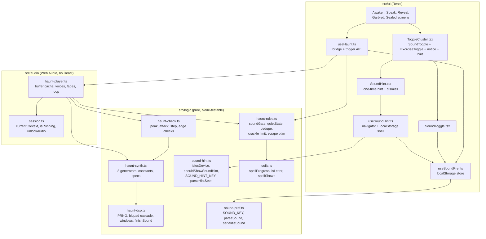
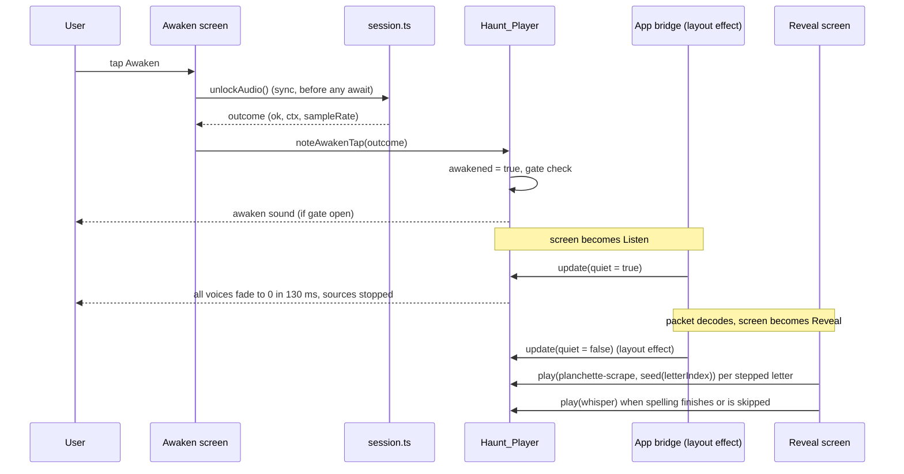
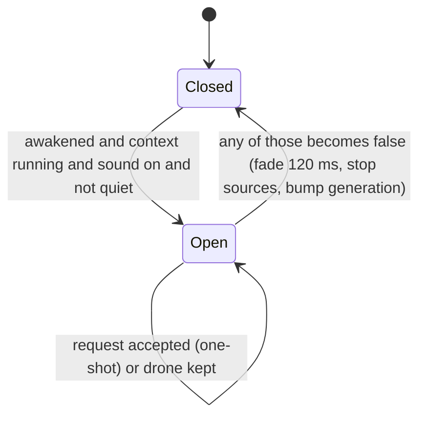

# Design Document: Haunting Sounds

## Overview

Haunting Sounds adds procedural horror atmosphere to `apps/web`. There are no audio files. Eight sounds are computed at runtime by pure functions that return a mono `Float32Array` for a given sample rate and seed. A small player turns those arrays into `AudioBuffer` objects and plays them through the existing `AudioContext`.

The design rests on four ideas.

1. **Synth and player are split.** `Haunt_Synth` lives in `src/logic` and is pure, so Vitest runs it in Node with no browser. `Haunt_Player` lives in `src/audio` and is the only code that touches the Web Audio API. The existing `tests/architecture.test.ts` already enforces this split.
2. **Every sound is band-limited by construction and lives in the Phone_Band.** Each generator uses sine partials at or below 1100 Hz (the `PARTIAL_LIMIT_HZ` of 1400 Hz is an upper bound, not a target) and noise passed through an 8th-order Butterworth low-pass whose corner is at most 800 Hz and a 4th-order high-pass at 300 Hz or more. Phone speakers play little below 300 Hz, so the low character comes from harmonics (the missing-fundamental effect) and most energy sits between 300 and 1500 Hz. The 1800 Hz ceiling holds with a wide margin, and FFT property tests prove both the ceiling and a Phone_Band_Share of at least 0.5 at two sample rates.
3. **All decisions are pure functions.** The Sound_Gate, Quiet_State, 30 ms dedupe, 400 ms crackle limit and per-letter scrape plan take every input as an argument. The player only supplies the clock and applies the answers.
4. **Sounds never compete with a packet.** The player has a single gate. When the gate closes (listening, transmitting, sound off, context not running) every voice fades out in 130 ms and nothing new starts.

### Research findings that shaped the design

| Question | Finding | Design consequence |
|---|---|---|
| How loud is a packet? | I encoded 1, 10, 60 and 100 byte packets with the project's ggwave 0.4.0 at `TRANSMIT_VOLUME` (50), fast protocol, at 44100 Hz and 48000 Hz. The peak was 0.487 to 0.494 in every case. | `HAUNT_PEAK_LIMIT` (0.2) is 0.41 times the packet peak (about 7.8 dB lower). The per-sound peak table stays at or below 0.19 so the loudest overlap (see Data Models) stays under 0.49. A test measures this with the real engine. |
| Where does ggwave put its tones? | The Screech_Band is 1875 to 6400 Hz (`band-energy.ts`). | `HAUNT_CEILING_HZ` is 1800, leaving a 75 Hz guard band. |
| How steep must the filters be? | An 8th-order Butterworth with corner `fc` has a power response of `1/(1+(f/fc)^16)`. For `fc` = 800 Hz the share of noise power above 1800 Hz is about 4e-7, far below the 1e-4 limit. For `fc` = 1100 Hz it is about 5e-5, too close. | Corner cap `SYNTH_CORNER_MAX_HZ` = 800. A unit test asserts that no generator uses a higher corner. |
| Can a sine loop seamlessly? | A sine whose frequency is `k / (2 * T)` for integer `k` has an integer number of half cycles in `T` seconds, so a loop of exactly `T` seconds has no seam. `AudioBufferSourceNode.loopEnd` lets the loop end one sample before the buffer end ([MDN loopEnd](https://developer.mozilla.org/en-US/docs/Web/API/AudioBufferSourceNode/loopEnd)). | The drone buffer has `N = 4 * sampleRate + 1` samples, zero at both ends, and the loop is `[0, 4 s)`. |
| How do I get a click-free fade? | `AudioParam` ramps on the context clock are sample accurate. `cancelAndHoldAtTime` is missing in Safari, so the portable pattern is `cancelScheduledValues`, `setValueAtTime(gain.value, t)`, `linearRampToValueAtTime(0, t + fade)` ([MDN AudioParam](https://developer.mozilla.org/en-US/docs/Web/API/AudioParam)). | The fade helper uses that pattern. |
| What filter maths? | Biquad coefficients from the RBJ cookbook ([W3C Audio EQ Cookbook](https://www.w3.org/TR/audio-eq-cookbook/)). Butterworth section Q values for order 8 are 0.5098, 0.6013, 0.9000 and 2.5629. | `haunt-dsp.ts` implements a double-precision biquad cascade. No dependency is added. |
| Phone speakers | Phone speakers reproduce little below about 300 to 500 Hz. Requirement 2 fixes the Phone_Band at 300 to 1500 Hz and the minimum Phone_Band_Share at 0.5. | Every recipe puts at least 80 percent of its energy at 300 Hz or above (estimates in the recipe table). Sub-300 Hz content is kept small and is only there for speakers that can play it. |
| Missing fundamental | The ear infers a low pitch from a harmonic series even when the fundamental is absent or inaudible. | Drone, thud and hum are stacks of harmonics of a 90 to 170 Hz fundamental. The fundamental and 2nd harmonic get small weights; the 3rd to 10th harmonics (300 to 1100 Hz) carry the energy. Drone partials stop at 880 Hz, thud and hum harmonics at 1100 Hz, no sine passes `PARTIAL_LIMIT_HZ` (1400 Hz). |
| Noise in the Phone_Band | White noise through `lowpass8(800)` alone has about 0.5 of its power below 300 Hz, so it fails the 0.5 share with no margin once windows spread it. A 4th-order Butterworth high-pass has power response `1/(1+(fc/f)^8)`. With `fc` = 350 Hz and `lowpass8(800)` I integrated the response numerically by hand: the power below 300 Hz is worth about 10 Hz of flat bandwidth against about 440 Hz inside 300 to 1500 Hz, a share near 0.95. | Every noise component is band-passed: `highpass4(300..450)` then `lowpass8(700..800)`. Short windowed pops (8 to 12 ms Hann) spread the spectrum by about 200 Hz, so they use `highpass4(450)` and the estimate drops to about 0.8. |
| Does the high corner still meet 1e-4? | For `lowpass8(800)` the share above 1800 Hz is about 3e-7 (the integral of `1/(1+(f/800)^16)` above 1800 Hz is 2.8e-4 Hz against a total of 816 Hz). A short Hann pop adds leakage of about `1/(pi^2 x^6)` per unit at `x` = window time times offset; for 8 ms and 1000 Hz offset (x = 8) that is below 1e-6. | Corner cap `SYNTH_CORNER_MAX_HZ` = 800 stays. No steeper filter is needed. The FFT property still measures every sound. |
| iOS ringer switch | On iOS Safari the silent switch can mute Web Audio and the page cannot detect it. | Not fixable in code. The app shows the one-time Sound_Hint "On iPhone, the silent switch mutes these sounds." (Requirement 12). The Sound_Toggle still reflects the user's intent. No `<audio>` workaround is used. |

### Design decisions

- **Phone-first spectrum.** The Phone_Band (300 to 1500 Hz) is where the energy goes; the Haunt_Ceiling (1800 Hz) stays the hard limit, with 300 Hz of room between the two. Partials and filter corners come from named tables (`PARTIAL_TABLES`, `FILTER_CORNERS`) that both the generators and the tests read, so a test about the constants is a test about the generators.
- **Drone swell, not a flat tone.** The Drone is multiplied by a loop-periodic swell `0.35 + 0.65 * sin^2(pi * t / T)` with `T` = 4 s. It has a floor of 0.35, so it never goes silent, and it makes the 90-percent point of the peak arrive about 0.8 s in, which satisfies the 30 ms attack check without a fade that would break the loop.
- **Step guard is a uniform scale.** `finishSound` ends with a guard that scales the whole sound down if the largest step exceeds 0.045. A uniform scale changes no spectral ratio, attack time or edge sample, and only lowers the peak, so every earlier check and the packet comparison stay valid. It replaces reliance on a hand estimate for the high-harmonic thud at 22050 Hz.
- **Peak table, not a single peak.** Each sound has its own peak target at or below 0.19, not 0.2. A `Float32Array` rounds 0.2 up to 0.20000000298, which would fail an exact `<= 0.2` property.
- **The cache key is (Sound_Name, Sample_Rate, Seed).** Requirement 6.6 fixes this key. Each scrape letter index has its own seed (8.5), so it has its own buffer. Every other sound uses one fixed seed, so it is generated once per rate. A pure `bufferKey` function builds the key, so a test can prove two different triples never share a key.
- **A Letter is any non-whitespace code point, and stepping counts Letters.** The Reveal screen also spells digits and punctuation (URLs, SSIDs). Requirement 8.6 wants exactly `min(n, SPELL_MAX_CHARS)` scrapes for `n` Letters. The old `spellProgress` cap counted code points including spaces, so "a b c ..." would step only about 15 Letters and break the count. The stepping now counts Letters (`spellShown` in `ouija.ts`), and `scrapePlan` reads the same shown positions, so the stepped Letters and the scrapes agree by construction.
- **The silent-switch hint is a pure decision plus a thin shell.** Whether to show it, and whether a device is iOS, are pure functions (Requirement 12.10, 12.11). Reading `navigator` and `localStorage` stays in one hook.
- **Gate checks happen at request time, with no queue.** A request refused by the gate is dropped, never queued (5.1). The only delayed starts are scrapes staggered inside one spelling step (see Reveal wiring), and they carry a generation number so a gate close discards them (5.4).
- **Bridge effect is a layout effect.** Screens request sounds from passive effects. The App bridge that pushes the Quiet_State into the player runs in a layout effect. React runs all layout effects of a commit before any passive effect, so a screen that mounts on the same render that ends a Quiet_State (Listen to Garbled) sees the new, correct gate. With a passive bridge effect the child effect would run first and the sound would be dropped.

## Architecture



### Runtime flow



### Gate states



## Components and Interfaces

All new exported functions have explicit parameter and return types. No `any`. New `src` files contain no `44100` or `48000` literal (the architecture test rejects them) and the `logic` files avoid the names that test scans for (the context, worklet, analyser and media-stream types), including in comments.

### `src/logic/haunt-dsp.ts` (pure)

```ts
export interface Prng { next(): number }                    // uniform [0, 1)
export function createPrng(seed: number): Prng;             // mulberry32 over seed >>> 0
export function assertSampleRate(sampleRate: number): void; // throws RangeError
export function lowpass8(corner: number, sampleRate: number): BiquadCascade;
export function highpass4(corner: number, sampleRate: number): BiquadCascade;
export function runCascade(c: BiquadCascade, x: Float64Array): Float64Array;
export function hannRise(n: number, i: number): number;     // 0 at i = 0, 1 at i = n
export interface FinishOptions { readonly peak: number; readonly attackMs: number; readonly releaseMs: number }
export function finishSound(raw: Float64Array, sampleRate: number, o: FinishOptions): Float32Array;
export function finishLoop(raw: Float64Array, sampleRate: number, peak: number): Float32Array; // drone only
```

- `createPrng` is mulberry32. It reads no `Math.random` and no clock. A seed is any integer; it is reduced with `>>> 0`. A non-integer seed throws `RangeError` with the received value in the message.
- `assertSampleRate` throws `RangeError` with the message `Sample rate <value> is outside the supported range 22050 to 96000 Hz (whole numbers only)`. `NaN`, `Infinity`, fractions, zero and negatives all take this path (1.8, 4.3).
- Filters use RBJ low-pass sections. The 8th-order low-pass is four sections with Q 0.5098, 0.6013, 0.9000, 2.5629. The 4th-order high-pass is two sections with Q 0.5412 and 1.3066. State is `Float64`.
- `finishSound` is the single choke point that makes every sound obey requirement 3:
  1. Multiply by a Hann rise over `attackMs` (at least 40) and a Hann fall over `releaseMs` (at least 40).
  2. Scale so the largest absolute value equals `peak`.
  3. Set sample 0 and the last sample to exactly 0.
  4. Attack guard: if the first sample with `abs >= 0.9 * peak` comes before 35 ms, multiply the region before 60 ms by 0.5 using a smooth ramp and rescale, up to 8 passes. Each pass strictly lowers the early region, so the loop ends. The case is rare because the envelope already makes early samples small.
  5. Step guard: if the largest absolute difference between consecutive samples exceeds `STEP_GUARD` (0.045, below `MAX_STEP`), multiply every sample by `STEP_GUARD / maxStep`. The scale is uniform and below 1, so the peak only falls, the attack time (a ratio to the peak) is unchanged, and the two zero edge samples stay zero. It runs after step 4 so that the attack guard cannot undo it.
  6. Convert to `Float32Array`. The conversion rounds each value to 24 bits of mantissa, so a value of at most 0.19 stays below 0.2.
- `finishLoop` is the drone's path. It skips the Hann attack and release (the drone's own swell already starts at a low level and the loop seam needs no fade), scales to `peak`, sets sample 0 and the last sample to exactly 0, and applies the same step guard. For the drone, sample 0 already equals `sin(0)` times the swell, so setting it to 0 changes nothing, and the last sample is 0 only because the loop length is a whole number of cycles of every partial.
- Both finishers also assert that the returned array has only finite values, so a filter that went unstable throws instead of being played.

### `src/logic/haunt-synth.ts` (pure)

```ts
export const HAUNT_CEILING_HZ = 1800;
export const MIN_SAMPLE_RATE = 22050;
export const MAX_SAMPLE_RATE = 96000;
export const HAUNT_PEAK_LIMIT = 0.2;
export const DRONE_PEAK_LIMIT = 0.1;
export const MIN_ATTACK_MS = 30;
export const MAX_STEP = 0.05;
export const OUT_OF_BAND_LIMIT = 0.0001;
export const SYNTH_CORNER_MAX_HZ = 800;      // highest low-pass corner (8th order)
export const PHONE_BAND_LOW_HZ = 300;
export const PHONE_BAND_HIGH_HZ = 1500;
export const PHONE_BAND_MIN_SHARE = 0.5;
export const PARTIAL_LIMIT_HZ = 1400;         // no sine partial above this
export const DRONE_PARTIAL_MAX_HZ = 880;
export const HARMONIC_MAX_HZ = 1100;          // thud and hum harmonics
export const LOOP_BASE_HZ = 0.25;             // 1 / loop seconds; drone partials are multiples of it
export const DRONE_LOOP_SEC = 4;

export interface FilterCorners { readonly highpass4: number | null; readonly lowpass8: number | null }
export const FILTER_CORNERS: Readonly<Record<SoundName, readonly FilterCorners[]>>;  // one entry per noise component
export function partialsOf(name: SoundName): readonly number[];  // every sine frequency the generator can use, in Hz

export const SOUND_NAMES = ['awaken','drone','card-flip','candle-crackle',
  'planchette-scrape','whisper','broken-crackle','sealed-thud'] as const;
export type SoundName = (typeof SOUND_NAMES)[number];
export type OneShotName = Exclude<SoundName, 'drone'>;

export interface SoundSpec { readonly minSec: number; readonly maxSec: number; readonly peak: number }
export const SOUND_SPECS: Readonly<Record<SoundName, SoundSpec>>;
export const FIXED_SEEDS: Readonly<Record<Exclude<OneShotName, 'planchette-scrape'>, number>>;

export function generateAwaken(sampleRate: number, seed: number): Float32Array;
export function generateDrone(sampleRate: number): Float32Array;
export function generateCardFlip(sampleRate: number, seed: number): Float32Array;
export function generateCandleCrackle(sampleRate: number, seed: number): Float32Array;
export function generatePlanchetteScrape(sampleRate: number, seed: number): Float32Array;
export function generateWhisper(sampleRate: number, seed: number): Float32Array;
export function generateBrokenCrackle(sampleRate: number, seed: number): Float32Array;
export function generateSealedThud(sampleRate: number, seed: number): Float32Array;
export function generateSound(name: SoundName, sampleRate: number, seed: number): Float32Array;
export function scrapeSeed(letterIndex: number): number;
```

Every generator calls `assertSampleRate` first, builds a `Float64Array` of `Math.round(seconds * sampleRate)` samples, and returns `finishSound(...)`. `generateDrone` takes no seed (it has no randomness). `generateSound` ignores the seed for the drone.

| Sound | Seconds | Peak | Recipe |
|---|---|---|---|
| `awaken` | 2.4 (limit 1.5 to 3.0) | 0.19 | Thunk: partials at 90, 180, 360, 540, 720, 900 and 1080 Hz (harmonics 1, 2, 4, 6, 8, 10 and 12 of 90 Hz; weights 0.3, 0.5, 1.0, 0.8, 0.5, 0.3, 0.15) with a 45 ms Hann attack and exponential decay (time constant 0.12 s), 0 to 0.5 s, level 1 (weights normalised to sum 1). Hum: a fundamental that glides linearly from 110 to 170 Hz with harmonics 1 to 6 (weights 0.2, 0.5, 1.0, 0.8, 0.5, 0.3, so the highest partial is 6 x 170 = 1020 Hz), 0.3 to 1.7 s, level 0.55, phase integrated from the instantaneous frequency. Ticks: 4 Hann-windowed 12 ms sine bursts at 520 to 720 Hz (pitch and a start jitter of at most 15 ms drawn from the seed), nominal starts at 1.80, 2.00, 2.20 and 2.35 s, so the last one ends by 2.38 s, level 0.3. Gaps between ticks are silent. The section times are exported as `AWAKEN_LAYOUT`. Phone_Band_Share estimate: thunk 0.85 (energy below 300 Hz is the 90 and 180 Hz partials, 0.34 of 2.34), hum 0.9, ticks 1.0, so the whole sound is at least 0.8. |
| `drone` | 4.0 plus one sample (limit 2.0 to 8.0) | 0.085 | Sum of sine partials at exact multiples of `LOOP_BASE_HZ` (0.25 Hz), so each completes a whole number of cycles in 4 s: 110.0, 220.0, 330.0, 330.5, 440.0, 550.0, 660.0, 770.0 and 880.0 Hz with weights 0.25, 0.5, 1.0, 0.8, 0.8, 0.5, 0.5, 0.3, 0.25. The pair at 330.0 and 330.5 Hz beats at 0.5 Hz. The sum is multiplied by the swell `0.35 + 0.65 * sin^2(pi * t / 4)`, which has period 4 s, so value and slope match at the seam. Sample 0 is `sin(0)`, and the last sample is set to exactly 0 (floating-point `sin` would give about 1e-13). Phone_Band_Share estimate: 2.93 of 3.24 weight-squared units are at 300 Hz or above, 0.90. Highest partial 880 Hz. |
| `card-flip` | 0.30 (0.15 to 0.5) | 0.14 | Noise through `highpass4(350)` then `lowpass8(800)`, Hann rise 45 ms, exponential decay. Estimate 0.95. |
| `candle-crackle` | 0.35 (0.15 to 0.6) | 0.10 | 5 to 8 pops placed by the PRNG between 25 and 300 ms. Each pop is noise through `highpass4(450)` and `lowpass8(800)` in an 8 to 12 ms Hann window with a PRNG amplitude. The short window spreads each pop by about 180 Hz, so the estimate is 0.8. |
| `planchette-scrape` | 0.18 (0.15 to 0.5) | 0.10 | Noise through `highpass4(350)` and `lowpass8(800)`, multiplied by a stick-slip modulation `0.6 + 0.4 * sin(2 * pi * f * t)` with `f` from the seed (35 to 60 Hz). The modulation adds sidebands of at most 60 Hz. Estimate 0.9. |
| `whisper` | 1.4 (0.8 to 2.0) | 0.10 | Noise through `highpass4(300)` and `lowpass8(800)`, slow swell envelope (Hann rise 0.5 s, fall 0.6 s) with seeded 6 to 9 Hz breath flutter of 15 percent depth. The pass band is 500 Hz wide, so a 10 Hz band holds about 2 percent of the energy, far under 50 percent. Estimate 0.95. |
| `broken-crackle` | 0.8 (0.4 to 1.2) | 0.16 | Noise through `highpass4(450)` and `lowpass8(800)`, gated by 5 to 8 dropouts. Each gate edge is an 8 ms Hann ramp. A mains buzz of sine partials at 360, 480, 600 and 720 Hz (the 6th, 8th, 10th and 12th harmonics of 60 Hz; the 60 Hz fundamental is left out) with weights 1, 0.8, 0.6, 0.4, level 0.15 of peak, runs under it. Estimate 0.85. |
| `sealed-thud` | 0.9 (0.4 to 1.5) | 0.19 | Harmonics 1 to 10 of 110 Hz (110 to 1100 Hz) with weights 0.3, 0.5, 1.0, 0.9, 0.8, 0.6, 0.45, 0.35, 0.25, 0.18, a 40 ms Hann attack and exponential decay of about 0.25 s. A seeded noise body at 0.08 of peak through `highpass4(300)` and `lowpass8(600)`. Estimate: 3.23 of 3.57 weight-squared units are at 300 Hz or above, 0.90. The 110 and 220 Hz partials are kept small and the ear fills in the 110 Hz pitch. |

`scrapeSeed(i)` is `(Math.imul(i + 1, 0x9e3779b1) ^ 0x5bd1e995) >>> 0`. It depends only on the 0-based letter index, so equal indexes give identical audio and different indexes give different seeds (8.5).

Bound behind the peak table (3.5): a sound with peak `a` and top frequency `f` changes by at most about `a * 2 * pi * f / sampleRate` per sample. At the worst supported rate (22050 Hz) the noise sounds with a 350 to 800 Hz pass band (card flip 0.14, broken crackle 0.16) give about 0.14 * 2 * pi * 600 / 22050 = 0.024 and 0.027 for a typical 600 Hz mean frequency. The harmonic stacks are the risk: the thud's coherent worst case at 22050 Hz is about 0.06. The step guard in `finishSound` (scale so the largest step is at most 0.045) turns that estimate into a guarantee, so Property 9 does not depend on it.

### `src/logic/haunt-check.ts` (pure)

```ts
export interface SoundCheck {
  readonly ok: boolean;
  readonly problems: readonly string[]; // e.g. "peak 0.31 is above 0.2"
  readonly peak: number;
  readonly attackMs: number;
  readonly maxStep: number;
}
export function peakOf(samples: Float32Array): number;
export function attackTimeMs(samples: Float32Array, sampleRate: number): number;
export function maxStep(samples: Float32Array): number;
export function checkSound(name: SoundName, samples: Float32Array, sampleRate: number): SoundCheck;
```

`checkSound` verifies criteria 3.1 to 3.5 and 3.9 (first and last sample are 0, peak at or below the limit, attack at least 30 ms, step at most 0.05, drone below 0.1). The player calls it before it plays anything (3.10). The tests call the same functions as oracles. The FFT is not here: the FFT helper is test-only (2.6), so neither the Out_Of_Band_Ratio nor the Phone_Band_Share is checked at run time. Both are fixed by the recipe tables and proven by the property tests. `checkSound` also reads `SOUND_SPECS[name].peak` and fails a sound whose peak is above that table value (a sound below it is fine, since the step guard may scale it down). The drone is generated through `finishLoop`, and `generateDrone` is the only generator that does not call `finishSound`.

### `src/logic/haunt-rules.ts` (pure, no clock, no random, no browser API)

```ts
export interface GateInputs {
  readonly awakened: boolean;
  readonly contextRunning: boolean;
  readonly soundOn: boolean;
  readonly quiet: boolean;
}
export function soundGate(i: GateInputs): boolean;               // all of awakened, running, on, not quiet

export interface QuietInputs {
  readonly screen: Screen;                                       // from logic/flow
  readonly captureActive: boolean;
  readonly playbackRunning: boolean;
}
export function quietState(i: QuietInputs): boolean;             // listen || screeching || capture || playback

export const DEDUPE_WINDOW_MS = 30;
export type LastAccepted = Readonly<Partial<Record<OneShotName, number>>>;
export interface DedupeDecision { readonly accept: boolean; readonly next: LastAccepted }
export function decideOneShot(last: LastAccepted, name: OneShotName, nowMs: number): DedupeDecision;

export const CRACKLE_LIMIT_MS = 400;
export function crackleAllowed(lastStartMs: number | null, nowMs: number): boolean;
export function candleChanged(prev: number | null, next: number | null): boolean;

export interface ScrapeRequest { readonly letterIndex: number; readonly delayMs: number }
export const SCRAPE_STAGGER_MS = 30;
export function scrapePlan(chars: readonly string[], shownBefore: number, shownAfter: number): readonly ScrapeRequest[];

export function bufferKey(name: SoundName, sampleRate: number, seed: number): string;  // `${name}@${sampleRate}#${seed}`
```

`haunt-rules.ts` imports `isLetter` and `SPELL_MAX_CHARS` from `ouija.ts` (same `logic` folder, both pure). It defines no second letter test, so the Letter definition lives in one place.

Rules:

- `decideOneShot`: let `elapsed = nowMs - last[name]`. The request is refused only when `last[name]` exists and `0 <= elapsed < 30`. A negative `elapsed` (the clock restarted) is accepted. A non-finite `nowMs` is refused. An accepted request returns a new `LastAccepted` with that name set to `nowMs`; a refused one returns the input unchanged. Other names are never affected (6.11).
- `crackleAllowed`: allowed when `lastStartMs` is `null`, or `nowMs - lastStartMs >= 400`, or the difference is negative.
- `candleChanged`: true only when `prev !== next` and `prev !== null` (the first reading is a baseline, not a change). Two `null` values are equal. `NaN` is treated as `null`.
- `scrapePlan`: reads `chars[shownBefore .. shownAfter)` (both clamped to `[0, chars.length]`, and `shownAfter <= shownBefore` gives an empty plan). A character gets a request only if `isLetter(ch)` is true (any non-whitespace code point; whitespace gets none) and its `letterIndex` is below `SPELL_MAX_CHARS`. `letterIndex` counts Letters from the start of `chars` (0-based, so spaces never shift it, even when `shownBefore` is above 0: the count is taken over `chars[0 .. i)`). The `j`-th request in one call has `delayMs = j * SCRAPE_STAGGER_MS`, so even a step that reveals several Letters (a stalled timer) never trips the 30 ms dedupe. Letters at index 30 and above are the remainder shown at once and get no request. Together with `spellShown` this gives exactly `min(n, SPELL_MAX_CHARS)` requests for a full reveal (8.6).
- `bufferKey`: returns `` `${name}@${sampleRate}#${seed}` ``. Distinct triples give distinct keys, because the name contains no `@` and the rate and seed are integers.

### `src/logic/ouija.ts` (existing, small addition)

`spellProgress`, `SPELL_RATE_CPS` (12), `SPELL_MAX_CHARS` (30) and `SPELL_MAX_MS` (2500) stay exactly as they are, so the existing `ouija.test.ts` and `ouija.property.test.ts` keep passing. `spellProgress(elapsed, length)` is a schedule over a count, and it does not care what the count is made of. Today the Reveal screen and `OuijaBoard` pass the number of code points, including spaces. That is the mismatch with Requirement 8.6: for "a b c d ...", 30 code points hold only 15 Letters, so only 15 scrapes would play where `min(n, 30)` is expected. The fix is to pass the number of Letters and map the result back to a code point position.

```ts
export function isLetter(ch: string): boolean;                       // !/^\s*$/u.test(ch)
export interface SpelledText {
  readonly shown: number;     // code points to show, from 0 to chars.length
  readonly letters: number;   // Letters inside the first `shown` code points
  readonly done: boolean;
}
export function spellShown(elapsedMs: number, chars: readonly string[]): SpelledText;
```

`spellShown` counts `n` = the Letters in `chars`, calls `spellProgress(elapsedMs, n)` and gets `count` Letters. When `done` is true, `shown` is `chars.length` (the remainder and any trailing whitespace appear at once). Otherwise `shown` is one past the `count`-th Letter (0 when `count` is 0), so whitespace before the next Letter appears together with that Letter. This keeps the schedule: 12 Letters per second, at most 30 stepped, everything shown at 2500 ms. For text with no spaces the result equals the old behaviour. It reads no clock and no `document`.

`Reveal.tsx` and `OuijaBoard.tsx` both call `spellShown(elapsedMs, chars)` and render `chars.slice(0, shown)`, so the text on screen and the scrape plan use the same `shown` value. Under reduced motion `shown = chars.length` and no scrape plays.

### `src/logic/sound-pref.ts` (pure)

```ts
export const SOUND_KEY = 'screech.sound';
export function parseSound(raw: string | null | undefined): boolean;   // raw !== '0'
export function serializeSound(on: boolean): '1' | '0';
```

`SOUND_KEY` is a different string from `EXORCISE_KEY`. Neither file imports the other (10.5, 10.6).

### `src/logic/sound-hint.ts` (pure)

```ts
export const SOUND_HINT_KEY = 'screech.sound-hint';
export const SOUND_HINT_TEXT = 'On iPhone, the silent switch mutes these sounds.';

export function isIosDevice(userAgent: string, platform: string, maxTouchPoints: number): boolean;

export interface HintInputs {
  readonly soundOn: boolean;
  readonly ios: boolean;
  readonly awakened: boolean;               // the Awaken_Tap has happened
  readonly savedValue: string | null;       // raw value under SOUND_HINT_KEY, null when missing
}
export function shouldShowSoundHint(i: HintInputs): boolean;

export function parseHintSeen(raw: string | null | undefined): boolean;   // any saved value counts
export function serializeHintSeen(): '1';
```

- `isIosDevice` follows 12.7 exactly. It is true when `/iPhone|iPad|iPod/.test(userAgent)`, or when `platform === 'MacIntel'` and `maxTouchPoints > 1`. A non-finite `maxTouchPoints` counts as 0. The function reads no global. Real Macs report 0 touch points, so they never see the hint.
- The hook calls `isIosDevice(navigator.userAgent, navigator.platform, navigator.maxTouchPoints)`. iPadOS Safari in desktop mode reports `MacIntel` with 5 touch points, so it is caught.
- `shouldShowSoundHint` returns `soundOn && ios && awakened && !parseHintSeen(savedValue)` (12.1, 12.3 to 12.6, 12.12).
- `parseHintSeen` is true for every string, including the empty string, and false for `null` and `undefined` (12.3: "a value is saved").
- `serializeHintSeen` always returns `'1'`.
- The file contains no `localStorage`, `navigator`, `Date`, `Math.random`, `window` or `document` (12.10, 12.11).

### `src/audio/haunt-player.ts` (Web Audio, no React)

```ts
export type PlayResult =
  | { readonly started: true }
  | { readonly started: false; readonly reason:
      'gate' | 'duplicate' | 'crackle-limit' | 'invalid-sound' | 'generator-failed' | 'no-context' };

export interface HauntPlayerDeps {
  readonly getContext: () => AudioContext | null;     // session.currentContext
  readonly isRunning: () => boolean;                  // session.isRunning
  readonly now: () => number;                         // milliseconds, performance.now
  readonly setTimer: (fn: () => void, ms: number) => number;
  readonly clearTimer: (id: number) => void;
  readonly generate: (name: SoundName, sampleRate: number, seed: number) => Float32Array;
  readonly onFailure: (message: string) => void;      // called at most once per session
}

export interface HauntPlayer {
  update(inputs: { readonly quiet: boolean; readonly soundOn: boolean }): void;
  noteAwakenTap(outcome: UnlockOutcome): void;
  setDroneWanted(wanted: boolean): void;
  play(name: OneShotName, options?: { readonly seed?: number; readonly delayMs?: number }): PlayResult;
  stopOneShots(): void;                               // fade only one-shots (screen exit, skip)
  stopKind(name: OneShotName): void;                  // fade one kind (skip stops scrapes)
  dispose(): void;
}
export function createHauntPlayer(deps: HauntPlayerDeps): HauntPlayer;
export const hauntPlayer: HauntPlayer;                // real deps, used by the app
```

Internal state: `awakened`, `soundOn` (default true), `quiet` (default false), `droneWanted`, `generation`, `voices: Set<Voice>`, `drone: Voice | null`, `lastAccepted: LastAccepted`, `lastCrackleStart: number | null`, `failureShown`, `buffers: Map<string, AudioBuffer>`.

Behavior:

- **Context.** The player never creates a context. It calls `deps.getContext()`, which is `currentContext()` from `session.ts`, so the only context is the one `unlockAudio` made (6.9). With no context, every request returns `no-context` without a notice (6.1).
- **Gate.** `gate()` is `soundGate({ awakened, contextRunning: deps.isRunning(), soundOn, quiet })`. `play` checks it first and returns `gate` with no notice (6.4, 6.7).
- **Sample rate.** Read from `ctx.sampleRate` on every generate call. The file has no rate constant (6.5).
- **Buffer cache.** Key `bufferKey(name, ctx.sampleRate, seed)`, that is (Sound_Name, Sample_Rate, Seed) as Requirement 6.6 says. Every sound except the scrape uses its fixed seed (drone: seed 0), so each is built once per rate; each scrape letter index has its own seed and its own entry. A change of context sample rate gives new keys, and old entries stay unused until they are evicted or the page closes. On a miss the player calls `deps.generate`, then `checkSound`. A failed check returns `invalid-sound`, caches nothing and leaves other audio alone (3.10). A thrown error from generation or from `ctx.createBuffer` or `copyToChannel` is caught, nothing is cached for that key, `onFailure("The spirits are silent. This sound could not be made.")` runs on the first failure of the session only, and the call returns `generator-failed` (6.8). Scrape entries are capped at 128 (at most 30 letter indexes are played per rate, so the cap is reached only after many sample rate changes); the oldest is deleted first.
- **One-shot start.**
  1. gate check;
  2. `decideOneShot(lastAccepted, name, now())`, refusing with `duplicate`;
  3. for `candle-crackle`, `crackleAllowed(lastCrackleStart, now())`, refusing with `crackle-limit`;
  4. get or build the buffer;
  5. create `source -> voiceGain -> ctx.destination`, set `voiceGain` to 1, `source.start()`;
  6. record `lastAccepted` (and `lastCrackleStart` for the crackle) only after `start()` returned.
  `delayMs > 0` requests wait on `setTimer`. When the timer fires it re-checks that `generation` is unchanged and the gate is open, and then runs steps 2 to 6. A refused delayed request is dropped, never retried.
- **Voice cleanup.** Each source gets an `ended` listener that disconnects the source and gain node and removes the voice. A fallback timer set to the buffer length plus 250 ms does the same if Safari never fires `ended` (6.10). Cleanup is idempotent.
- **Fade out.** `fadeVoice(v)` runs at `t = ctx.currentTime`: `cancelScheduledValues(t)`, `setValueAtTime(gain.value, t)`, `linearRampToValueAtTime(0, t + 0.12)`, `source.stop(t + 0.13)`. The fade starts in the same call that detected the gate close, so it begins well within 50 ms, and ends 130 ms later, inside the 200 ms limit (5.2, 5.3). `fadeAll()` fades every voice including the drone, increments `generation` (which discards pending delayed starts, 5.4) and clears the drone reference.
- **Reconcile.** Called from `update`, `noteAwakenTap`, `setDroneWanted`, the context `statechange` listener and after any gate change. If the gate is closed and voices exist, call `fadeAll()`. If the gate is open, `droneWanted` is true and no drone exists, start the drone. If `droneWanted` is false and a drone exists, fade just the drone. It is idempotent, so a second drone request keeps the existing source (4.7).
- **Drone.** A looping `AudioBufferSourceNode` with `loop = true`, `loopStart = 0`, `loopEnd = (buffer.length - 1) / sampleRate`. Its gain goes `setValueAtTime(0, t)` then `linearRampToValueAtTime(DRONE_LEVEL, t + 0.8)` where `DRONE_LEVEL` is 1 and the ramp is at least 500 ms (3.8, 4.4). The source is started once and never restarted per loop.
- **Awaken tap.** `noteAwakenTap(outcome)`: if `outcome.ok` is false, do nothing (the gate stays closed, 6.7). Otherwise set `awakened = true`, then `play('awaken')` once per call (6.3, 7.1). The Awaken tap handler itself keeps calling `unlockAudio()` synchronously before any `await` (6.2); the player is only told the result.
- **Failures never throw out of the player.** Every public method wraps its body in `try/catch`.
- **Voice level bound.** Peaks per sound are listed above. Overlaps: scrapes last 0.18 s and are spelled at least 83 ms apart, so at most 3 overlap (3 * 0.10 = 0.30), plus a whisper (0.10) gives at most 0.40, below the 0.49 packet peak. Card flip, candle crackle and drone can overlap with each other but not with a scrape (different screens): 0.14 + 0.10 + 0.085 = 0.325 at most. The awaken sound (0.19) plays alone on its screen. The new recipes keep every table peak the same and the step guard only lowers peaks, so the 0.49 packet peak still exceeds the largest overlap (0.40) and every single sound by at least 2.5 times.

### `src/ui/hooks/useSoundPref.ts`

Same pattern as `useMotion.ts`: module-level `on`, a listener set, `useSyncExternalStore`, and `initSound()` that reads `localStorage` once.

```ts
export interface SoundPrefState { readonly on: boolean }
export function initSound(): void;                   // read storage, never write
export function setSound(on: boolean): void;         // update memory, notify, then try to write
export function useSoundPref(): SoundPrefState & { setSound: (on: boolean) => void };
```

`readStorage` and `writeStorage` each wrap `localStorage` in `try/catch`. A read failure gives `null`, so `parseSound(null)` gives on. A write failure is ignored, so the in-memory value still applies (9.8). Startup never writes (9.5). The store does not import `motion.ts` or `useMotion.ts`.

### `src/ui/hooks/useSoundHint.ts`

The only place that touches `navigator` and the hint's `localStorage` key. It is a module store read through `useSyncExternalStore`, like `useSoundPref`.

```ts
export interface SoundHintState { readonly visible: boolean; readonly dismiss: () => void }
export function markAwakenTapped(): void;            // called by the Awaken screen after the tap
export function useSoundHint(): SoundHintState;
```

The logic sits in `createSoundHintStore(deps)`, where `deps` supplies `readStorage`, `writeStorage`, `detectIos` and `soundOn` as functions. The module exports one instance built with the real `localStorage` and `navigator` wrappers, so tests (Property 31) build their own store with stubs and need no DOM.

Module state: `awakened` (false at start), `ios` (computed once on first use inside `try/catch`, false if `navigator` is missing), `savedValue` (read once from `SOUND_HINT_KEY`, `null` on a read failure), `latched` (false) and `dismissed` (false).

- `markAwakenTapped()` sets `awakened = true` and notifies. It does not depend on the unlock outcome: the Awaken_Tap has happened either way (12.5).
- After every notify, `evaluate()` runs `shouldShowSoundHint({ soundOn: <useSoundPref value>, ios, awakened, savedValue })`. The first time it returns true and `latched` is false, the store sets `latched = true`, then tries `localStorage.setItem(SOUND_HINT_KEY, serializeHintSeen())` in a `try/catch` (12.2). `savedValue` is not changed by that write, so the decision that was true stays true on the next render. `latched` is the in-memory record that the hint was shown: `evaluate()` never latches twice, so the hint appears at most once per session even when storage throws (12.14).
- `visible = latched && !dismissed && soundOn`. Turning the Sound toggle off hides the hint while it is off (12.6); turning it back on shows it again until it is dismissed. Dismissing sets `dismissed = true` for the session; the saved key already stops it on later visits.
- The store reads `soundOn` through the same `useSoundPref` store that the toggle uses and imports no motion file.
- No effect writes at startup. The key is written only when the hint becomes visible.

### `src/ui/components/SoundHint.tsx`

```tsx
export default function SoundHint(): ReactElement | null
```

Returns `null` when `visible` is false. Otherwise it renders:

```tsx
<div role="status" className="note sound-hint">
  <span className="sound-hint-text">On iPhone, the silent switch mutes these sounds.</span>
  <button type="button" className="hit sound-hint-dismiss" aria-label="Dismiss the silent switch hint" onClick={dismiss}>OK</button>
</div>
```

- **Theme.** It reuses the existing `.note` tokens (the same style as the failure notice and the system notes), not the error red: bone white `#e9e4d4` text in VT323 on near-black `#050806` (about 15:1) and a 1 px `#5aa86c` border. The dismiss button is phosphor green `#39ff7a` on near-black (about 14:1), outlined like the other `.hit` controls. No emoji, no gradient and no glow animation.
- **Touch target.** The dismiss button has the `.hit` class, so it is at least 44 by 44 px. The row is `display: flex; align-items: center; gap: 8px`, and the text wraps inside the remaining width at 390 px (the text is about 48 characters, so two lines at most).
- **Does not block.** It is an in-flow element, not a modal, overlay or toast. It has no focus trap, takes no focus on appearing, sets no `aria-modal` and covers no control. `role="status"` makes a screen reader announce it politely without moving focus. Every screen stays fully usable with it visible (12.8).
- **No sound, no motion.** It starts no sound (12.8) and has no animation, so Exorcise and `prefers-reduced-motion` need no special case.
- **Placement.** Inside `ToggleCluster`, directly under the two toggles and above the failure notice. The cluster is on every screen, so the hint appears on the first screen after the Awaken tap (Speak, or Listen if the tap leads there) and stays visible across screen changes until dismissed or until the toggle is off. The Speak screen uses `.screen-tight` and loses up to about 56 px of height while the hint is visible; the implementation checks 390 by 844 with the hint showing, and the content may scroll for that one visit.

### `src/ui/hooks/useHaunt.ts`

```ts
export function useHauntBridge(flow: Pick<FlowApi, 'state'>, audio: Pick<AudioSessionApi, 'listenStatus'>): void;
export function useHaunt(): HauntTriggers;           // stable object, no re-render
export interface HauntTriggers {
  noteAwakenTap(outcome: UnlockOutcome): void;
  play(name: OneShotName, options?: { seed?: number; delayMs?: number }): void;
  setDroneWanted(wanted: boolean): void;
  stopOneShots(): void;
  stopKind(name: OneShotName): void;
}
```

`useHauntBridge` is called once in `App`. It computes `quiet = quietState({ screen: flow.state.screen, captureActive: audio.listenStatus.kind === 'listening', playbackRunning: flow.state.transmitting })` and `on` from `useSoundPref()`, then runs `useLayoutEffect(() => hauntPlayer.update({ quiet, soundOn: on }), [quiet, on])`. `useHaunt` returns the module singleton's methods. Because `hauntPlayer` makes no sound until `noteAwakenTap` succeeds, every existing screen test stays silent with no change.

### `src/ui/components/SoundToggle.tsx`

```tsx
export default function SoundToggle(): ReactElement
```

Renders one `<button type="button" role="switch" aria-checked={on} className="hit exorcise-toggle sound-toggle">` with the visible text `Sound: on` or `Sound: off`. A native `button` gives tap, click, Enter and Space with no extra code (9.6). It is never disabled, so it works before the Awaken tap (9.11). It has no emoji and uses the same colour tokens as the Exorcise toggle (phosphor green on near-black, about 14:1; the off state adds `is-off` with `#5aa86c`, about 6.9:1). It is at least 44 by 44 px through the existing `.hit` class. Unlike the Exorcise toggle, `aria-checked` is the saved preference itself, because the sound toggle has no system override.

### `src/ui/components/ToggleCluster.tsx` and placement

Every screen today renders `<ExorciseToggle />` inside `<div className="row">` after `<span className="label grow">`. There are seven: Awaken, Speak, Listen, Screeching, Reveal, Garbled, Sealed. `ToggleCluster` renders `SoundToggle` directly before `ExorciseToggle` in one flex row (gap 6 px, `flex-wrap: wrap`, right-aligned), plus `SoundHint` and then the one-time failure notice under it. Each screen replaces `<ExorciseToggle />` with `<ToggleCluster />`. That puts exactly one Sound_Toggle next to the Exorcise toggle on every screen that has one (9.1) and needs no other layout change.

At 390 px wide, with 16 px side padding, the row has 358 px. The label is about 110 px, "Sound: off" about 90 px and "Exorcise: off" about 115 px, with two 6 px gaps. That is about 327 px, so it fits on one line. If a long system note wraps, the cluster wraps rather than overflowing. Speak uses `.screen-tight` and must still fit 390 by 844 without scrolling, so the implementation verifies that screen visually.

The failure notice is a `<p role="status" className="note">The spirits are silent. This sound could not be made.</p>` driven by a small module store (`useSyncExternalStore`) that `hauntPlayer`'s `onFailure` writes to. It is in plain words and not red. It appears on the first failure and stays for the rest of the session.

### Screen wiring

| Screen | Change |
|---|---|
| App | Call `useHauntBridge(flow, audio)`. |
| Awaken | After `await unlocking`, before `dispatch`, call `haunt.noteAwakenTap(outcome)` and then `markAwakenTapped()` (which lets the silent-switch hint show on the next screen, 12.1). The `unlockAudio()` call stays first and synchronous. If the tap leads to the Listen screen, the bridge's `quiet = true` cuts the awaken sound (assumption 1). |
| Speak | `useEffect(() => { haunt.setDroneWanted(true); return () => haunt.setDroneWanted(false); }, [])`. In `select(key)`, call `haunt.play('card-flip')` only when `key !== draft.selected` (7.3, 7.4). A passive effect on `reading.budget.size` skips its first run and then calls `haunt.play('candle-crackle')` when `candleChanged(prev, next)` is true. The 400 ms limit sits inside the player (7.5, 7.6). |
| Reveal | `chars = Array.from(value)` and `spelled = reduced ? { shown: chars.length, done: true } : spellShown(elapsedMs, chars)`. `OuijaBoard` renders `chars.slice(0, spelled.shown)` and `finished` (reduced, skipped or `spelled.done`) uses the same value, so the visible text, the stepping and the scrape plan share one `shown`. A passive effect on `spelled.shown` keeps `prevShown` in a ref (starting at 0) and, when not `reduced` and not `skipped`, calls `scrapePlan(chars, prevShown, shown)` and then `haunt.play('planchette-scrape', { seed: scrapeSeed(r.letterIndex), delayMs: r.delayMs })` for each request, then updates `prevShown`. Letters past `SPELL_MAX_CHARS` appear in the final jump and the plan gives them no request. Result for a full reveal: exactly `min(n, 30)` scrapes, with spaces never counted (8.6). A second effect on `finished` plays `whisper` once per mount (a ref guards it). When the skip button is pressed, call `haunt.stopKind('planchette-scrape')` first, then the whisper plays through the same `finished` effect (8.4). Under reduced motion no scrape plays and the whisper plays when the screen opens (assumption 5). On unmount call `haunt.stopOneShots()`. |
| Garbled | `useEffect(() => { haunt.play('broken-crackle'); return haunt.stopOneShots; }, [])`. |
| Sealed | Same with `sealed-thud`. |
| Listen, Screeching | No sound code. The bridge's Quiet_State fades anything running (5.6, 5.7). |

React StrictMode may run a mount effect twice in development. The 30 ms dedupe removes the second request.

## Data Models

```ts
type SoundName = 'awaken' | 'drone' | 'card-flip' | 'candle-crackle'
  | 'planchette-scrape' | 'whisper' | 'broken-crackle' | 'sealed-thud';

/** Cache key: (Sound_Name, Sample_Rate, Seed), built by bufferKey(). */
type BufferKey = `${SoundName}@${number}#${number}`;
// HauntPlayer cache: Map<BufferKey, AudioBuffer>

interface Voice {
  readonly name: SoundName;
  readonly source: AudioBufferSourceNode;
  readonly gain: GainNode;
  readonly fallbackTimer: number;
  ended: boolean;
}
```

Peak table (`SOUND_SPECS`), all at or below 0.19:

| Sound | Peak | Duration limit (s) |
|---|---|---|
| awaken | 0.19 | 1.5 to 3.0 |
| drone | 0.085 | 2.0 to 8.0 |
| card-flip | 0.14 | 0.15 to 0.5 |
| candle-crackle | 0.10 | 0.15 to 0.6 |
| planchette-scrape | 0.10 | 0.15 to 0.5 |
| whisper | 0.10 | 0.8 to 2.0 |
| broken-crackle | 0.16 | 0.4 to 1.2 |
| sealed-thud | 0.19 | 0.4 to 1.5 |

Persisted state: two `localStorage` keys. `screech.sound` holds `'1'` or `'0'`, and a missing key means on. `screech.sound-hint` holds `'1'` once the silent-switch hint has been shown, and any saved value counts as shown. Nothing else is stored. If storage is unavailable, both live in memory for the session.

Constants and where they live:

| Constant | Value | File |
|---|---|---|
| `HAUNT_CEILING_HZ` | 1800 | `haunt-synth.ts` |
| `OUT_OF_BAND_LIMIT` | 0.0001 | `haunt-synth.ts` |
| `HAUNT_PEAK_LIMIT` | 0.2 | `haunt-synth.ts` |
| `MIN_ATTACK_MS` | 30 | `haunt-synth.ts` |
| `SYNTH_CORNER_MAX_HZ` | 800 | `haunt-synth.ts` |
| `PHONE_BAND_LOW_HZ`, `PHONE_BAND_HIGH_HZ` | 300, 1500 | `haunt-synth.ts` |
| `PHONE_BAND_MIN_SHARE` | 0.5 | `haunt-synth.ts` |
| `PARTIAL_LIMIT_HZ` | 1400 | `haunt-synth.ts` |
| `DRONE_PARTIAL_MAX_HZ`, `HARMONIC_MAX_HZ` | 880, 1100 | `haunt-synth.ts` |
| `LOOP_BASE_HZ`, `DRONE_LOOP_SEC` | 0.25, 4 | `haunt-synth.ts` |
| `STEP_GUARD` | 0.045 | `haunt-dsp.ts` |
| `FILTER_CORNERS`, `partialsOf` | tables listed in the recipe table | `haunt-synth.ts` |
| `DEDUPE_WINDOW_MS` | 30 | `haunt-rules.ts` |
| `CRACKLE_LIMIT_MS` | 400 | `haunt-rules.ts` |
| `QUIET_FADE_S` | 0.12 (ramp), 0.13 (stop) | `haunt-player.ts` |
| `DRONE_RAMP_S` | 0.8 | `haunt-player.ts` |
| `SOUND_KEY` | `screech.sound` | `sound-pref.ts` |
| `SOUND_HINT_KEY` | `screech.sound-hint` | `sound-hint.ts` |
| `SOUND_HINT_TEXT` | `On iPhone, the silent switch mutes these sounds.` | `sound-hint.ts` |
| `SCRAPE_STAGGER_MS` | 30 | `haunt-rules.ts` |
| `SPELL_MAX_CHARS` | 30 (counts Letters in the scrape plan) | `ouija.ts` |

## Correctness Properties

*A property is a characteristic or behavior that should hold true across all valid executions of a system-essentially, a formal statement about what the system should do. Properties serve as the bridge between human-readable specifications and machine-verifiable correctness guarantees.*

Merged criteria: 1.2, 1.6, 1.7 and 8.9 all check the shape of the generated array and share one check. 2.1 to 2.4 are one spectral measurement (Property 5), 2.10, 2.11, 2.15 and 2.16 are the matching Phone_Band_Share measurement (Property 24), 2.12 and 2.13 are the partial tables (Property 25) and 2.14 is the filter table (Property 26). 3.1, 3.2 and 4.1 are one edge check. 3.3 and 3.9 are one level check. 5.1, 5.6, 5.7, 6.4, 6.7 and 9.9 all mean "no sound unless the gate is open", so the pure gate check and one player-level invariant cover them. 8.1, 8.2 and 8.6 are one scrape-plan check (Property 19, with the stepping in Property 27). Requirement 12 gives Properties 29 to 31, and 6.6 gives Property 28. Structure, configuration and process criteria (1.3, 2.5 to 2.8, 10.3 to 10.5, all of Requirement 11) are covered by architecture and unit tests in the Testing Strategy.

### Property 1: Determinism

For any sound name, any sample rate from 22050 to 96000 and any integer seed, calling the generator twice with the same arguments returns arrays of identical length and bit-identical samples.

**Validates: Requirements 1.4**

### Property 2: Seed sensitivity

For any one-shot name, any sample rate from 22050 to 96000 and any two different integer seeds in 0 to 4294967295, the two generated arrays differ in at least one sample.

**Validates: Requirements 1.5**

### Property 3: Valid shape and duration

For any sound name, any integer sample rate from 22050 to 96000 and any seed, the result is a non-empty `Float32Array` whose samples are all finite and inside -1 to 1, and whose length divided by the sample rate lies inside the duration range of that sound (2.0 to 8.0 s for the drone, and for the one-shots the ranges in `SOUND_SPECS`, which sit inside 0.15 to 3.0 s and, for scrape, whisper, broken crackle and thud, inside the ranges of 8.9).

**Validates: Requirements 1.2, 1.6, 1.7, 8.9**

### Property 4: Bad sample rates are rejected

For any value that is not an integer from 22050 to 96000 (`NaN`, `Infinity`, `-Infinity`, fractions, zero, negatives, values below 22050 and above 96000) and any sound name, the generator throws a `RangeError` whose message contains the received value and the allowed range, and returns nothing.

**Validates: Requirements 1.8, 4.3**

### Property 5: Energy stays out of the Screech_Band

For any sound name, any sample rate in {44100, 48000} and any seed in 0 to 4294967295, the Out_Of_Band_Ratio of the generated sound (squared FFT magnitude above `HAUNT_CEILING_HZ` divided by the total, Hann window, zero-padded to the next power of two) is at most `OUT_OF_BAND_LIMIT` (1e-4), and the squared-magnitude share inside 1875 to 6400 Hz is at most `OUT_OF_BAND_LIMIT`. The ceiling stays 1800 Hz after the Phone_Band change. A failure message names the sound, the rate, the seed and the measured ratio.

**Validates: Requirements 2.1, 2.2, 2.3, 2.4, 2.9**

### Property 6: Silent edges

For any sound name, any sample rate from 22050 to 96000 and any seed, the first sample and the last sample are exactly 0.

**Validates: Requirements 3.1, 3.2, 4.1**

### Property 7: Level limit

For any sound name, any sample rate from 22050 to 96000 and any seed, the largest absolute sample is at most `SOUND_SPECS[name].peak` (which is at most 0.19) and so at most `HAUNT_PEAK_LIMIT`, and for the drone every absolute sample is below `DRONE_PEAK_LIMIT`. The step guard can only lower a peak, so the bound holds for the phone-band recipes too.

**Validates: Requirements 3.3, 3.9**

### Property 8: Gentle attack

For any sound name, any sample rate from 22050 to 96000 and any seed, the time from the first sample to the first sample with absolute value at least 90 percent of the peak is at least 30 ms.

**Validates: Requirements 3.4**

### Property 9: Smooth steps

For any sound name, any sample rate from 22050 to 96000 and any seed, the largest absolute difference between two consecutive samples is at most 0.05.

**Validates: Requirements 3.5**

### Property 10: Drone loop seam

For any sample rate from 22050 to 96000, the absolute difference between the last and first drone sample is at most the largest absolute difference between two consecutive samples inside the buffer, and every drone partial frequency is an integer multiple of `LOOP_BASE_HZ` (0.25 Hz, which is 1 / `DRONE_LOOP_SEC`), so the loop window `[0, (N - 1) / sampleRate)` contains a whole number of cycles of every partial. The swell has the same period, so the value and the slope of the last in-loop sample continue into sample 0.

**Validates: Requirements 4.2**

### Property 11: Awaken has three ordered parts

For any sample rate from 22050 to 96000 and any seed, the awaken sound has a hum section in which the dominant frequency (the strongest bin of a Hann-windowed FFT of that 100 ms; the hum is a harmonic stack that glides from 110 to 170 Hz, so the strongest bin is the 3rd harmonic and rises from about 330 to about 510 Hz) in the last 100 ms is higher than in the first 100 ms, followed by at least 3 tick bursts, and between each pair of ticks there are at least 20 ms of samples whose absolute value is below 5 percent of the louder neighbouring tick's peak.

**Validates: Requirements 1.9**

### Property 12: Whisper is spread noise

For any sample rate from 22050 to 96000 and any seed, no frequency band 10 Hz wide holds more than 50 percent of the whisper's total spectral energy. (The whisper is noise through `highpass4(300)` and `lowpass8(800)`, so its energy spreads over about 500 Hz.)

**Validates: Requirements 1.10**

### Property 13: A packet is louder than every haunting sound

For any packet of 1 to 100 bytes and any sample rate in {44100, 48000}, the peak of the real ggwave waveform encoded at `TRANSMIT_VOLUME` is greater than `HAUNT_PEAK_LIMIT`, and is at least twice the peak of every generated haunting sound at that rate. (Measured by hand while designing: 0.487 to 0.494. The loudest sound peak is 0.19, so the ratio is at least 2.5. The phone-band recipes keep the peak table, so this property does not move.)

**Validates: Requirements 3.7**

### Property 14: Quiet_State is exactly listen, capture, screeching or playback

For any screen, any capture flag and any playback flag, `quietState` returns true if and only if the screen is `listen`, the screen is `screeching`, the capture flag is true or the playback flag is true. Calling it twice with the same input gives the same answer.

**Validates: Requirements 5.8, 5.9**

### Property 15: Sound_Gate is the conjunction of four conditions

For any combination of `awakened`, `contextRunning`, `soundOn` and `quiet`, `soundGate` returns true if and only if `awakened`, `contextRunning` and `soundOn` are true and `quiet` is false.

**Validates: Requirements 5.1, 5.6, 5.7, 6.4, 6.7, 9.9**

### Property 16: The player never plays while the gate is closed and always ends silent

For any sequence of player events (update with any quiet and soundOn, awaken tap with success or failure, drone wanted on or off, play requests for any sound name, context running or suspended, and time advances) run against a fake audio context and fake timers: no source is started while the gate is closed, every gain value ever set is between 0 and 1, and after the gate has been closed and 200 ms of fake time have passed, zero sources are active and no delayed request fires afterwards.

**Validates: Requirements 3.6, 5.1, 5.2, 5.3, 5.4, 7.8, 9.9**

### Property 17: Duplicate one-shots inside 30 ms are ignored

For any history of one-shot requests (a non-decreasing list of times and names), the accepted requests with the same name are at least 30 ms apart, a request refused by `decideOneShot` leaves `LastAccepted` unchanged, and a request with a name that has no accepted request in the previous 30 ms is always accepted.

**Validates: Requirements 6.11**

### Property 18: Candle crackle limit

For any list of byte-candle readings with times, the crackles that `candleChanged` and `crackleAllowed` let through are at least 400 ms apart, no crackle is let through for two equal consecutive readings, and the first reading never causes one.

**Validates: Requirements 7.5, 7.6**

### Property 19: A full reveal gives exactly min(n, 30) scrapes

For any array of 0 to 100 code points in which any code point may be whitespace, with `n` the number of non-whitespace code points (Letters), and for any strictly increasing list of elapsed times that ends at or after `SPELL_MAX_MS` (stalled timers and big jumps included), let `shown_k = spellShown(t_k, chars).shown` and let the plan be the concatenation of `scrapePlan(chars, shown_(k-1), shown_k)` with `shown_0 = 0`. Then the plan has exactly `min(n, SPELL_MAX_CHARS)` requests, no request points at a whitespace code point, the `letterIndex` values are exactly `0 .. min(n, 30) - 1` in order, and within one call the `delayMs` values are `0, 30, 60, ...`. A reveal in a single step from 0 to `chars.length` gives the same plan.

**Validates: Requirements 8.1, 8.2, 8.6**

### Property 20: Scrape seed depends only on the letter index

For any two letter indexes `i` and `j` from 0 to 99, `scrapeSeed(i) === scrapeSeed(j)` if and only if `i === j`, calling `scrapeSeed(i)` twice gives the same value, and for `i !== j` the generated scrapes at one sample rate differ in at least one sample. For any string, inserting or removing whitespace changes no `letterIndex` and so no seed: the list of `letterIndex` values from `scrapePlan` over the whole string equals the list from the same string with all whitespace removed.

**Validates: Requirements 8.5**

### Property 21: Sound preference round trip

For any boolean preference, `parseSound(serializeSound(on))` equals `on`, and `serializeSound` returns only `'1'` or `'0'`.

**Validates: Requirements 9.12, 9.13**

### Property 22: Only `0` means off

For any string other than `'0'`, and for `null` and `undefined`, `parseSound` returns true. `parseSound('0')` returns false.

**Validates: Requirements 9.7, 9.14**

### Property 23: Settings are independent

For any pair of saved values (one for the Exorcise key, one for the Sound key), `parseSound` of the sound value and `parseExorcise` of the exorcise value each depend only on their own input, the two keys are different strings, and a missing or corrupt value for one never changes the parsed result of the other.

**Validates: Requirements 9.15, 10.6, 10.7**

### Property 24: Most energy lies in the Phone_Band

For any sound name, any sample rate in {44100, 48000} and any seed in 0 to 4294967295, the Phone_Band_Share of the generated sound (squared FFT magnitude from `PHONE_BAND_LOW_HZ` to `PHONE_BAND_HIGH_HZ` divided by the total, Hann window, zero-padded to the next power of two) is at least `PHONE_BAND_MIN_SHARE`. The bounds and the minimum are read from the exported constants. A failure message names the sound, the rate, the seed and the measured share.

**Validates: Requirements 2.10, 2.11, 2.15, 2.16**

### Property 25: No sine partial above the Partial_Limit

For any sound name, every frequency in `partialsOf(name)` is at most `PARTIAL_LIMIT_HZ`, and `PARTIAL_LIMIT_HZ` equals 1400. In addition the drone's partials are all at most `DRONE_PARTIAL_MAX_HZ` (880), and the partials of the sealed thud and the awaken sound (thunk, hum at its highest glide frequency, and ticks) are all at most `HARMONIC_MAX_HZ` (1100). The generators build their sines from the same tables that `partialsOf` returns, so the property checks the values the sound is made of. The measured spectrum cannot tell a sine partial from noise, which is why the table is checked directly; Property 5 still measures what the sound actually puts above 1800 Hz.

**Validates: Requirements 2.12, 2.13**

### Property 26: Filter corners keep noise in the Phone_Band and under the ceiling

For any sound name and any noise component listed in `FILTER_CORNERS[name]`, the low-pass corner is at most `SYNTH_CORNER_MAX_HZ` (800) and the filter is 8th order, the high-pass corner is at least `PHONE_BAND_LOW_HZ` and below the low-pass corner, and for the 8th-order low-pass the analytic power response `1 / (1 + (HAUNT_CEILING_HZ / corner)^16)` is below `OUT_OF_BAND_LIMIT`. Sounds with a noise component list at least one entry; the drone, whose entry is empty, has none.

**Validates: Requirements 2.14, 2.9**

### Property 27: Stepping counts Letters and matches the scrape plan

For any array of 0 to 100 code points (whitespace allowed) and any elapsed time (including negative, `NaN` and very large values), `spellShown` returns `shown` between 0 and `chars.length`, `letters` equal to the number of Letters in `chars.slice(0, shown)`, and `done` equal to `spellProgress(elapsed, n).done` where `n` is the number of Letters. While `done` is false, `letters` equals `min(n, 30, floor(elapsed * 12 / 1000))` for elapsed below 2500. When `done` is true, `shown` equals `chars.length`. For elapsed times `a <= b`, `spellShown(a).shown <= spellShown(b).shown`. For a string with no whitespace, `shown` equals `spellProgress(elapsed, chars.length).count`.

**Validates: Requirements 8.1, 8.3, 8.6**

### Property 28: Buffer cache keys are unique per sound, rate and seed

For any two triples (sound name, sample rate, seed), `bufferKey` returns the same string if and only if the two names, the two rates and the two seeds are all equal. Generating the same triple twice through the player produces one `createBuffer` call.

**Validates: Requirements 6.6, 8.5**

### Property 29: The hint is shown if and only if all four conditions hold

For any `soundOn`, `ios` and `awakened` booleans and any saved value (`null`, or any string including the empty string), `shouldShowSoundHint` returns true if and only if `soundOn`, `ios` and `awakened` are true and the saved value is `null`. `parseHintSeen` returns true for every string and false for `null` and `undefined`.

**Validates: Requirements 12.1, 12.3, 12.4, 12.5, 12.6, 12.12**

### Property 30: iOS detection

For any user agent string that does not contain `iPhone`, `iPad` or `iPod`, any platform string other than `MacIntel` and any touch point count, `isIosDevice` returns false. For any user agent and `platform === 'MacIntel'`, it returns true when `maxTouchPoints > 1`, and returns false when `maxTouchPoints <= 1` (including non-finite values) and the user agent names none of the three. For any user agent that contains `iPhone`, `iPad` or `iPod`, it returns true for every platform and touch count.

**Validates: Requirements 12.7, 12.11, 12.13**

### Property 31: The hint is shown at most once per session

For any sequence of events (Sound toggle changes, awaken tap, screen changes, dismiss, and storage that works, throws on read, throws on write or throws on both), run against the hint store with a stubbed `localStorage` and an iOS device: the hint becomes visible at most once, `setItem` is called at most once with key `screech.sound-hint`, a stored value at startup keeps it hidden for the whole session, and the store never throws. The store is a plain module with injectable dependencies, so no DOM is needed.

**Validates: Requirements 12.2, 12.3, 12.14**

## Error Handling

| Situation | Behavior | Notice shown |
|---|---|---|
| Sample rate outside 22050 to 96000 or not an integer | Generator throws `RangeError("Sample rate <value> is outside the supported range 22050 to 96000 Hz (whole numbers only)")`. The player catches it, skips the sound and caches nothing. | First failure only |
| Generator or `createBuffer` or `copyToChannel` throws | Player catches, skips, caches nothing for that (Sound_Name, Sample_Rate, Seed) key, so the next request for the same key tries again; other keys and other voices are untouched. | "The spirits are silent. This sound could not be made." once per session |
| Generated sound fails `checkSound` | Player refuses to play it, caches nothing under that key, leaves current audio unchanged. | First failure only |
| Awaken `unlockAudio` returns `ok: false` | `noteAwakenTap` does nothing. The gate stays closed. The Awaken screen keeps its existing unlock error handling. | None from this feature |
| Context suspended or `interrupted` (iOS call, tab hidden) | Gate is false on the next check. The `statechange` listener runs reconcile, which fades and stops voices. When the context runs again and the Speak screen is open, the drone restarts. | None |
| No context yet | `play` returns `no-context`. No context is created. | None |
| Quiet_State begins | Voices fade in 120 ms and stop 10 ms later. Delayed starts are discarded by the generation counter. | None |
| `source.start` or `stop` throws (already stopped) | Caught. Cleanup still runs and is idempotent. | None |
| Safari does not fire `ended` | A fallback timer (buffer length plus 250 ms) disconnects the nodes. | None |
| `localStorage` read or write throws | Read gives `null` which parses to on. Write failure is ignored and the in-memory value is used. | None |
| Sound off, or silent switch on iOS | Nothing plays. Visual content is unchanged. | On iOS with sound on, the one-time hint "On iPhone, the silent switch mutes these sounds." |
| `localStorage` throws on read of `screech.sound-hint` | Treated as not saved. The hint is shown once, then latched in memory. | None |
| `localStorage` throws on write of `screech.sound-hint` | Ignored. The in-memory latch keeps the hint from showing again this session. It may show again after a reload, because nothing was saved. | None |
| `navigator` missing or `navigator.platform` unreadable | `detectIos` catches the error and returns false, so no hint is shown. | None |
| Sound turned off while the hint is visible | The hint hides while sound is off. It was already saved as shown. | None |

Every refusal to play is silent by design (6.4, 6.7). Only the generation failures show the single notice.

## Testing Strategy

### Why PBT applies

The synth, the decision rules and the preference parser are pure functions with clear input and output behaviour and large input spaces (sample rates, seeds, strings, histories). They get fast-check property tests. The Web Audio shell, the React components and the wiring have side effects or render UI, so they get example-based tests, and the player gets one model-style property over a fake context (Property 16). The tests use Vitest 2.1 and fast-check 3.22 as the project already does. No property-based testing framework is written from scratch.

### Test files

| File | Environment | Contents |
|---|---|---|
| `tests/logic/haunt-synth.property.test.ts` | node | Properties 1 to 4, 6 to 12, 20 (audio part), 25, 26 |
| `tests/logic/haunt-spectrum.property.test.ts` | node | Properties 5 and 24, using `tests/logic/haunt-fft.ts`. Each case runs one FFT and both properties read from it, as two separate `fc.assert` calls over the same cached spectrum keyed by name, rate and seed. |
| `tests/logic/haunt-fft.ts` | node, test only | Iterative radix-2 FFT, Hann window, `outOfBandRatio(samples, sampleRate, fromHz)`, `bandShare(samples, sampleRate, lowHz, highHz)` (the Phone_Band_Share is `bandShare(..., PHONE_BAND_LOW_HZ, PHONE_BAND_HIGH_HZ)`), `peakBandShare(samples, sampleRate, widthHz)`. It sits under `tests/`, so it is not in the bundle (2.6). |
| `tests/logic/haunt-synth.test.ts` | node | Unit: one example per generator and per export, `SYNTH_CORNER_MAX_HZ` is 800, `PARTIAL_LIMIT_HZ` is 1400, `PHONE_BAND_LOW_HZ`, `PHONE_BAND_HIGH_HZ` and `PHONE_BAND_MIN_SHARE` are 300, 1500 and 0.5, `HAUNT_CEILING_HZ` is still 1800 and `OUT_OF_BAND_LIMIT` still 0.0001, peak table all at or below 0.19, `RangeError` message text, `AWAKEN_LAYOUT`, a fixed-seed example per sound at both rates with the Phone_Band_Share printed (so a regression shows its number), and the drone's partial list as multiples of `LOOP_BASE_HZ` |
| `tests/logic/haunt-rules.property.test.ts` | node | Properties 14, 15, 17, 18, 19 (with `spellShown`), 20 (seed and whitespace part), 28 |
| `tests/logic/haunt-rules.test.ts` | node | Unit examples including edges: 29.99 ms refused, 30 ms accepted, negative elapsed accepted, 399 and 400 ms crackle, first reading baseline, `'a b'` plans two scrapes with indexes 0 and 1, 40 Letters give 30 requests, `'a b c d ...'` of 30 Letters and 29 spaces gives 30 requests, a string of only spaces gives none, `'a1.-/'` gives 5, `bufferKey('planchette-scrape', 48000, 3)` is `planchette-scrape@48000#3` |
| `tests/logic/ouija.property.test.ts` (extended) | node | Property 27. The existing `spellProgress` properties stay unchanged. |
| `tests/logic/ouija.test.ts` (extended) | node | Unit: `spellShown` on `'a b c'` at 0, 84, 167 and 250 ms; an all-space string is done at once with `shown` equal to its length; 31 spaced Letters step 30 and then jump at 2500 ms; `isLetter` for a space, a tab, a newline, `'1'`, `'.'`, an accented letter and an emoji code point |
| `tests/logic/sound-hint.property.test.ts` | node | Properties 29, 30 |
| `tests/logic/sound-hint.test.ts` | node | Unit: exact `SOUND_HINT_TEXT`, key string `screech.sound-hint`, an iPhone user agent, an iPad user agent, required by 12.16: a Mac (`MacIntel`, 0 touch points, desktop Safari Mac user agent) returns false, and an iPad in desktop mode (`MacIntel`, 5 touch points, same user agent) returns true; also `MacIntel` with 1 touch point false, an Android user agent false, `parseHintSeen('')` true |
| `tests/ui/sound-hint-store.property.test.ts` | node | Property 31, against `createSoundHintStore` with stubbed dependencies |
| `tests/logic/sound-pref.property.test.ts` | node | Properties 21, 22, 23 |
| `tests/logic/sound-pref.test.ts` | node | Unit: `'1'`, `'0'`, `''`, `'false'`, `'off'`, `null`, key value |
| `tests/audio/haunt-transmit-peak.test.ts` | node | Property 13, using `loadEngine(sampleRate)` and `encode` at `TRANSMIT_VOLUME`. It reads the sample rate from the loop variable, never from a literal in `src`. |
| `tests/audio/haunt-player.property.test.ts` | node | Property 16 with a fake context |
| `tests/audio/haunt-player.test.ts` | node | Unit: cache hit, no second context, `loop` and `loopEnd`, 0.8 s drone ramp, fade begin within 50 ms and end within 200 ms, failure notice once, invalid sound refused, sample rate read from the fake context, node disconnect after `ended` |
| `tests/ui/sound-toggle.test.tsx` | jsdom | Unit: label text, `role="switch"`, `aria-checked`, tap, Enter and Space, storage write `'1'` or `'0'`, no write at start, storage throwing on read and on write, works before the Awaken tap, 44 px class, no emoji |
| `tests/ui/sound-hint.test.tsx` | jsdom | Unit with stubbed `navigator` and `localStorage`: hidden before the Awaken tap, shown after it on an iPhone user agent with the exact text, hidden on a desktop user agent, hidden when sound is off and back when it is on again, key written once on first show and never at startup, hidden when the key already exists, shown once and not again after a remount when the write throws, no error when the read throws, dismiss button has the `.hit` class and an accessible name, hint has `role="status"`, takes no focus, has no `aria-modal`, starts no sound (stubbed `hauntPlayer` gets no call), text has no emoji, every other control stays clickable while it shows |
| `tests/ui/haunt-wiring.test.tsx` | jsdom | Unit with a stubbed `hauntPlayer`: Awaken tap order (`unlockAudio` first, then `noteAwakenTap`, then `markAwakenTapped`), Speak card flip only for a new card, crackle on size change only, Reveal with a spaced 40-Letter string plays 30 scrapes and one whisper at fake times covering the whole spelling, `OuijaBoard` and Reveal show the same text at each step, one whisper, skip behavior, Garbled and Sealed once, Listen and Screeching make no calls, every screen renders one Sound_Toggle directly before the Exorcise toggle |
| `tests/architecture.test.ts` (extended) | node | Haunt files never import `motion.ts` or `useMotion`, and motion files never import sound files (10.5). `haunt-synth.ts`, `haunt-dsp.ts`, `haunt-check.ts`, `haunt-rules.ts` and `sound-hint.ts` contain none of `Math.random`, `Date`, `performance`, `document`, `window`. No `any` (already checked). No `44100` or `48000` literal in `src` (already checked). `src` imports no `.mp3`, `.wav`, `.ogg` or `.m4a`. |
| build check (script, run by hand or in CI) | shell | After `pnpm build`, `find apps/web/dist` finds none of the four audio extensions (11.9). |

### Property test configuration

- Every property test uses `numRuns: 100` or more. The spectral properties (5 and 24) run at exactly 100 so that their FFT work (up to 2^18 points at 48000 Hz) finishes in a few seconds, and set a 60 s test timeout. Property 25 and 26 read tables and take no FFT, so they run at 100 cases or one case per sound name, whichever is larger (`fc.constantFrom(...SOUND_NAMES)`). A separate non-random example test runs all 8 sounds at both rates with fixed seeds, so every sound is always measured, even if fast-check happens not to pick one.
- Each test has a comment `Feature: haunting-sounds, Property <n>: <text>`, for example `// Feature: haunting-sounds, Property 5: Energy stays out of the Screech_Band`.
- One property test implements one property.
- Sample-rate generators for the "all rates" properties: `fc.integer({ min: 22050, max: 96000 })`, plus `fc.constantFrom(22050, 32000, 44100, 48000, 96000)` mixed in so the edges and the common rates are always hit. Seed generator: `fc.integer({ min: 0, max: 4294967295 })`.
- The FFT helper takes the ceiling from the exported `HAUNT_CEILING_HZ`, not from a literal (2.5).

### Notes on specific measurements

- **Real packet peak (Property 13).** The test builds packets with `fc.uint8Array({ minLength: 1, maxLength: 100 })`, encodes with the engine from `loadEngine`, takes the peak of the returned `Float32Array`, and compares it with `HAUNT_PEAK_LIMIT` and with the peak of each of the 8 sounds. Hand measurement while designing gave 0.487 to 0.494, so the 0.2 limit has a 2.4 times margin and the "at least twice" check has room.
- **Attack time (Property 8).** The oracle is `attackTimeMs` from `haunt-check.ts`, but the test also recomputes it from a plain loop in the test file, so a bug in the shipped function cannot hide itself.
- **Awaken hum frequency (Property 11).** The test takes the strongest bin of a Hann-windowed FFT of the first and last 100 ms of the hum section from `AWAKEN_LAYOUT`. Zero crossings are not used, because a harmonic stack crosses zero at the rate of its mixture and not of its dominant partial.
- **Property 16 fake.** A hand-written `FakeContext` records nodes, `AudioParam` automation events, `start` and `stop` calls, and a manual clock. `HauntPlayerDeps` makes the timers, clock and generator injectable, so no Web Audio or real time is involved.

### Out of scope for automated tests

Hearing quality (whether the whisper sounds like a whisper), the iOS silent switch and real Safari audio behaviour cannot be checked in Node. They are covered by a manual check on an iPhone (Safari) and on Chrome for Android and desktop: tap Awaken and listen, check that the silent-switch hint shows once on the iPhone and iPad (including iPad in desktop mode) and never on Android or desktop, and that it is gone after a reload, switch the Sound toggle, open Listen and confirm silence, receive a packet and confirm the reveal sounds, and confirm that a packet is still decoded while sounds are on in the Speak screen.

## Open Issues for the Requirements Owner

The 8.6 scrape cap, the (Sound_Name, Sample_Rate, Seed) cache key and the Letter definition are settled by the requirements and are no longer open. Two notes remain.

1. **Peak limit and float rounding.** The peak table stays at or below 0.19 so that the `Float32Array` value never rounds above 0.2.
2. **Phone speakers.** Content is concentrated between 300 and 1500 Hz and the low feel comes from harmonics. The recipes' Phone_Band_Share estimates (0.8 to 0.95) are hand calculations, and the property tests are the proof. The iOS silent switch issue is resolved by the one-time hint (Requirement 12); the switch itself still cannot be detected or overridden.

If any of these needs a different decision, I can go back to the requirements and revise them before the task list is written.
