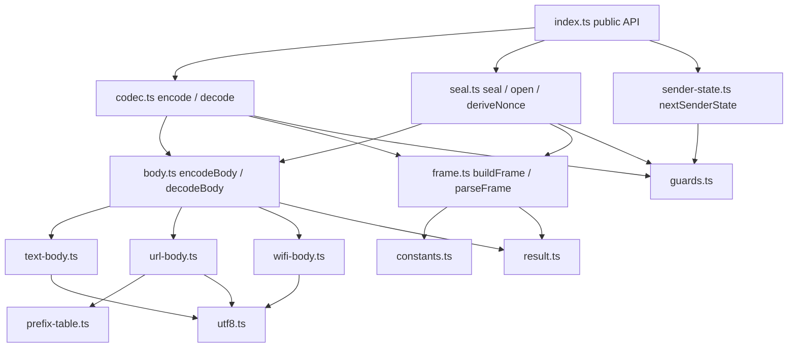
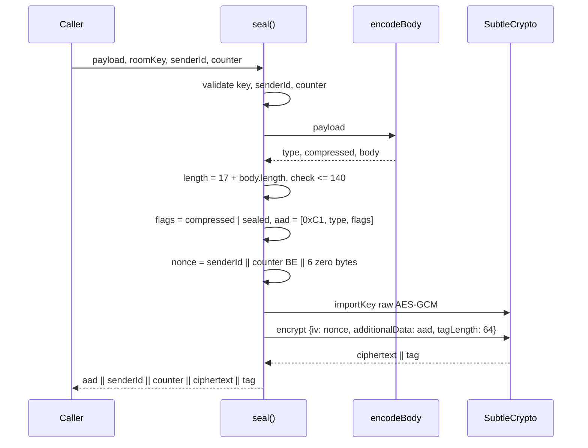

# Design Document: Screech Protocol

## Overview

This document designs the Packet_V1 codec in `packages/core`. The codec turns a typed `Payload` into a `Uint8Array` of at most 140 bytes and back. An optional sealed mode encrypts the Body with AES-GCM under a caller-supplied 128-bit Room_Key.

The design follows these rules from the workspace conventions:

- Every function is a pure function over `Uint8Array` and plain values. The only randomness is in `nextSenderState`.
- Packets are never strings, because ggwave converts strings to UTF-8 and would corrupt binary data.
- Only `SubtleCrypto` and `crypto.getRandomValues` are used. No Node.js APIs. Code runs on iOS Safari and Chrome.
- No `any`. Results are discriminated unions. Nothing throws and no Promise rejects.
- The full `packages/core` test suite runs in under 20 seconds, so `pnpm test` stays fast enough to run on every change.

### Decisions the requirements deferred to design

| Item | Decision |
|---|---|
| Magic_Nibble | `0xC` (binary 1100). Header byte is `0xC1`. It is neither all-zero nor all-one, so silence or saturated noise decoded as bytes is not mistaken for a header. |
| Type bytes | text `0`, url `1`, wifi `2`, contact `3`, checkin `4`, hunt-clue `5` |
| Flag bits | sealed `0x01`, compressed `0x02`, multipart `0x04`. Reserved mask `0xF8`. |
| Security-type bytes | open `0`, WPA `1`, WEP `2` |
| Nonce | `Sender_ID (4) \|\| Counter (2, big-endian) \|\| 0x00 x 6` |
| AAD | The first three packet bytes: Header, Type, Flags |
| Tag | 8 bytes, requested from Web Crypto with `tagLength: 64` |
| Error codes | The 16 codes in the requirements, including `crypto-unavailable` (Requirement 10.9, 10.10) |
| Non-`Uint8Array` input to `decode` or `open` | `invalid-payload` with `field: 'packet'` (Requirement 10.11). Settled. |
| Decoder strictness | The decoder accepts only what the encoder produces, for each type and flag combination (Requirements 4.6, 6.10, 7.6). Settled. |
| Rotation no-repeat guarantee | Assumes a random source that does not repeat Sender_IDs (Requirement 9.4). Settled. |
| Test-suite time budget | The full `packages/core` suite finishes in under 20 seconds (Requirement 12.15). See Testing Strategy. |

### Research notes

- **Web Crypto output shape.** `SubtleCrypto.encrypt` with AES-GCM returns ciphertext followed by the tag. With `tagLength: 64` the last 8 bytes are the tag. The sealed packet is `header(3) || sender_id(4) || counter(2) || (ciphertext || tag)`, so the output of `encrypt` is appended unchanged. ([MDN: SubtleCrypto.encrypt](https://developer.mozilla.org/en-US/docs/Web/API/SubtleCrypto/encrypt), [MDN: AesGcmParams](https://developer.mozilla.org/en-US/docs/Web/API/AesGcmParams))
- **Secure context.** `crypto.subtle` exists only in secure contexts (HTTPS or localhost). On an insecure origin it is `undefined`. The codec must detect this and resolve to an error rather than throw. `crypto.getRandomValues` is available in insecure contexts too.
- **Nonce reuse.** AES-GCM is catastrophic if a (key, nonce) pair repeats. The 6 zero bytes in the Nonce are unused. The 4-byte random Sender_ID per sending session separates senders that share one Room_Key. Two senders collide only if they pick the same Sender_ID and then reuse counters, which has probability about n²/2³³ for n senders in a room. This is acceptable for rooms of tens to hundreds of devices.
- **TextEncoder and TextDecoder.** `TextEncoder` replaces a lone surrogate with U+FFFD, which would break round trips. The encoder therefore rejects strings with lone surrogates. `TextDecoder` must be constructed with `fatal: true` to reject invalid UTF-8, and with `ignoreBOM: true` so a leading U+FEFF is kept as a character instead of being stripped.
- **Truncated GCM tags.** NIST SP 800-38D allows 64-bit tags with limits on invocations and forgery attempts. A packet carries at most 2¹⁶ messages per Sender_ID and the channel is slow (8 to 16 bytes per second), so an attacker's forgery attempts are limited by audio throughput. The 64-bit tag is a deliberate size trade-off, not an oversight.
- **Safari support for `tagLength: 64`.** Requirement 8.2 requires it. I believe current WebKit accepts the standard tag lengths (32, 64, 96, 104, 112, 120, 128), but I have not verified this in a browser. A manual smoke test on iOS Safari is listed in the Testing Strategy.

## Architecture

The codec is layered. Each layer depends only on the layers below it.



### Module layout in `packages/core/src`

| File | Responsibility |
|---|---|
| `constants.ts` | `MAGIC_NIBBLE`, `VERSION`, `HEADER_BYTE`, type values, flag bits, `SIZE_CAP`, `UNSEALED_OVERHEAD`, `SEALED_OVERHEAD`, `MAX_UNSEALED_BODY`, `MAX_SEALED_BODY`, key/ID/tag lengths, counter max. |
| `types.ts` | `PacketType`, `Payload`, `PacketFlags`, `DecodedPacket`, `SenderState`, `WifiSecurity`. |
| `result.ts` | `Result<T>`, `CodecError`, `CodecErrorCode`, helpers `ok` and `err`. |
| `guards.ts` | `isUint8Array`, `isSenderId`, `isCounter`, `isRoomKey`. All return booleans and never throw. |
| `utf8.ts` | `encodeUtf8Strict`, `decodeUtf8Strict`, `hasLoneSurrogate`. |
| `frame.ts` | `buildFrame`, `parseFrame`. Owns the first three bytes. |
| `prefix-table.ts` | `PREFIX_TABLE`, `compressUrl`, `expandUrl`. The only definition of the table. |
| `text-body.ts`, `url-body.ts`, `wifi-body.ts` | Per-type body encode and decode. |
| `body.ts` | `encodeBody` and `decodeBody`, dispatching on type. |
| `codec.ts` | `encode`, `decode` (synchronous). |
| `seal.ts` | `seal`, `open`, `deriveNonce` (asynchronous except `deriveNonce`). |
| `sender-state.ts` | `nextSenderState`. The only file that touches `getRandomValues`. |
| `index.ts` | Re-exports the public API. |

Tests go in `packages/core/tests/`, one file per module plus `arbitraries.ts` (shared generators) and `helpers.ts` (the `NUM_RUNS` constant and independent reference implementations). `helpers.ts` uses `node:crypto` to compute the expected bytes of the known-answer sealed packet, independently of `src/`. Node.js APIs are allowed in `tests/` and forbidden in `src/` (Requirement 10.4).

### Packet layout

```
Unsealed:  | 0xC1 | type | flags | body (1..137) |                        total <= 140
Sealed:    | 0xC1 | type | flags | sender_id (4) | counter (2, BE) | ciphertext (1..123) | tag (8) |   total <= 140
           |<-------- AAD -------->|<------ nonce source ------->|
```

The sealed flag is set in `flags` for sealed packets. The AAD covers bytes 0 to 2. The Sender_ID and Counter are not in the AAD, but they form the Nonce. Changing either changes the Nonce, so decryption fails the tag check. Every byte of a sealed packet is therefore authenticated.

### Validation order

`decode` and `open` share the header checks. They run in this order and stop at the first failure:

1. Input is not a `Uint8Array`: `invalid-payload` with `field: 'packet'` (settled, Requirement 10.11).
2. Length under 3: `truncated`.
3. Magic nibble differs: `bad-magic`.
4. Version nibble differs from 1: `unsupported-version`.
5. Type byte above 5: `unknown-type`.
6. Any bit of `flags & 0xF8`: `reserved-flags`.

Then:

- `decode`: sealed flag set returns `key-required`. Multipart flag set returns the raw Body. Otherwise the body is decoded by type.
- `open`: sealed flag clear returns `not-sealed`. Length under 17 returns `truncated`. Key `undefined` or `null` returns `key-required`. Key not a 16-byte `Uint8Array` returns `invalid-key`. Then decrypt. A failed tag check returns `auth-failed`.

`seal` validates in this order: key (`invalid-key`), Sender_ID (`invalid-sender-id`), Counter (`invalid-counter`), Payload (`invalid-payload` or `invalid-wifi`), size (`too-large`), then encrypts. A missing key to `seal` is `invalid-key`, because `key-required` is only for the Opener and the unsealed Decoder.

## Components and Interfaces

### Public types

```ts
export type PacketType = 'text' | 'url' | 'wifi' | 'contact' | 'checkin' | 'hunt-clue';

export type WifiSecurity = 'open' | 'wpa' | 'wep';

export type Payload =
  | { readonly type: 'text'; readonly text: string }
  | { readonly type: 'url'; readonly url: string }
  | {
      readonly type: 'wifi';
      readonly ssid: string;
      readonly password: string;
      readonly security: WifiSecurity;
    }
  | { readonly type: 'contact'; readonly text: string }
  | { readonly type: 'checkin'; readonly text: string }
  | { readonly type: 'hunt-clue'; readonly text: string };

export interface PacketFlags {
  readonly sealed: boolean;
  readonly compressed: boolean;
  readonly multipart: boolean;
}

/** Result of decoding or opening a packet. */
export type DecodedPacket =
  | {
      readonly multipart: false;
      readonly type: PacketType;
      readonly flags: PacketFlags;
      readonly payload: Payload;
    }
  | {
      /** Multipart packets are not interpreted. `body` is a copy of the Body bytes
          (after decryption for a Sealed_Packet). */
      readonly multipart: true;
      readonly type: PacketType;
      readonly flags: PacketFlags;
      readonly body: Uint8Array;
    };

export interface SenderState {
  readonly senderId: Uint8Array; // exactly 4 bytes
  readonly counter: number;      // integer 0..65535
}
```

### Results and errors

```ts
export type CodecErrorCode =
  | 'bad-magic' | 'unsupported-version' | 'truncated' | 'unknown-type'
  | 'reserved-flags' | 'too-large' | 'invalid-payload' | 'invalid-wifi'
  | 'invalid-body' | 'auth-failed' | 'key-required' | 'invalid-key'
  | 'invalid-counter' | 'invalid-sender-id' | 'not-sealed'
  | 'crypto-unavailable';

export type CodecError =
  | { readonly code: 'too-large'; readonly length: number; readonly message: string }
  | { readonly code: 'invalid-payload'; readonly field: string; readonly message: string }
  | {
      readonly code: Exclude<CodecErrorCode, 'too-large' | 'invalid-payload'>;
      readonly message: string;
    };

export type Ok<T> = { readonly ok: true; readonly value: T };
export type Err = { readonly ok: false; readonly error: CodecError };
export type Result<T> = Ok<T> | Err;
```

`too-large.length` is the computed total packet length in bytes. `invalid-payload.field` names the offending field (`'text'`, `'url'`, `'ssid'`, `'password'`, `'security'`, `'type'`, `'payload'`, `'packet'`).

### Functions

```ts
// codec.ts (synchronous)
export function encode(payload: Payload): Result<Uint8Array>;
export function decode(packet: Uint8Array): Result<DecodedPacket>;

// seal.ts (asynchronous; the returned Promise never rejects)
export function seal(
  payload: Payload,
  roomKey: Uint8Array,
  senderId: Uint8Array,
  counter: number,
): Promise<Result<Uint8Array>>;

export function open(
  packet: Uint8Array,
  roomKey: Uint8Array | undefined,
): Promise<Result<DecodedPacket>>;

export function deriveNonce(senderId: Uint8Array, counter: number): Result<Uint8Array>;

// sender-state.ts (synchronous)
export type RandomFill = (buffer: Uint8Array) => Uint8Array;

export function nextSenderState(
  previous?: SenderState,
  fill?: RandomFill,
): Result<SenderState>;

// frame.ts (exported for tests and for the multipart follow-up spec)
export function buildFrame(type: PacketType, flags: PacketFlags, body: Uint8Array): Uint8Array;
export function parseFrame(bytes: Uint8Array): Result<{
  readonly type: PacketType;
  readonly flags: PacketFlags;
  readonly body: Uint8Array;
}>;
```

Because the parameter types are strict, callers in TypeScript cannot pass the wrong types. The runtime guards exist for JavaScript callers and for the totality property (10.7).

### Frame (`frame.ts`)

`buildFrame` writes `HEADER_BYTE`, the type value, and the flags byte (`sealed | compressed << 1 | multipart << 2` expressed with the bit constants), then a copy of `body`. It does no size checking. Size is checked by `encode` and `seal`, which know the overhead. `parseFrame` runs validation steps 2 to 6 and returns a copy of everything after byte 2.

### Encoder and Decoder (`codec.ts`)

`encode` calls `encodeBody(payload)`, which returns `{ type, compressed, body }` or an error. It then computes `3 + body.length`. If that is above 140 it returns `too-large` with the computed length. Otherwise it returns `buildFrame(...)`. `encode` never sets the sealed or multipart bit.

`decode` calls `parseFrame`, then applies the rules above. For a non-multipart packet it calls `decodeBody(type, compressed, body)`.

### Type-specific body encodings (`body.ts` and per-type files)

`decodeBody` is strict. It accepts only what `encodeBody` produces, so decode(encode(x)) round-trips and every other byte string is rejected or interpreted as its single canonical meaning. This is a settled decision: a text-like packet with the compressed flag set is `invalid-body` (Requirements 4.6, 7.6), and a wifi packet with it clear is `invalid-body` (Requirement 6.10). If a later spec needs a compressed text type, the flag has room for it.

**Text, contact, checkin, hunt-clue.** Body is strict UTF-8 of the text. The compressed flag is clear. The decoder rejects a packet of one of these types with the compressed flag set (`invalid-body`), because the encoder never produces it.

**URL.**

Encoding steps:

1. The URL must match `/^(https?):\/\//i`. Otherwise `invalid-payload` with `field: 'url'`.
2. Record the scheme as http or https (lowercased). Remove it. The remainder is `rest`.
3. Find the longest `PREFIX_TABLE` entry such that `rest.startsWith(prefix)`. Matching is case-sensitive, so `WWW.example.com` is not compressed and keeps its case. Remove the prefix.
4. If `rest` was empty before step 3, return `invalid-payload`.
5. Body is `[schemeByte] || utf8(remaining)`, with the compressed flag set.

Scheme byte: bit 7 is 1 for https and 0 for http. Bits 6 to 0 are the Prefix_Table code, or `0x00` for no prefix.

The compressed flag is always set for a valid URL, because the scheme is always removed (5.3). A URL packet with the compressed flag clear is still decodable: its Body is the literal UTF-8 URL, and it must match the scheme pattern or the decoder returns `invalid-body`. The Encoder never produces this form. It exists so the compressed flag keeps its meaning.

Decoding a compressed URL:

1. Body empty: `invalid-body` (no recorded scheme, 5.7).
2. Code `0x00` means no prefix. A code that is not in the table: `invalid-body` (5.6).
3. Result is `scheme + "://" + prefix + decodeUtf8Strict(rest)`. If both the prefix and the decoded rest are empty: `invalid-body`.

Decoded URLs have a lowercase scheme. Everything after the scheme is returned exactly as encoded (5.4).

**Prefix_Table.** Codes `0x01` to `0x10` are assigned. Codes `0x11` to `0x7F` are undefined and rejected. Every entry ends in `/` or `.` so a prefix ends at a boundary.

| Code | Prefix | Code | Prefix |
|---|---|---|---|
| `0x01` | `www.` | `0x09` | `discord.gg/` |
| `0x02` | `github.com/` | `0x0A` | `linkedin.com/in/` |
| `0x03` | `www.youtube.com/` | `0x0B` | `www.linkedin.com/in/` |
| `0x04` | `youtu.be/` | `0x0C` | `twitter.com/` |
| `0x05` | `docs.google.com/` | `0x0D` | `x.com/` |
| `0x06` | `drive.google.com/` | `0x0E` | `bit.ly/` |
| `0x07` | `meet.google.com/` | `0x0F` | `en.wikipedia.org/wiki/` |
| `0x08` | `zoom.us/` | `0x10` | `forms.gle/` |

The table is an `as const` readonly array of `{ code, prefix }`, and both `compressUrl` and `expandUrl` read from it (5.8). The wire table is part of Packet_V1: entries may be appended but never changed or reused.

**Wi-Fi.** Body is:

```
security (1) | ssid_len (1) | ssid bytes | password_len (1) | password bytes
```

The compressed flag is always set. Security values: open `0`, WPA `1`, WEP `2`. Open networks write `password_len = 0` and no password bytes. The maximum Body is 1 + 1 + 32 + 1 + 63 = 98 bytes, which fits both the unsealed (137) and sealed (123) limits, so a wifi Payload never produces `too-large`.

Encoder checks, in order:

1. `ssid` and `password` are strings without lone surrogates, otherwise `invalid-payload`.
2. `security` is one of the three values, otherwise `invalid-payload` with `field: 'security'`.
3. SSID is 1 to 32 UTF-8 bytes, otherwise `invalid-payload` with `field: 'ssid'`.
4. Security is open and the password is non-empty: `invalid-wifi` (6.8).
5. Password is at most 63 UTF-8 bytes, otherwise `invalid-payload` with `field: 'password'`.
6. Security is WPA or WEP and the password is empty: `invalid-payload` with `field: 'password'`.

Decoder checks: compressed flag set; security byte defined; each length does not run past the Body; no bytes left over; SSID 1 to 32 bytes; password at most 63 bytes; open has an empty password; WPA and WEP have a non-empty password; SSID and password are strict UTF-8. Any failure is `invalid-body`. These checks mirror the encoder so every accepted Body maps to a Payload the encoder would produce.

### Field limits

| Field | Limit | Error |
|---|---|---|
| text, contact, checkin, hunt-clue | 1 or more characters, no lone surrogate. The upper bound is the Size_Cap, not a separate limit. | empty or lone surrogate: `invalid-payload`; over cap: `too-large` |
| url | `http://` or `https://` scheme, then 1 or more characters | `invalid-payload` |
| ssid | 1 to 32 UTF-8 bytes | `invalid-payload` |
| password | 0 to 63 UTF-8 bytes; 0 only for open; must be 0 for open | `invalid-payload` or `invalid-wifi` |

Whitespace-only text is valid. Text containing U+0000 is valid. The codec makes no further policy decisions.

### Sealing (`seal.ts`)



Details:

- `deriveNonce(senderId, counter)` returns a new 12-byte array. It is exported so tests can check it directly.
- The key is imported with `importKey('raw', copyOfKey, { name: 'AES-GCM' }, false, ['encrypt', 'decrypt'])` on each call. The codec keeps no state. A copy of every input is passed to Web Crypto so views with a nonzero `byteOffset` cannot leak neighbouring bytes.
- GCM ciphertext length equals plaintext length, so the size check runs before encryption using `17 + body.length`.
- `open` mirrors this: it takes bytes 0 to 2 as AAD, bytes 3 to 6 as Sender_ID, bytes 7 to 8 as Counter, the rest as `ciphertext || tag`, and calls `decrypt`. A `decrypt` rejection becomes `auth-failed`. After a successful decrypt, `open` builds a plain frame from the type, flags with the sealed bit cleared, and plaintext, then follows the same multipart or `decodeBody` path as `decode`. A plaintext that decrypts but does not decode returns `invalid-body`. This can only happen if an authorised key holder sealed a bad body.
- If `globalThis.crypto?.subtle` is missing, or `importKey`, `encrypt` or `decrypt` throws or rejects for a reason other than a tag mismatch, the result is `crypto-unavailable` (Requirement 10.9). A tag mismatch is the only failure that maps to `auth-failed`. Every `await` is inside a `try` block, so the Promise never rejects (10.8).

A sealed Body has 1 to 123 bytes. A sealed packet with an empty Body is 17 bytes, which the Opener does not reject as `truncated`. AES-GCM of an empty plaintext decodes to an empty Body, which each type decoder rejects with `invalid-body`. Test 12.7 only needs the length boundary.

### Sender state rotation (`sender-state.ts`)

```ts
nextSenderState(previous?: SenderState, fill: RandomFill = defaultFill): Result<SenderState>
```

- `previous` is `undefined`: return a fresh 4-byte Sender_ID from `fill` and Counter `0` (9.1).
- `previous` is present: check `senderId` first (`invalid-sender-id`), then `counter` (`invalid-counter`). A `previous` that is not an object is `invalid-sender-id`.
- Counter below 65535: same Sender_ID (copied), Counter + 1 (9.2).
- Counter equal to 65535: draw a fresh ID. If it equals the old one, XOR byte 0 with `0x01`. This guarantees a different ID without a retry loop (9.3). Counter becomes 0.
- `fill` defaults to `(b) => crypto.getRandomValues(b)`. Injection exists so tests are deterministic. If `crypto.getRandomValues` is missing or throws, the result is `crypto-unavailable` and no Sender_State (Requirement 10.10).
- Returned `senderId` arrays are fresh. The caller's arrays are never retained or mutated.

The helper is stateless. It guarantees that a rotated ID differs from the ID it replaced. Its no-repeat guarantee (Requirement 9.4) assumes a random source that does not repeat Sender_IDs. With the real `getRandomValues` source, a repeat of an older ID has probability about k/2³² per rotation for k earlier IDs, which the design accepts.

## Data Models

Constants (all in `constants.ts`):

| Name | Value |
|---|---|
| `MAGIC_NIBBLE` | `0xC` |
| `VERSION` | `1` |
| `HEADER_BYTE` | `0xC1` |
| `TYPE_VALUE` | `{ text: 0, url: 1, wifi: 2, contact: 3, checkin: 4, 'hunt-clue': 5 }` |
| `FLAG_SEALED`, `FLAG_COMPRESSED`, `FLAG_MULTIPART` | `0x01`, `0x02`, `0x04` |
| `FLAG_RESERVED_MASK` | `0xF8` |
| `SECURITY_VALUE` | `{ open: 0, wpa: 1, wep: 2 }` |
| `SIZE_CAP` | `140` |
| `UNSEALED_OVERHEAD` | `3` |
| `SEALED_OVERHEAD` | `17` (3 + 4 + 2 + 8) |
| `MAX_UNSEALED_BODY`, `MAX_SEALED_BODY` | `137`, `123` |
| `ROOM_KEY_LENGTH`, `SENDER_ID_LENGTH`, `COUNTER_MAX`, `TAG_LENGTH_BITS` | `16`, `4`, `65535`, `64` |
| `NONCE_LENGTH` | `12` |

`isUint8Array` checks `value instanceof Uint8Array` or `Object.prototype.toString.call(value) === '[object Uint8Array]'`, so arrays from another realm (for example an iframe) are accepted.

Immutability: every function copies bytes it keeps, and every returned array is newly allocated. The decoded multipart `body` is a copy (10.5).

## Correctness Properties

*A property is a characteristic or behavior that should hold true across all valid executions of a system-essentially, a formal statement about what the system should do. Properties serve as the bridge between human-readable specifications and machine-verifiable correctness guarantees.*


### Property 1: Frame round trip

*For any* packet type, any combination of the sealed, compressed and multipart flags, and any body, `parseFrame(buildFrame(type, flags, body))` returns the same type, flags and body, and the first three bytes of the frame are `0xC1`, the type value, and the flags byte with no reserved bit set.

**Validates: Requirements 1.1, 1.5, 2.1, 2.3, 2.6**

### Property 2: Header validation matches the reference model

*For any* byte array of 0 to 300 bytes, `decode` and `open` return the error that a reference classifier assigns using the order: length under 3 is `truncated`, wrong magic is `bad-magic`, version other than 1 is `unsupported-version`, type above 5 is `unknown-type`, any reserved flag bit is `reserved-flags`. `open` never returns `auth-failed` for a packet that fails one of these checks.

**Validates: Requirements 1.2, 1.3, 1.4, 2.2, 2.4, 8.7**

### Property 3: Unsealed round trip

*For any* valid Payload of any of the six types whose encoded packet fits within 140 bytes, `decode(encode(payload))` returns a non-multipart packet whose type equals the Payload type and whose Payload equals the original. For url Payloads the expected value has the scheme lowercased. For wifi Payloads with open security the password is empty on both sides. Text may contain multi-byte characters, whitespace, U+0000 and U+FEFF.

**Validates: Requirements 4.1, 4.2, 5.4, 6.1, 6.4, 6.9, 7.1, 7.2, 7.5, 11.1**

### Property 4: URL compression canonical form

*For any* valid URL (scheme in any letter case, with or without a Prefix_Table prefix), the encoded Body equals `[schemeByte] || utf8(remainder)` where the scheme bit matches the scheme, the code is the longest matching table prefix (or `0x00`), the remainder is the URL with scheme and prefix removed, and the compressed flag is set.

**Validates: Requirements 5.1, 5.2, 5.3**

### Property 5: Prefix_Table is a bijection

*For any* entry in `PREFIX_TABLE`, `expandUrl` of its code returns its prefix and `compressUrl` of a string starting with that prefix selects a code whose prefix is at least as long. All codes are distinct and all prefixes are distinct.

**Validates: Requirements 5.8**

### Property 6: Invalid URL payloads and bodies are rejected

*For any* string that does not start with `http://` or `https://` (case-insensitive), or that has nothing after the scheme, `encode` returns `invalid-payload` with `field: 'url'`. *For any* url packet with the compressed flag set whose Body is empty, or whose first byte carries a code not in the table, `decode` returns `invalid-body` and no URL.

**Validates: Requirements 5.5, 5.6, 5.7**

### Property 7: Wi-Fi encoding rules

*For any* wifi Payload with security open and a non-empty password, `encode` and `seal` return `invalid-wifi`. *For any* wifi Payload with an SSID of 0 or more than 32 UTF-8 bytes, a password over 63 bytes, or WPA or WEP with an empty password, `encode` returns `invalid-payload`. *For any* accepted wifi Payload, the Body matches `security || len || ssid || len || password`, with password length 0 for open, and the compressed flag is set.

**Validates: Requirements 6.1, 6.2, 6.3, 6.6, 6.7, 6.8**

### Property 8: Malformed Wi-Fi bodies are rejected

*For any* valid wifi Body, removing one or more trailing bytes, appending one or more bytes, replacing the security byte with an undefined value, or raising a length byte past the remaining bytes makes `decode` return `invalid-body`.

**Validates: Requirements 6.5**

### Property 9: Invalid payloads are rejected without a packet

*For any* text-like Payload that is empty or contains a lone surrogate, and *for any* value that is not a valid Payload (wrong shape, unknown type, non-string fields), `encode` and `seal` return `invalid-payload` that names the offending field and return no packet. The input Payload is unchanged afterwards.

**Validates: Requirements 3.3, 4.4, 7.4**

### Property 10: Text-like bodies must be valid UTF-8

*For any* body that is not valid UTF-8, a frame of type text, contact, checkin or hunt-clue with that body makes `decode` return `invalid-body` and no text. *For any* text-like frame with the compressed flag set, `decode` returns `invalid-body`.

**Validates: Requirements 4.3, 7.3**

### Property 11: Size cap is never exceeded

*For any* Payload, `encode` returns either a packet of at most 140 bytes or an error, and `seal` resolves to either a packet of at most 140 bytes or an error. Whenever the result is `too-large`, its `length` equals the computed packet length (3 + Body for `encode`, 17 + Body for `seal`) and exceeds 140. Whenever a computed length is at most 140 and the Payload is otherwise valid, the result is a packet of exactly that length. Output is a `Uint8Array`.

**Validates: Requirements 3.1, 3.2, 3.4, 4.5, 8.14, 8.15, 12.3**

### Property 12: Sealed round trip and layout

*For any* valid Payload that fits in a Sealed_Packet, any 16-byte Room_Key, any 4-byte Sender_ID and any Counter from 0 to 65535, `open` resolves to the original Payload (with the same url normalization as Property 3). The sealed packet has length `17 + body length`, the sealed flag set, bytes 3 to 6 equal to the Sender_ID, and bytes 7 to 8 equal to the Counter in big-endian. Decrypting the packet independently with `SubtleCrypto`, using the derived Nonce, `tagLength: 64` and the first three bytes as AAD, yields the plaintext Body.

**Validates: Requirements 8.1, 8.2, 8.3, 8.4, 8.5, 11.2**

### Property 13: Nonce derivation

*For any* Sender_ID and Counter, `deriveNonce` returns 12 bytes: the Sender_ID, then the Counter in big-endian, then six zero bytes. *For any* two different (Sender_ID, Counter) pairs the Nonces differ, and for the same pair the Nonces are equal.

**Validates: Requirements 8.3, 12.6**

### Property 14: Determinism

*For any* Payload, `encode` called twice returns identical bytes. *For any* Payload, Room_Key, Sender_ID and Counter, `seal` called twice returns identical bytes.

**Validates: Requirements 10.3, 11.3**

### Property 15: Tampering is detected

*For any* Sealed_Packet and any bit position in it, flipping that bit makes `open` resolve to a Codec_Error and never a Payload. Any error code is accepted.

**Validates: Requirements 8.6, 12.2**

### Property 16: Wrong key fails authentication

*For any* Sealed_Packet and any 16-byte Room_Key different from the one used to seal it, `open` resolves to `auth-failed` and returns no Payload.

**Validates: Requirements 11.4, 8.6**

### Property 17: Sealed-flag routing

*For any* bytes that pass the header checks: if the sealed flag is clear, `open` resolves to `not-sealed`; if the sealed flag is set and the length is under 17, `open` resolves to `truncated` without calling Web Crypto; if the sealed flag is set, `decode` returns `key-required`; if the sealed flag is set, the length is at least 17 and the key is `undefined` or `null`, `open` resolves to `key-required`.

**Validates: Requirements 8.8, 8.10, 8.16, 8.17**

### Property 18: Sealer and Opener argument validation

*For any* Room_Key that is not a 16-byte `Uint8Array`, `seal` and `open` resolve to `invalid-key`. *For any* Sender_ID that is not a 4-byte `Uint8Array`, `seal` resolves to `invalid-sender-id`. *For any* Counter that is not an integer from 0 to 65535, `seal` resolves to `invalid-counter`. No packet is returned in any of these cases.

**Validates: Requirements 8.9, 8.12, 8.13**

### Property 19: Sender state rotation

*For any* valid Sender_State whose Counter is under 65535, `nextSenderState` returns the same Sender_ID and Counter + 1. *For any* valid Sender_State whose Counter is 65535, it returns a Sender_ID that differs from the old one and Counter 0, even when the injected random source returns the old ID. Called without a state, it returns a 4-byte Sender_ID and Counter 0. *For any* previous state with an invalid Sender_ID or Counter, it returns `invalid-sender-id` or `invalid-counter` and no state. The no-repeat guarantee over a long sequence (Requirement 9.4) is not a property test. It is one deterministic unit test, described in the Testing Strategy.

**Validates: Requirements 9.1, 9.2, 9.3, 9.5, 9.6, 12.6**

### Property 20: Totality

*For any* byte array of 0 to 300 bytes, `decode` returns a Result without throwing and the Promise from `open` resolves (never rejects) to a Result. *For any* arbitrary value (including `null`, `undefined`, numbers, strings, plain objects, arrays), passed as any argument of `encode`, `decode`, `seal`, `open` or `nextSenderState`, the function returns an error Result without throwing, and the Promise functions resolve. A non-`Uint8Array` argument to `decode` or `open` yields `invalid-payload` with `field: 'packet'`.

**Validates: Requirements 10.6, 10.7, 10.8, 10.11, 12.4, 12.5**

### Property 21: Inputs are not modified or retained

*For any* byte-array input to `decode`, `open`, `seal` (key and Sender_ID) and `nextSenderState` (Sender_ID), the input bytes are identical before and after the call, and mutating any returned array does not change any input array.

**Validates: Requirements 10.5**

### Property 22: Multipart passthrough

*For any* valid frame with the multipart flag set and any body, `decode` returns `multipart: true`, `flags.multipart: true`, the type, and a body identical to the one supplied. For a sealed multipart frame, `open` returns the decrypted Body unchanged. The Body is not interpreted as a Payload.

**Validates: Requirements 2.5**

Requirement 9.4 and Requirement 12.13 are covered by a single deterministic unit test, not by a property (see Testing Strategy). Requirements 9.7, 10.1, 10.2, 10.4, 10.9, 10.10 and 12.x are covered by unit and smoke tests.

Notes on merged criteria: the prework produced about 45 testable criteria. Redundant ones were merged. Header rejection criteria (1.2 to 1.4, 2.2, 2.4) share one reference-model property. All round-trip criteria (4.1, 4.2, 5.4, 6.4, 6.9, 7.1, 7.2, 7.5, 11.1) share one round-trip property, because a single generator over all six Payload types covers each. Size-cap criteria for the Encoder and Sealer (3.1, 3.2, 4.5, 8.14, 8.15, 12.3) share one property. Criteria 8.2 and 8.4 are folded into the sealed round trip by decrypting independently with Web Crypto.

## Error Handling

Rules that apply to every public function:

- Nothing throws. Each public function wraps its work so that an unexpected exception becomes a `Result` error. Synchronous functions return an `Err` for non-recoverable states they cannot classify, using the closest code: `invalid-payload` for arguments, `crypto-unavailable` for platform failures.
- Promises resolve. `seal` and `open` put every `await` inside `try/catch`.
- The first failing check wins, in the order stated under Validation order. Header-level errors are never replaced by `auth-failed`.
- Error values contain a code, a human-readable message, and for two codes a structured extra field (`length`, `field`). The message never includes key bytes or plaintext.

| Code | Raised by | Meaning |
|---|---|---|
| `bad-magic` | decode, open | Magic nibble is not `0xC` |
| `unsupported-version` | decode, open | Version nibble is not 1 |
| `truncated` | decode, open | Under 3 bytes, or sealed flag set and under 17 bytes |
| `unknown-type` | decode, open | Type byte above 5 |
| `reserved-flags` | decode, open | Flag bit outside `0x07` set |
| `too-large` | encode, seal | Computed packet length above 140 (`length` field) |
| `invalid-payload` | encode, seal, decode | Payload or input is empty, malformed, or wrongly typed (`field` names it) |
| `invalid-wifi` | encode, seal | Open network with a password |
| `invalid-body` | decode, open | Body does not decode for its type |
| `auth-failed` | open | AES-GCM tag check failed |
| `key-required` | decode, open | Sealed packet and no key |
| `invalid-key` | seal, open | Room_Key is not a 16-byte `Uint8Array` |
| `invalid-counter` | seal, nextSenderState | Counter is not an integer 0 to 65535 |
| `invalid-sender-id` | seal, nextSenderState | Sender_ID is not a 4-byte `Uint8Array` |
| `not-sealed` | open | Sealed flag clear |
| `crypto-unavailable` | seal, open, nextSenderState | `crypto.subtle` missing (for example an HTTP page) or failing for a reason other than a tag mismatch (seal, open); `crypto.getRandomValues` missing or failing (nextSenderState). Settled. |

Receivers should treat `bad-magic`, `unsupported-version`, `truncated`, `unknown-type` and `reserved-flags` as "not a Screech packet" and ignore them silently. Room microphones pick up noise, so these are expected.

## Testing Strategy

Property-based testing applies. The codec is made of pure functions with clear input and output (parsers, serializers, a deterministic AEAD wrapper), and the input space is large. The I/O boundary (microphone, ggwave, UI) is out of scope for this spec.

**Libraries.** Vitest 2.1.4 and fast-check 3.22.0 (already in `packages/core`). No property-testing code is written by hand. Run with `pnpm test` from the repository root.

**Property tests.**

- Each of Properties 1 to 22 is implemented as exactly one `fc.assert(fc.property(...))` or `fc.asyncProperty(...)` test.
- Every property runs with `numRuns` from a shared constant `NUM_RUNS = 100` in `tests/helpers.ts`, which is the minimum required by Requirement 12.11. Crypto properties use the same constant, and no property goes below it. Pure, cheap properties (Properties 1 to 10, 13, 14, 20) may use a larger count only if the suite stays within the time budget.
- Each test carries a comment tag in the form `Feature: screech-protocol, Property N: <property text>`.
- Failures print the seed and counterexample (fast-check default). Tests must not hide the seed, so a failure can be replayed with `fc.assert(..., { seed, path })`.
- Properties that need independent verification use their own reference implementation in `tests/helpers.ts`: a header classifier (Property 2), a URL compressor (Property 4), and a direct `SubtleCrypto` decrypt (Property 12). The reference must not import from `src` helpers it is checking.
- Property 15 flips one bit of one generated packet per run, so each run costs one `decrypt`. Packet size is at most 140 bytes.

**Generators (`tests/arbitraries.ts`).**

- `payloadArb`: a union over the six types. Text uses `fc.fullUnicodeString` with a weighting toward lengths around the cap (including 123, 124, 137 and 138 UTF-8 bytes) and includes U+0000, U+FEFF and multi-byte characters.
- `urlArb`: scheme in random letter case, optional table prefix, random path.
- `wifiArb`: valid cases and, for Property 7, separate generators for each invalid case.
- `keyArb` (16 bytes), `senderIdArb` (4 bytes), `counterArb` (0 to 65535, with boundary weighting for 0 and 65535).
- `anyBytesArb`: 0 to 300 bytes, with a bias to start with `0xC1` so deeper checks are reached.
- `anythingArb`: `fc.anything()` for totality.
- `stringWithLoneSurrogateArb`: built from `fc.string` plus an inserted `\uD800` to `\uDFFF` code unit.

**Unit tests (fixed example bytes).**

- One example per type, with the exact expected packet bytes, including `0xC1` header, a compressed URL using code `0x02`, and a wifi packet for each security type.
- One example for each of the 16 error codes.
- Size boundaries: unsealed 140 bytes (137-byte Body) accepted and 141 rejected; sealed 140 bytes (123-byte Body) accepted and 141 rejected.
- Sealed packet of 16 bytes rejected with `truncated`; of 17 bytes not rejected with `truncated`.
- Rotation examples: initial state, increment, rollover at 65535, `invalid-counter`, `invalid-sender-id` (12.9).
- A single deterministic unit test (not a fast-check property) for Requirements 9.4 and 12.13. It calls `nextSenderState` 70,000 consecutive times, starting from no state, with an injected `fill` that never returns the same Sender_ID twice (for example a 32-bit counter written big-endian into the buffer). It records each `(senderId, counter)` pair in a `Set` of strings and fails on a repeat. The loop is plain synchronous code and takes a few milliseconds.
- A known-answer test for sealing (12.14), with a fixed Room_Key, Sender_ID, Counter and Payload, to pin the AES-GCM output across browsers and Node. The expected Sealed_Packet bytes are computed in `tests/helpers.ts` with `node:crypto` (`createCipheriv('aes-128-gcm', key, nonce, { authTagLength: 8 })`, `setAAD` with the first three bytes, then header, Sender_ID, Counter, ciphertext and tag concatenated by hand). They are never taken from `seal()` and never generated from the implementation and checked in. The helper builds the Nonce and layout itself, without importing `deriveNonce` or `buildFrame` from `src/`.
- `crypto-unavailable` tests: with `globalThis.crypto.subtle` stubbed to `undefined`, `seal` and `open` resolve to `crypto-unavailable`. With `getRandomValues` stubbed to throw or removed, `nextSenderState` returns `crypto-unavailable` (10.9, 10.10).
- `encode` and `decode` results are not thenable. `seal` and `open` results are thenable (10.1, 10.2).

**Static smoke tests.** A test reads the files in `src/` only and fails if any contains `node:`, `require(`, `Buffer`, `process.` (10.4), or if `getRandomValues` appears outside `sender-state.ts` (9.7), or if `crypto.subtle` appears outside `seal.ts` (8.11). The scan does not read `tests/`, where `node:crypto` is allowed (Requirement 10.4).

**Run time budget (Requirement 12.15).** The full `packages/core` suite must complete in under 20 seconds. The design supports this as follows:

- The 70,000-step rotation test is one deterministic loop, not 100 property runs of long sequences.
- Generators have bounded sizes: byte arrays up to 300 bytes, Payloads that encode to at most about 150 bytes, strings up to a few hundred characters.
- Each crypto property run does at most two Web Crypto calls (seal then open), plus one `importKey` per call. With 100 runs per property this is a few thousand calls in total, each well under a millisecond in Node.
- The suite uses `NUM_RUNS = 100` for crypto properties and does not raise it. If the suite approaches the budget, the fix is to cut generator sizes, not to go below 100 runs (Requirement 12.11).
- No test sleeps, uses timers, or touches the network or the file system, apart from the static scan, which reads about 15 small files.

**Manual check (not automated).** Run the known-answer test and a seal and open round trip in iOS Safari and Android Chrome, over HTTPS. This confirms `tagLength: 64` support and the secure-context behaviour. Vitest in Node needs Node 20 or later for `globalThis.crypto`.

**Requirements without a property.** 3.4 (types), 9.4 and 12.13 (deterministic unit test), 10.1 and 10.2 (sync and async), 10.9 and 10.10 (stubbed crypto), 8.11, 9.7 and 10.4 (static) and 12.x (test-suite requirements) are covered by unit and smoke tests above.

## Resolved Decisions

All earlier open items are resolved and reflected in the sections above.

1. **`crypto-unavailable`: Resolved.** It is the 16th Codec_Error code, defined in the requirements (Requirements 10.9, 10.10). It is returned by `seal` and `open` when SubtleCrypto is missing or fails for a reason other than a tag mismatch, and by `nextSenderState` when `getRandomValues` is missing or fails.
2. **Requirement 9.4 wording: Resolved.** The no-repeat guarantee assumes a random source that does not repeat Sender_IDs. It is verified by one deterministic 70,000-step unit test, not by a property.
3. **Decoder strictness: Resolved.** The decoder rejects a text-like packet with the compressed flag set and a wifi packet with it clear (`invalid-body`).
4. **Wrong-typed input code: Resolved.** A non-`Uint8Array` input to `decode` or `open` returns `invalid-payload` with `field: 'packet'` (Requirement 10.11).
