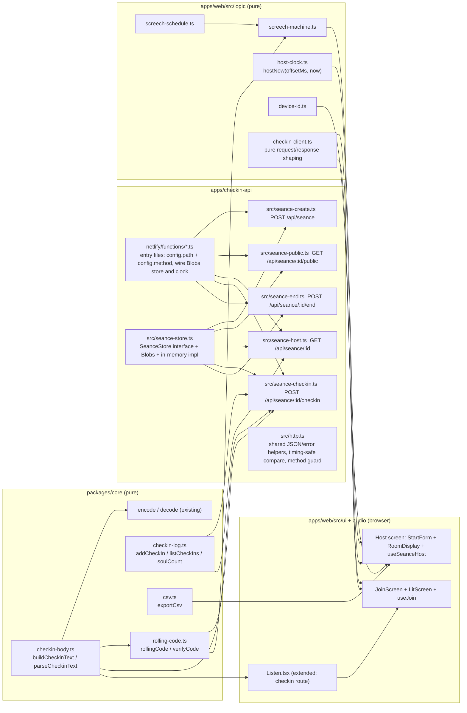
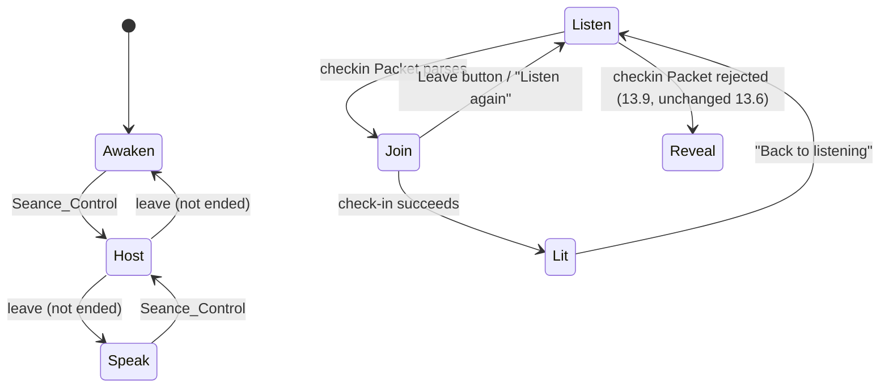

## Overview

Séance is presence check-in. A host opens a laptop (or any screen) to the Room_Display, which repeatedly screeches a `checkin` Packet containing a Session_ID and a time-based Rolling_Code. Attendees already have the app open on the Listen_Screen; when it decodes a `checkin` Packet it offers a Join_Screen showing the séance Title, and one tap records their name on the server. The Room_Display polls the server and lights a candle per check-in.

Séance adds no protocol type. It reuses the `checkin` Packet type, `SIZE_CAP`, `encode()` and `decode()` from `packages/core` (spec `screech-protocol`), and the screens, flow reducer, audio session, transmit path, Hold_State_Machine and wake-lock controller from `apps/web` (spec `spirit-box-app`). It is the first feature with a server component: `apps/checkin-api`, Netlify Functions in TypeScript, storing data in Netlify Blobs, served under `/api` on the same origin as `apps/web`.

The design follows the existing split in this codebase: all protocol, time-code and data-shape logic that has no side effect lives in `packages/core` as pure functions with fast-check property tests (`tech.md`). The Netlify Functions are thin handlers that call those pure functions and talk to Netlify Blobs; the React app is a thin UI over pure logic modules in `apps/web/src/logic`, following the pattern already used for Ghost Hunt (`beacon-machine.ts`, `hunt-route.ts`, `dedupe.ts`, …).

### Findings that shape the design

1. **The `checkin` Packet type, `SIZE_CAP` (140) and `encode()`/`decode()` already exist** (`packages/core/src/types.ts`, `codec.ts`). `encodeBody`/`decodeBody` already accept a `checkin` Payload as plain UTF-8 text with no compression (`text-body.ts` pattern, confirmed by reading `types.ts` and `codec.ts`). Séance adds one new module, `checkin-body.ts`, with the build/parse pair for the Checkin_Fields text, following the shape of `hunt-clue.ts` exactly (sanitize → validate → build text → `encode()`; and the strict-inverse parse pattern used by `parseClueText`).
2. **The Rolling_Code needs HMAC-SHA-256 and the design derives test vectors from an independent, from-scratch reference** rather than from `node:crypto`, since the pure `rollingCode` function in Core must use Web Crypto (`crypto.subtle`) and Core's static scan (`tests/static-scan.test.ts`) forbids `node:`, `require(`, `Buffer` and `process.` in `src/`, and restricts `crypto.subtle` to `seal.ts` today — this design extends that scan's allow-list to include `checkin-body.ts`'s sibling `rolling-code.ts`. I computed reference vectors below with a plain Python HMAC-SHA-256 and dynamic truncation (RFC 4226 §5.3), independent of any implementation in this repo (see "Rolling code test vectors").
3. **The screech-protocol `checkin` Payload already carries free text**, so the 15-byte `S1:<8 chars>:<6 digits>` text fits in one Packet with room to spare (`UNSEALED_OVERHEAD` + 15 bytes is far under 140).
4. **Netlify Blobs has an atomic, conditional write** (`store.set(key, value, { onlyIfNew: true })`, resolving `{ modified: false }` when the key already exists) — this is the mechanism requirement 17.3/17.5 and 8.8 need for "store under its own key, write only if it does not already exist" without a transaction or a lock (Netlify docs, "Netlify Blobs" — `getStore`, `set` with `onlyIfNew`).
5. **Netlify deploys every top-level file in the functions directory as its own function**, so the functions directory (`apps/checkin-api/netlify/functions/`) holds only thin entry files, one per endpoint. Each entry uses the Functions v2 format: a default export `(req: Request, context: Context)` and an `export const config = { path, method }` that routes the endpoint, with `:id` read from `context.params`. There are no `/api` redirects in `netlify.toml`. Handler logic, the store and the http helpers live in `apps/checkin-api/src/`. `netlify dev` serves `apps/web` and the functions from one origin, so relative `/api/...` fetches reach the functions locally (requirement 18.2–18.3). Requirement 18.1 is superseded on one point, see "Routing and `netlify.toml`".
6. **The existing screens never call a server.** `Listen.tsx` decodes locally and dispatches `received`/`huntReceived` into the flow reducer; there is no network hook anywhere in `apps/web`. Séance's Join_Screen and Host_Screen are the first screens to call `fetch`, so the design adds one small `checkin-client.ts` module (pure request/response shaping is unit-testable; the `fetch` call itself is mocked in tests, the same pattern the ghost-hunt design used for `localStorage`-backed `hunt-progress.ts`).
7. **The Hold_State_Machine (`hold-machine.ts`, `useHold`) is reused as-is** for the End_Hold, exactly like the Beacon's hold-to-stop key (`Beacon.tsx`'s `beacon-stop` button). No new hold logic is needed.
8. **The Screech_Loop needs its own small state machine**, because it differs from `beacon-machine.ts` in two ways: the interval is random *per screech* in a 10–15 s range (not 15–20 s) measured from *screech start* to *next screech start* (while Beacon measures start-to-start only when not re-queued; the same semantic actually holds in `beacon-machine.ts` already — Séance reuses `beaconStep`'s shape but with its own interval constants), and the host never leaves the page to go quiet on wake-lock loss (12.11 only shows a message, never pauses the loop). The design introduces `screech-schedule.ts` (interval constants) and reuses `beacon-machine.ts`'s `beaconStep` shape by introducing an identical, separately-named `screechStep` in `logic/screech-machine.ts` — kept separate from Beacon's module because Beacon is Ghost-Hunt-only and must not gain a Séance-only dependency, and because the host loop has no "quiet" concept (12.9–12.11 keep the loop running even when wake-lock is unavailable).
9. **Clock skew**: the host corrects its clock against the server's `Date` response header (assumption 5), a pure offset the Screech_Loop adds to `Date.now()` before computing the Window_Number — this needs no new Core function beyond `rollingCode`, just a pure `hostNow(offsetMs, nowMs)` helper in `apps/web`.
10. **In-memory `Seance_Store` double for handler tests**: `apps/checkin-api` defines a small `SeanceStore` interface (get/set/delete-by-expiry semantics already shaped by the Checkin_Log and the Blobs API) so the handlers take an injected store; tests use an in-memory `Map`-backed implementation and the real Netlify Blobs implementation is excluded from any test run (18.6).

## Architecture



### Screen flow

The Host_Screen is a new top-level route, opened from the Seance_Control on Awaken and Speak, the same way `Beacon` is opened from the URL fragment and `HuntSetup` is opened from the flow reducer's `openHuntSetup`. Unlike Beacon, the Host_Screen has no fragment route: it is reached only from an in-app control and resumes from `sessionStorage`, so it is modeled as a new `flow.screen` value plus its own small local state (title/session/secret), not folded into `FlowState`. This mirrors `hunt-setup`, which also joins the flow reducer because it is reached from Awaken and Speak.



The Join_Screen replaces the Reveal_Screen only for a `checkin` Packet that parses (amendment in the Introduction). It is modeled the same way `huntRoute` intercepts `hunt-clue` before `screenState` in `Listen.tsx`: a new `checkinRoute(result)` pure function is checked first, then `huntRoute`, then the existing `screenState`. `Listen.tsx` already composes two pure routers before falling back to `screenState`; Séance adds a third in the same chain.

### Why not fold Host state into `FlowState`

`FlowState` enforces the send/listen exclusion invariant for the Speak/Listen pair. The Host_Screen never transmits through the Speak path and never opens the mic, so adding Host fields to `FlowState` would force every other flow transition to reason about a state it cannot affect. Instead, `flow.screen` gains one value (`'seance-host'`), and `App.tsx` renders a `SeanceHost` component that owns its own `useSeanceHost()` hook (title, session, secret, loop, poll), the same separation `Beacon`/`useBeacon` already use for a loop that is orthogonal to `FlowState`.

## Components and Interfaces

### `packages/core/src/checkin-body.ts`

```ts
export interface CheckinFields {
  readonly sessionId: string;   // exactly 8 chars, Hunt_Alphabet
  readonly code: string;        // exactly 6 digits, '0'..'9', leading zeros kept
}
export type CheckinFieldsInput = { readonly [K in keyof CheckinFields]: unknown };

export const CHECKIN_PREFIX = 'S1';
export const SESSION_ID_LENGTH = 8;
export const ROLLING_CODE_LENGTH = 6;

export function validateCheckinFields(input: CheckinFieldsInput): Result<CheckinFields>;
export function buildCheckinText(fields: CheckinFields): string; // "S1:<id>:<code>"
export function buildCheckin(input: CheckinFieldsInput): Result<Uint8Array>; // validate -> text -> encode()
export function parseCheckinText(text: unknown): Result<CheckinFields>; // strict inverse
```

Session_ID reuses `HUNT_ALPHABET` exported from `hunt-clue.ts` (already public from `index.ts`) rather than redefining the 31-character set, so the two specs cannot drift. `validateCheckinFields` checks Session_ID, then Rolling_Code (order fixed by 1.6), mirroring `validateClueFields`'s fixed check order. `parseCheckinText` checks prefix, Session_ID, Rolling_Code, then extra characters, in that order (1.5), mirroring `parseClueText`'s canonical-form re-check (it rebuilds the text from parsed fields and rejects on mismatch, which also catches a trailing `:` or extra trailing characters that a naive split would silently drop).

### `packages/core/src/rolling-code.ts`

```ts
export const WINDOW_SECONDS = 30;
export function windowNumber(unixSeconds: number): number; // floor(unixSeconds / WINDOW_SECONDS), Core-internal helper
export function rollingCode(secret: Uint8Array, windowNumber: number): Promise<string>; // 6 digits, Web Crypto HMAC-SHA-256
export function verifyCode(secret: Uint8Array, code: string, nowSeconds: number): Promise<boolean>;
```

`rollingCode` is `async` because it uses `crypto.subtle.sign('HMAC', ...)`, following `seal.ts`'s existing pattern of async Web-Crypto functions in Core (`seal`/`open` are already `async`). `windowNumber` is a separate exported pure sync helper so the Checkin_API and the browser Screech_Loop can both compute "the window that contains time T" without re-deriving the formula, and so property tests can generate windows directly. Dynamic truncation: HMAC-SHA-256 digest `h` (32 bytes), offset `o = h[31] & 0x0f`, `value = ((h[o] & 0x7f) << 24 | h[o+1] << 16 | h[o+2] << 8 | h[o+3]) >>> 0`, code = `String(value % 1_000_000).padStart(6, '0')` — this is RFC 4226 §5.3 dynamic truncation applied to a SHA-256 HMAC instead of SHA-1, keyed by the Host_Secret, with the HMAC message the decimal text of the Window_Number (assumption 3). `verifyCode` accepts the code of the current Window or the one immediately before it (2.5–2.9); it computes both and does a plain `===` (no secret byte comparison here — timing safety for the Rolling_Code is not security-critical the way the Host_Secret comparison is, since a leaked code is only valid for ≤60 seconds and reveals nothing about the Host_Secret).

#### Rolling code test vectors

Computed independently in this design with a plain Python `hmac`/`hashlib` script (not Node, not this repo's code), to seed Requirement 2.10's "at least 5 vectors … derived from a reference HMAC-SHA-256 implementation":

| Secret (32 bytes) | Window_Number | Rolling_Code |
|---|---|---|
| all zero bytes | 0 | `919345` |
| all zero bytes | 1 | `259693` |
| all zero bytes | `9007199254740991` (2^53 − 1) | `907326` |
| all `0xff` bytes | `57000000` | `063422` |
| ASCII `"12345678901234567890123456789012"` | 2 | `648140` |
| all `0x08` bytes | 0 | `084520` (leading zero) |
| all `0x3f` bytes | 0 | `044471` (leading zero) |

The last two rows were found by scanning single-byte-repeated 32-byte secrets for a code starting with `0` against Window_Number 0, satisfying 2.10's "at least 5 vectors that include a Window_Number of 0 and a Rolling_Code that begins with a leading zero" (two such vectors are included; the task-writing phase should keep at least one). The implementation task for `rolling-code.ts` and its unit test MUST reproduce this table with the Core implementation and fail loudly on any mismatch; these are fixed example-based unit tests, not generated by property tests, since property tests check relationships (determinism, neighbouring-window difference) rather than absolute values.

### `packages/core/src/checkin-log.ts`

```ts
export interface CheckIn {
  readonly name: string;       // trimmed Attendee_Name, 1..32 code points
  readonly deviceId: string;   // 32 lowercase hex chars
  readonly at: string;         // UTC ISO 8601, e.g. 2026-10-31T23:04:05.123Z
}
export interface CheckinLog {
  readonly byDevice: ReadonlyMap<string, CheckIn>;
  readonly order: readonly string[]; // deviceIds in insertion order, for stable tie-break (3.6)
}
export const EMPTY_CHECKIN_LOG: CheckinLog;
export interface AddResult {
  readonly log: CheckinLog;
  readonly checkIn: CheckIn;     // the stored one (new, or the pre-existing one on a repeat)
  readonly isNew: boolean;
}
export function addCheckIn(log: CheckinLog, checkIn: CheckIn): AddResult;
export function listCheckIns(log: CheckinLog): readonly CheckIn[]; // sorted by `at`, ties by insertion order
export function soulCount(log: CheckinLog): number;
```

`CheckinLog` is an immutable value (map + order array), matching the immutable-state style of `beacon-machine.ts`/`hunt-found.ts`. The Checkin_API does not keep this whole structure in Blobs (see Data Models below); it is the pure data structure the design, the property tests, and the Room_Display's incremental "light the next candle" logic (11.3) all share — the Room_Display keeps its own `CheckinLog` built from each poll response, append-only in display order, so it can detect "not yet on the Candle_Circle" by diffing against the previous poll's device IDs.

### `packages/core/src/csv.ts`

```ts
export function exportCsv(checkIns: readonly CheckIn[]): string;
```

Header `name,checked_in_at`, CRLF-separated, RFC 4180 quoting, formula-injection guard (prepend `'` for names starting with `=`, `+`, `-`, `@`, tab or CR — OWASP's documented CSV-injection mitigation — then apply quoting), no trailing CRLF, matching Requirement 4 exactly.

### `apps/checkin-api`

```
apps/checkin-api/
  netlify/
    functions/            // ONLY entry files: Netlify deploys each top-level file here as a function
      seance-create.ts    // config = { path: '/api/seance', method: 'POST' }
      seance-public.ts    // config = { path: '/api/seance/:id/public', method: 'GET' }
      seance-host.ts      // config = { path: '/api/seance/:id', method: 'GET' }
      seance-checkin.ts   // config = { path: '/api/seance/:id/checkin', method: 'POST' }
      seance-end.ts       // config = { path: '/api/seance/:id/end', method: 'POST' }
      seance-cleanup.ts   // config = { schedule: '@hourly' }
  src/                    // handler logic, store and helpers; never deployed as functions
    http.ts            // json(), error(), CACHE_CONTROL_NO_STORE, timingSafeEqual(), methodGuard()
    seance-store.ts     // SeanceStore interface, createBlobsStore(), createMemoryStore()
    seance.ts           // Seance/StoredCheckIn types, key helpers, expiry check
    seance-create.ts    // handleCreate(req, deps)
    seance-public.ts     // handlePublic(req, id, deps)
    seance-host.ts       // handleHost(req, id, deps)
    seance-checkin.ts    // handleCheckin(req, id, deps)
    seance-end.ts         // handleEnd(req, id, deps)
    seance-cleanup.ts     // runCleanup(deps)
  tests/
    seance-create.test.ts
    seance-public.test.ts
    seance-host.test.ts
    seance-checkin.test.ts
    seance-end.test.ts
    seance-store-memory.test.ts
    seance-cleanup.test.ts
    entry-config.test.ts
  README.md
  package.json
  tsconfig.json
  vitest.config.ts
```

#### Entry files and routing

Each entry file imports its handler from `../../src/`, builds the real dependencies (`createBlobsStore()` and `() => Date.now()`), and delegates. It holds no logic of its own:

```ts
// apps/checkin-api/netlify/functions/seance-checkin.ts
import type { Context, Config } from '@netlify/functions';
import { handleCheckin } from '../../src/seance-checkin';
import { createBlobsStore } from '../../src/seance-store';

export default async (req: Request, context: Context): Promise<Response> =>
  handleCheckin(req, context.params.id, { store: createBlobsStore(), now: () => Date.now() });

export const config: Config = { path: '/api/seance/:id/checkin', method: 'POST' };
```

| Entry file | `config.path` | `config.method` |
|---|---|---|
| `seance-create.ts` | `/api/seance` | `POST` |
| `seance-public.ts` | `/api/seance/:id/public` | `GET` |
| `seance-host.ts` | `/api/seance/:id` | `GET` |
| `seance-checkin.ts` | `/api/seance/:id/checkin` | `POST` |
| `seance-end.ts` | `/api/seance/:id/end` | `POST` |
| `seance-cleanup.ts` | none (scheduled) | `config = { schedule: '@hourly' }` |

The five paths do not overlap, because `:id` matches one path segment. `seance-create.ts` ignores `context.params`. The other four read `:id` from `context.params.id` and pass it to the handler, which re-validates it as a Session_ID (requirement 6.4) before any store access.

**405 and `Allow` (requirement 17.11).** Two layers cooperate:
1. `config.method` is the routing allow-list. Netlify sends only the listed method to that function for that path, so the platform never runs a handler for a method the endpoint does not support.
2. Every handler begins with `methodGuard(ALLOWED, req.method)` from `src/http.ts`. `ALLOWED` is a constant next to the handler (for example `['POST']`), and it is the same value as the entry's `config.method`. For any other method the guard returns 405 with `Allow: <ALLOWED joined by ", ">` and `Cache-Control: no-store` before reading the body or touching the store.

The 405 response itself comes only from the handler-level guard. Netlify's response to a method that `config.method` excludes is outside this code, and I have not verified it, so requirement 17.11 is tested at the handler level (see Testing Strategy) and `entry-config.test.ts` asserts that each entry's `config.method` equals its handler's `ALLOWED`, so the two layers cannot drift.

#### Routing and `netlify.toml`

Routing is declared only by each function's `config.path`. `netlify.toml` has no `[[redirects]]` for `/api/*`. **Requirement 18.1 is superseded on this point:** it says `netlify.toml` maps every `/api/` path to the functions, and the design routes through `config.path` instead. The rest of 18.1 (build, publish, functions location) still holds.

```toml
[build]
  command = "pnpm --filter @screech/core build && pnpm --filter @screech/web build"
  publish = "apps/web/dist"
  functions = "apps/checkin-api/netlify/functions"

[functions]
  node_bundler = "esbuild"

[build.environment]
  NODE_VERSION = "22"

[dev]
  framework = "#custom"
  command = "pnpm --filter @screech/web dev"
  targetPort = 5173
  port = 8888
```

`apps/checkin-api/package.json` declares dependencies `@netlify/blobs` and `@netlify/functions`, plus `"@screech/core": "workspace:*"`. The core build runs first because the functions and the web app import `@screech/core`, and esbuild bundles it into each function.

#### Local development on phones

Phones need HTTPS for the microphone, so the laptop is exposed through a tunnel. `apps/web/vite.config.ts` loads `@vitejs/plugin-basic-ssl` today, and its self-signed certificate on port 5173 clashes with the `netlify dev` proxy, which forwards to `targetPort` over plain HTTP. The config therefore loads the plugin only when `process.env.NETLIFY_DEV` is not set:

```ts
const plugins = [react(), ...(process.env.NETLIFY_DEV ? [] : [basicSsl()])];
```

Plain `pnpm --filter @screech/web dev` keeps its current HTTPS behaviour. Under `netlify dev` (which sets `NETLIFY_DEV`), Vite serves plain HTTP on 5173 and Netlify serves one origin on 8888. `apps/checkin-api/README.md` documents these steps:
1. Run `netlify dev` from the repository root.
2. Run `cloudflared tunnel --url http://localhost:8888`.
3. Open the printed tunnel URL (HTTPS) on the laptop and on the phones. The laptop uses the Host_Screen and the phones use the Listen_Screen, all on the same origin, so `/api/` requests need no CORS.

`SeanceStore` interface (the "in-memory `Seance_Store` double" from the findings):

```ts
export interface StoredSeance {
  readonly sessionId: string;
  readonly title: string;
  readonly hostSecret: string;     // 43 base64url chars
  readonly createdAt: string;      // ISO 8601
  readonly ended: boolean;
}
export interface StoredCheckIn extends CheckIn {}

export interface SeanceStore {
  createSeance(seance: StoredSeance): Promise<void>; // sessionId assumed unique by caller's retry loop
  getSeance(sessionId: string): Promise<StoredSeance | null>; // null if missing or 24h+ old
  endSeance(sessionId: string): Promise<void>;
  /** Atomic: resolves `{ added: true, checkIn }` only if this (sessionId, deviceId) key was not already present. */
  addCheckIn(sessionId: string, deviceId: string, checkIn: StoredCheckIn): Promise<{ added: boolean; checkIn: StoredCheckIn }>;
  listCheckIns(sessionId: string): Promise<readonly StoredCheckIn[]>;
}
```

- `createBlobsStore()`: one Netlify Blobs store named `seance-sessions`, keyed by `session:<sessionId>` holding the `StoredSeance` JSON (`setJSON`/`getJSON`), and a second store `seance-checkins`, keyed by `checkin:<sessionId>:<deviceId>` holding one `StoredCheckIn` each. `addCheckIn` calls `store.setJSON(key, checkIn, { onlyIfNew: true })`; the `{ modified: false }` result (key already existed) maps to `{ added: false, checkIn: <value read back with getJSON> }`, giving the exact atomicity Requirement 17.3–17.5 and 8.8/8.9 need without a lock — this directly implements finding 4. `listCheckIns` lists blobs with the `checkin:<sessionId>:` prefix (Blobs `store.list({ prefix })`) and reads each; this keeps one check-in per device as its own object rather than one growing JSON blob per séance, so concurrent check-ins from different devices (8.9, 17.4) never race on the same key — only same-device repeats contend, and that contention is exactly what `onlyIfNew` resolves.
- `createMemoryStore()`: two `Map`s mirroring the same key shapes, `addCheckIn` implemented with a single `has`/`set` check (synchronous Maps make the "only if new" check inherently atomic within one Node event-loop turn, which is all a unit test needs). Used by every handler test; `apps/checkin-api/tests/*.test.ts` import only `createMemoryStore`, never `createBlobsStore`, satisfying 18.6 (zero network calls, zero real-store access).
- Expiry (24 hours, 5.7–5.8, 17.6): `getSeance` compares `createdAt` against the caller-supplied "now" (injected, not `Date.now()`, so tests control it) and returns `null` for an Expired_Seance without deleting it immediately; deletion within 1 hour of expiry (17.6) is a scheduled Netlify Function (entry `netlify/functions/seance-cleanup.ts` with `config = { schedule: '@hourly' }`, logic in `src/seance-cleanup.ts`) that lists all `session:*` keys and deletes the expired ones and their check-ins. Ended séances that are not yet 24 hours old are kept, because 9.5 requires their check-ins to stay readable. This keeps every request handler's expiry check a pure "is this old" comparison, and makes cleanup an operational concern that cannot affect request latency or correctness (a request for an expired-but-not-yet-deleted record still gets treated as missing by `getSeance`).

`http.ts`:
- `timingSafeEqual(a: string, b: string): boolean` — compares the full length always (pads the shorter to the longer's length with a constant before comparing byte-by-byte, so comparison time depends only on the longer string's length, never on the position of the first mismatch), giving 7.6's constant-time Host_Secret check without `node:crypto.timingSafeEqual` (Functions run on Node, but Core's "no `node:`" ban is `packages/core`-only; `apps/checkin-api` may use `node:crypto` freely — this design still writes a dependency-free version since the comparison is this simple and it keeps one fewer import to audit).
- `json(status, body)` always sets `Content-Type: application/json` and `Cache-Control: no-store` (17.8, 6.5).
- `methodGuard(allowed, method)` returns a 405 + `Allow` response when the method is not in `allowed` (17.11). See "Entry files and routing" for how it pairs with each entry's `config.method`.
- `readJsonBody(req, maxBytes = 2048)` rejects with a 413-shaped error before parsing when `Content-Length` exceeds 2048 or the body size read exceeds it while streaming (19.7), and returns a 400-shaped error on invalid JSON without touching the store (5.6, 19.8).

### `apps/web/src/logic/screech-schedule.ts`

```ts
export const SCREECH_MIN_MS = 10000;
export const SCREECH_MAX_MS = 15000;
export function screechInterval(random: number): number; // same shape as beaconInterval, 10..15s
```

### `apps/web/src/logic/screech-machine.ts`

Same state shape and transition table as `beacon-machine.ts` (`stopped` / `running{ nextDueAt, playing }`), built independently for Séance (finding 8) and driven by `screechInterval` instead of `beaconInterval`. No `quiet` field: 12.11 says a wake-lock failure only shows a message and the loop keeps running, so there is nothing to gate on. A `contextFailed` event still exists, to cover "the browser blocks audio playback" (12.13), and resumes on the next successful screech attempt rather than needing a `wakeSucceeded` event (there is no explicit host "tap to wake the beacon" gesture required before resuming — the Room_Display's "Tap here to wake the sound" tap just calls `ensureRunning()`/`unlockAudio()` then lets the loop's next tick try again).

### `apps/web/src/logic/host-clock.ts`

```ts
export function parseDateHeader(value: string | null): number | null; // epoch ms, or null if unparseable
export function clockOffsetMs(serverDateMs: number, localNowMs: number): number; // serverDateMs - localNowMs
export function correctedNowSeconds(offsetMs: number, localNowMs: number): number; // Math.floor((localNowMs + offsetMs) / 1000)
```

Pure arithmetic only; the `fetch` call that reads the `Date` header lives in `checkin-client.ts` / `useSeanceHost`.

### `apps/web/src/logic/device-id.ts`

```ts
export function isDeviceId(value: unknown): value is string; // 32 lowercase hex chars
export function randomDeviceId(randomBytes: (n: number) => Uint8Array): string; // 16 bytes -> 32 hex chars
```

`randomDeviceId` takes an injected byte source (`crypto.getRandomValues`-backed in the real hook, a seeded fake in tests), following the pattern Core's `sender-state.ts` already uses for `RandomFill`.

### `apps/web/src/logic/checkin-client.ts`

Pure request/response *shaping* only (building request bodies, parsing/validating response JSON shapes, mapping an HTTP status to one of the plain-word messages from Requirements 16); the actual `fetch` calls are made by the hooks below, which take a `fetch`-like function as a dependency (mirroring `BeaconDeps` injection in `useBeacon.ts`).

```ts
export type ApiOutcome<T> =
  | { readonly kind: 'ok'; readonly value: T }
  | { readonly kind: 'http-error'; readonly status: number; readonly body: unknown }
  | { readonly kind: 'network-error' }
  | { readonly kind: 'timeout' };

export function parseCreateResponse(status: number, body: unknown): ApiOutcome<{ sessionId: string; title: string; hostSecret: string }>;
export function parsePublicResponse(status: number, body: unknown): ApiOutcome<{ title: string; open: boolean }>;
export function parseHostResponse(status: number, body: unknown): ApiOutcome<{ title: string; open: boolean; checkIns: readonly { name: string; at: string }[] }>;
export function parseCheckinResponse(status: number, body: unknown): ApiOutcome<{ name: string; at: string; alreadyCheckedIn: boolean }>;
export function parseEndResponse(status: number, body: unknown): ApiOutcome<{ count: number }>;

export function joinErrorMessage(outcome: ApiOutcome<unknown>): string; // 16.1, 16.3–16.9 mapping
```

### `apps/web/src/ui` additions

- `screens/SeanceHost.tsx` + `ui/hooks/useSeanceHost.ts`: Start_Form / Room_Display, screech loop, poll loop, End_Hold, wake lock, CSV download. `useSeanceHost` composes `screech-machine.ts`, `host-clock.ts`, `checkin-client.ts`, `wake-lock.ts` (reused as-is), `useHold` (reused as-is), and the existing `playWaveform`/`loadEngine`/`unlockAudio` audio primitives — no new audio code, per the Introduction.
- `screens/Join.tsx` + `ui/hooks/useJoin.ts`: Join_Screen / Lit_Screen, name field, device ID, retry logic.
- `logic/checkin-route.ts`: `checkinRoute(result: Result<DecodedPacket>): { kind: 'none' } | { kind: 'checkin'; fields: CheckinFields }`, checked in `Listen.tsx` before `huntRoute`, same shape as `huntRoute`.
- `components/CandleCircle.tsx`, `components/SeanceControl.tsx` (the control shown on Awaken/Speak): presentation only, styled per `ui-theme`.

`flow.ts` gains one `Screen` value, `'seance-host'`, and two events, `openSeanceHost` / `closeSeanceHost`, following the exact shape of `openHuntSetup`/`closeHuntSetup` (open from `awaken` or `speak` only, blocked while transmitting or listening, returns to the screen it was opened from). The Join/Lit screens do **not** join `FlowState`: like the `already`-clue Already_Note, they are reached and left entirely inside `Listen.tsx`'s own local state, because (13.1) entering Join_Screen already performs the existing "stop capture" side effect that `received` normally performs, and (13.10, 13.12) repeated/duplicate checkin Packets must update Join/Lit state without re-triggering flow transitions — exactly the reasoning the ghost-hunt design gave for keeping `already`-clue handling local to `Listen.tsx` rather than in the flow reducer.

## Data Models

### Core (in-memory, pure)

```ts
// checkin-body.ts
interface CheckinFields { sessionId: string; code: string }

// checkin-log.ts
interface CheckIn { name: string; deviceId: string; at: string }
interface CheckinLog { byDevice: ReadonlyMap<string, CheckIn>; order: readonly string[] }
```

### Netlify Blobs (`apps/checkin-api`)

| Store | Key | Value (JSON) | Written by | Read by |
|---|---|---|---|---|
| `seance-sessions` | `session:<sessionId>` | `{ sessionId, title, hostSecret, createdAt, ended }` | create, end | public, host, checkin, end, cleanup |
| `seance-checkins` | `checkin:<sessionId>:<deviceId>` | `{ name, deviceId, at }` | checkin (via `onlyIfNew`) | host, checkin (repeat lookup), cleanup |

Rationale for one object per check-in rather than one array per séance: Blobs' only atomic primitive is per-key `onlyIfNew`/`onlyIfMatch`; a single array value would need a read-modify-write per check-in and could lose a concurrent write from a second device (violates 8.9/17.4). One key per `(sessionId, deviceId)` makes "first writer for this device wins" a single `set` call, and `listCheckIns` is `store.list({ prefix: "checkin:<sessionId>:" })` + N `get`s — acceptable because a séance has at most a few hundred check-ins (10.1/Candle_Circle capacity note) and the Room_Display only polls every 2 seconds (11.6).

No Device_ID, IP address or other field is ever stored beyond what Requirement 19.1–19.2 lists; the Checkin_API's request-shape validators reject any extra unexpected top-level field the same way they reject a missing one (19.8), so there is one validation step per endpoint, not an allow-list applied after storage.

### Wire format (unchanged Packet, new text layout)

`checkin` Payload text: `S1:<8-char Session_ID>:<6-digit Rolling_Code>` — 15 bytes, well under the 140-byte `SIZE_CAP`.

### Browser storage

| Where | Key | Value | Written | Notes |
|---|---|---|---|---|
| `sessionStorage` | `seance.host` | `{ sessionId, title, hostSecret }` JSON | on create success | cleared on end / on 404 resume (10.6, 10.11) |
| `localStorage` | `seance.deviceId` | 32 lowercase hex chars | once, lazily | shared with no other feature (19.6) |
| `localStorage` | `seance.lastName` | last successful Attendee_Name | on check-in success | prefill only (14.1) |

## Correctness Properties

*A property is a characteristic or behavior that should hold true across all valid executions of a system—essentially, a formal statement about what the system should do. Properties serve as the bridge between human-readable specifications and machine-verifiable correctness guarantees.*

### Reflection on redundant properties

Several prework items point at the same underlying property and are merged below:

- 1.2 (size cap) is a direct corollary of the fixed-length text produced by 1.1/1.4, so it is folded into Property 1 rather than stated separately.
- 1.3 is the "parse direction" half of the round trip in 1.4; merged into Property 2.
- 2.5, 2.6, 2.7 are exactly the single "acceptance-set" property the requirements already name in 2.9; merged into Property 6.
- 3.1 and 3.2 are both consequences of the general dedupe invariant (3.3) and the first-write-wins rule (3.5); the add-grows-by-one and add-is-a-no-op-on-repeat behaviors are kept as two sides of Property 9 (the invariant), rather than four separate properties.
- 3.7 (`soulCount` equals length) is folded into Property 9 as a trailing clause, since it is a one-line corollary of the same invariant.
- 4.1, 4.2, 4.4, 4.7 (literal header text, CRLF, no trailing CRLF, header-only-when-empty) are fixed-format claims with no varying input and are covered by unit tests, not a property; 4.3 and 4.5 (quoting and the injection guard) are only meaningfully checked by seeing them survive a round trip, so they are folded into the round-trip property (Property 10) rather than stated on their own.
- Requirement 5's "shape of generated Session_ID/Host_Secret" and Requirement 8/17's "ignore client-supplied time" and "exactly one new check-in under concurrent same-device requests" are kept as separate properties (11, 12, 13) because they test different functions (ID generation vs. the check-in handler) even though all three sit under the general heading of server behavior.

### Property 1: Checkin_Builder produces a fixed, size-capped layout

For any Session_ID of exactly 8 Hunt_Alphabet characters and any Rolling_Code of exactly 6 decimal digits, `buildCheckinText` returns the text `S1:<Session_ID>:<Rolling_Code>`, and `buildCheckin` on the same fields returns a Checkin_Packet that is a `checkin`-type Packet of at most `SIZE_CAP` (140) bytes.

**Validates: Requirements 1.1, 1.2**

### Property 2: Build/encode/decode/parse round trip

For any valid Checkin_Fields, building a Checkin_Packet with `buildCheckin`, decoding it with Core `decode()`, and parsing the decoded payload text with `parseCheckinText` returns Checkin_Fields deep-equal to the original, including any leading zeros in the Rolling_Code.

**Validates: Requirements 1.3, 1.4**

### Property 3: Parser rejects every malformed text, and only malformed text

For any string that is not exactly the canonical form `S1:<8 Hunt_Alphabet chars>:<6 digits>` (generated by independently corrupting a valid instance: wrong prefix, wrong-length or wrong-alphabet Session_ID, wrong-length or non-digit Rolling_Code, missing separator, or any extra leading/trailing character including whitespace or a trailing `:`), `parseCheckinText` returns an error and no Checkin_Fields.

**Validates: Requirements 1.5**

### Property 4: Builder rejects every malformed field, and only malformed fields

For any input where the Session_ID is not exactly 8 Hunt_Alphabet characters, or the Rolling_Code is not exactly 6 decimal digits (including empty, `null`, `undefined`, or a non-string value for either field), `validateCheckinFields` and `buildCheckin` return an error and never a Checkin_Fields value or a Packet.

**Validates: Requirements 1.6**

### Property 5: Parser totality

For any string, including the empty string and strings of 10,000 characters or more, `parseCheckinText` returns a `Result` (either Checkin_Fields or an error) and never throws.

**Validates: Requirements 1.7**

### Property 6: Rolling-code shape, determinism and window behavior

For any Host_Secret and any Window_Number that is an integer from 0 to 2^53 − 1: (a) `rollingCode` returns a string of exactly 6 decimal digits, including leading zeros; (b) calling `rollingCode` twice with the same inputs returns the same code; (c) `rollingCode` returns the same code for every time value that falls inside the Window that Window_Number names, and a different code for every time value in the immediately following Window, except for the acknowledged 1-in-1,000,000 chance of a genuine collision between neighbouring windows (see Testing Strategy for how the test handles this).

**Validates: Requirements 2.1, 2.2, 2.3, 2.4**

### Property 7: Code_Verifier totality on malformed input

For any value for `code` that is not exactly 6 characters each in `"0"`–`"9"`, and for any value for the time argument that is negative, not finite, or not a number, `verifyCode` returns `false` and never throws.

**Validates: Requirements 2.8, 2.11**

### Property 8: Code_Verifier acceptance set

For any Host_Secret and any time in seconds, `verifyCode` returns `true` for the Rolling_Code of the Window that contains that time and for the Rolling_Code of the Window immediately before it, and returns `false` for the Rolling_Code of the Window two before it and for the Rolling_Code of the Window immediately after it, whenever those two rejected codes differ from the two accepted codes (see Testing Strategy for the same collision caveat as Property 6).

**Validates: Requirements 2.5, 2.6, 2.7, 2.9**

### Property 9: Checkin_Log dedupe invariant and first-write-wins

For any sequence of 0 to 1,000 Check_Ins folded through `addCheckIn`: the resulting Checkin_Log holds at most one Check_In per Device_ID, its length (and `soulCount`) equals the number of distinct Device_IDs in the sequence, each adding of a not-yet-seen Device_ID is reported as new and increases the length by exactly 1, each adding of an already-seen Device_ID is reported as a repeat and leaves the log unchanged, and the stored name and time for each Device_ID equal those of the *first* Check_In in the sequence with that Device_ID, regardless of what any later Check_In with the same Device_ID carries.

**Validates: Requirements 3.1, 3.2, 3.3, 3.5, 3.7**

### Property 10: Replaying a sequence is a no-op

For any sequence of 0 to 1,000 Check_Ins, folding the sequence through `addCheckIn` twice in a row leaves the Checkin_Log after the second pass identical to the log after the first pass, and every Check_In in the second pass is reported as a repeat.

**Validates: Requirements 3.4**

### Property 11: Checkin_Log ordering

For any Checkin_Log, `listCheckIns` returns the Check_Ins sorted in ascending order of `at`, with Check_Ins of equal `at` kept in the order they were added, and returns an empty list for an empty log.

**Validates: Requirements 3.6**

### Property 12: CSV export round trip

For any list of 0 to 500 Check_Ins with Attendee_Names of 1 to 32 characters (including names containing commas, double quotes, CR, LF, and names starting with `=`, `+`, `-`, `@`, a tab, or a CR), parsing the output of `exportCsv` with an RFC 4180 reader returns exactly one record per Check_In, in the same order, plus the header record, and each name field equals the original Attendee_Name except for the single leading quote the injection guard adds when the original name started with one of the six guarded characters.

**Validates: Requirements 4.3, 4.5, 4.6**

### Property 13: Candle_Circle split preserves order and count

For any list of Check_Ins of any length, the pure `splitCandles` helper (first 100 for the Candle_Circle, the remainder for the scrolling list) returns two lists whose concatenation equals the original list in the same order, and whose combined length equals the original length.

**Validates: Requirements 11.10**

### Property 14: Screech interval stays in range

For any number in `[0, 1)`, `screechInterval` returns a value that is an integer number of milliseconds in the inclusive range 10,000 to 15,000, and for any other input (`NaN`, `Infinity`, negative, 1 or more, non-number) it returns `SCREECH_MIN_MS`.

**Validates: Requirements 12.2**

### Property 15: `checkinRoute` total classification

For any `Result<DecodedPacket>` value, `checkinRoute` returns `{ kind: 'checkin', fields }` if and only if the value is a successful, non-multipart decode of a `checkin`-type Packet whose payload text `parseCheckinText` accepts, and returns `{ kind: 'none' }` for every other input, including malformed `Result` shapes, without throwing.

**Validates: Requirements 13.1**

### Property 16: Attendee-name validation

For any string, `validateAttendeeName` returns the trimmed string if and only if, after trimming leading and trailing whitespace, it has 1 to 32 Unicode code points, and otherwise returns a rejection, for every string including ones built entirely of combining marks, surrogate pairs, or whitespace.

**Validates: Requirements 14.2, 14.3**

### Property 17: Join-error message mapping never leaks internals

For any `ApiOutcome` value (every HTTP status bucket from Requirement 16, a network error, and a timeout), `joinErrorMessage` returns one of the fixed plain-word messages from Requirements 16.1–16.8, and the returned string never contains a 3-digit HTTP status code, the word `Error`, or a stack trace fragment such as `.ts:` or `at `.

**Validates: Requirements 16.9**

### Property 18: Check-in handler ignores client-supplied time

For any valid check-in request and any value the request body supplies for a time-like field, the handler's stored `at` and the time it feeds to `verifyCode` are both taken from the injected server clock and are independent of the request body's value, for any server-clock value and any request-body time value chosen independently.

**Validates: Requirements 8.10**

### Property 19: Concurrent same-device check-ins resolve to exactly one new record

For any number from 1 to 20 of simultaneously issued check-in requests carrying the same Session_ID, the same Device_ID and valid names/codes, resolved against a shared `SeanceStore` double, exactly one of them is answered with `alreadyCheckedIn: false`, the rest are answered with `alreadyCheckedIn: true` and the same stored name and time as the one that was new, and the store holds exactly one Check_In for that Device_ID afterward.

**Validates: Requirements 8.8, 17.3, 17.5**

### Property 20: Ending a séance is idempotent

For any stored Seance with any number of Check_Ins, calling the end handler twice with the correct Host_Secret returns the same Check_In count both times, and the Seance's `ended` flag and stored Check_Ins are identical after the second call to what they were after the first.

**Validates: Requirements 9.2**

## Error Handling

**Core (`packages/core`)**: every new function returns the existing `Result<T>` type and never throws, following the pattern already enforced by `codec.ts`, `hunt-clue.ts` and the `static-scan.test.ts` checks. `rollingCode`/`verifyCode` add one new failure mode — `crypto.subtle` being unavailable — handled the same way `seal.ts` already handles it (`cryptoUnavailable()` returning a `Result` error rather than throwing); `verifyCode` additionally treats a Web-Crypto failure the same as "code rejected" (returns `false`), since a verifier has no error channel in its signature (Requirement 2 only ever asks for `true`/`false`).

**Checkin_API handlers**: every handler follows the same four-stage shape: (1) method guard (405 + `Allow`), (2) request-size guard (413 before any parse), (3) field validation (400, naming the invalid field, before any store access — Requirement 19.8/19.9), (4) store operation, then map the store result to the documented status code. A caught unexpected error at any stage answers 500 with a JSON body holding only a fixed message string, never an exception message, a stack trace, or a value read from the store (17.10). The Host_Secret comparison always runs through `timingSafeEqual`, and a missing, malformed, or wrong Host_Secret is answered with exactly the same status and body as a missing Seance (6.3/7.5/9.3), computed by routing both cases through one `seanceNotFound()` helper so the two paths cannot drift.

**Netlify Blobs failures** (the store throwing, e.g. a transient network error between the Function and Blobs) are caught at the `SeanceStore` implementation boundary and re-thrown as a typed `StoreUnavailableError`; every handler catches that specific error and answers 500 with the same fixed-message body as any other unexpected error, so a Blobs outage never reaches the client as a raw error or as a stack trace.

**Browser (`apps/web`)**: every `fetch` call made by `useSeanceHost`/`useJoin` is wrapped with an AbortController-based timeout (10 seconds for create/public/checkin, 5 seconds for each poll, matching the requirements) and a `try`/`catch`; `checkin-client.ts`'s `parse*Response` functions classify the outcome (`ok` / `http-error` / `network-error` / `timeout`) without throwing, and `joinErrorMessage`/the Room_Display's own status-to-message mapping render only the fixed plain-word strings from Requirements 10, 11, 12 and 16 — raw status codes, exception messages and stack traces never reach JSX, matching the existing convention in `Listen.tsx`/`Beacon.tsx` where every shown string is a constant or built from constants.

## Testing Strategy

**Dual approach.** Unit tests cover fixed examples, status-code branches, and boundary/edge cases (name length 0/1/32/33, title length 0/1/60/61, the fixed HMAC test vectors). Property tests (fast-check, already a dependency of both `packages/core` and `apps/web`) cover the 20 universal properties above, each configured for a minimum of 100 runs via the existing `NUM_RUNS` constant pattern (`packages/core/tests/helpers.ts`) and tagged in a comment as **Feature: seance, Property N: \<property text\>**, exactly as `packages/core/tests/hunt-clue.property.test.ts` already tags its tests for the ghost-hunt spec.

**Collision handling for Properties 6 and 8.** A 6-digit decimal code collides between two specific windows with probability 1 in 1,000,000. To keep the property deterministic rather than a 1-in-a-million flake: the test computes both codes being compared and, in the rare case they are equal, either (a) re-draws a fresh random Window_Number/secret pair for that run via fast-check's `filter`, or (b) when the arbitrary is `fc.integer()`-seeded and reproducible, asserts the weaker "codes are equal or windows are 2+ apart" statement directly, matching the property text above ("except … a genuine collision", "whenever those two rejected codes differ"). The implementation task must pick option (a) for Property 6 and option (b) for Property 8, since Property 8 compares four codes in one run and filtering on every pairwise collision would shrink the usable input space too aggressively.

**Independent reference implementation.** Following the `tests/helpers.ts` convention already used for `screech-protocol` (hardcoded header classifier, URL compressor, Wi-Fi body builder, sealed-packet builder — "nothing here imports from `src/`"), `rolling-code.test.ts` adds a from-scratch HMAC-SHA-256 + dynamic-truncation reference inside the test file itself (not imported from `src/`), used to cross-check `rollingCode`'s output on randomly generated secrets and windows, in addition to the 7 fixed vectors in the design above (computed with a separate, non-Node, non-repo Python script, reproduced here as literal expected values so the test has no runtime dependency on that script).

**All tests are required.** Every unit test, property test and component test named in this strategy is part of the deliverable. None is optional, and each must pass in `pnpm test` from the repository root.

**Handler tests import from `src/`.** Tests import `handleCreate`, `handlePublic`, `handleHost`, `handleCheckin`, `handleEnd` and `runCleanup` from `apps/checkin-api/src/`, never from `netlify/functions/`, because the entry files wire in the real Blobs store. Tests pass `createMemoryStore()` and an injected clock as the handlers' dependencies.
- 405 and `Allow` (17.11): each handler test file sends an unsupported method (for example `PUT`, and `GET` to the POST endpoints) and asserts status 405, an `Allow` header equal to the handler's `ALLOWED` list, `Cache-Control: no-store`, and no store access.
- `entry-config.test.ts` imports each entry file's `config` export only (the default export is not called, so no Blobs access happens) and asserts the `path` and `method` values in the routing table above, that `method` equals the matching handler's `ALLOWED`, that `seance-cleanup.ts` has `schedule: '@hourly'`, and that `netlify/functions/` holds exactly the six entry files.
- `seance-cleanup.test.ts` asserts that expired séances and their check-ins are deleted, and that open and ended séances under 24 hours old are kept.
- A config test reads `netlify.toml` and asserts the build command, publish directory, functions directory, `node_bundler`, `NODE_VERSION`, the `[dev]` block, and that it contains no `/api` redirect. A second test asserts that `apps/checkin-api/package.json` lists `@netlify/blobs`, `@netlify/functions` and `@screech/core` as `workspace:*`.
- A `vite.config.ts` test loads the config with and without `NETLIFY_DEV` set and asserts that `basicSsl` is present only when it is unset.

**In-memory `SeanceStore` for handler tests.** Every `apps/checkin-api/tests/*.test.ts` file constructs handlers with `createMemoryStore()` and an injected clock function; no test imports `createBlobsStore` or sets Netlify Blobs environment variables, satisfying Requirement 18.6 (zero network calls, zero reads/writes of the real store). `seance-store-memory.test.ts` additionally property-tests the memory store's `addCheckIn` against the same "exactly one winner under N concurrent calls" shape as Property 19, as a sanity check that the double itself has the atomicity the real Blobs-backed store is designed to have.

**UI and integration tests** (not property-based, per the PBT-applicability rules in this workflow): component tests for `SeanceHost`/`Join`/`Lit` screens using `@testing-library/react` and a mocked `fetch`, mirroring the existing `Beacon.test.tsx`/`Listen.test.tsx` style already in `apps/web/tests`; a `netlify.toml` + `netlify dev` smoke check documented in `apps/checkin-api/README.md` (18.7) run manually, not part of `pnpm test`; and the existing `static-scan.test.ts` in `packages/core` is extended to allow `crypto.subtle` in `rolling-code.ts` alongside `seal.ts`.
