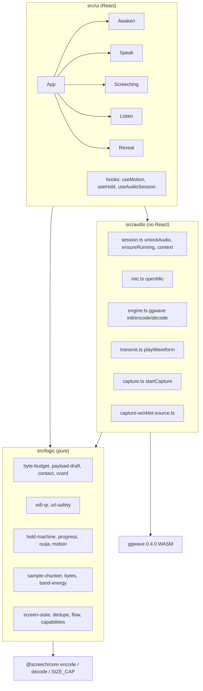
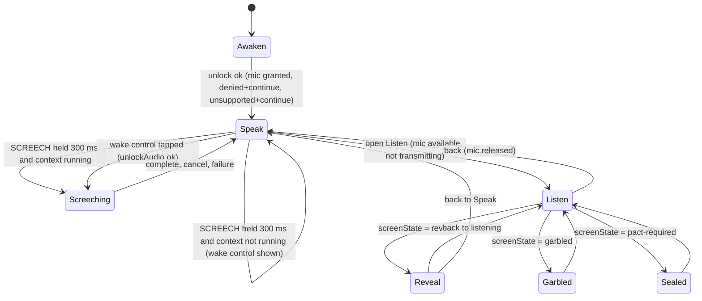
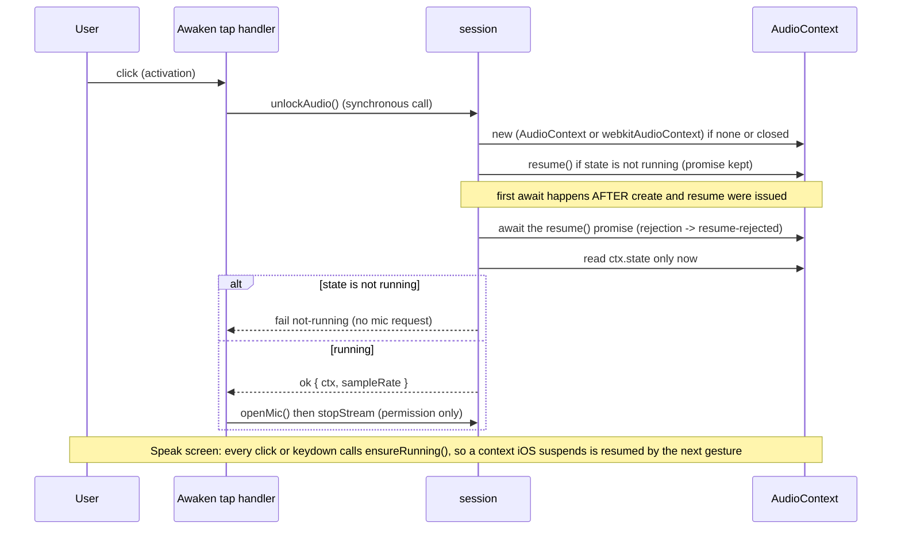
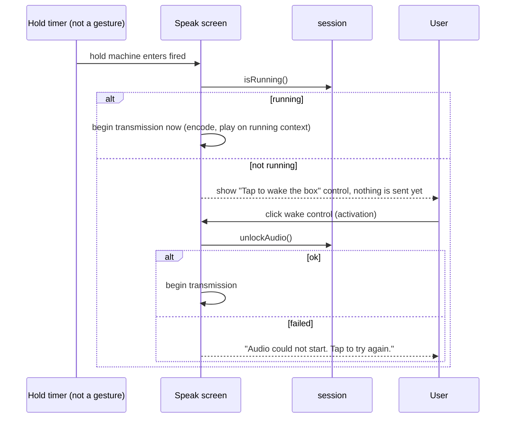

# Design Document

## Overview

The Spirit_Box_App turns `apps/web` (currently a stub `App.tsx` that renders `<h1>Screech</h1>`) into the five-screen spirit box: Awaken, Speak, Screeching, Listen and Reveal. It sends and receives Core Packets as sound with ggwave 0.4.0 (WASM). Everything about the protocol (frame, bodies, prefix compression, size cap) stays in `@screech/core`. The web app only calls `encode`, `decode` and `SIZE_CAP`.

The design rests on three layers with one-way dependencies:

1. **Pure logic** (`src/logic`): functions with no React, no DOM and no audio API. Every correctness property in this document targets this layer.
2. **Audio engine** (`src/audio`): wraps ggwave, `AudioContext`, the microphone, playback and capture. No React. It may import from `src/logic`.
3. **React UI** (`src/ui`): screens and hooks. It calls the audio engine and the pure logic and holds no protocol or DSP logic.

### Findings from the existing code that shape the design

| Source | Finding | Design consequence |
| --- | --- | --- |
| `packages/core/src/index.ts`, `result.ts`, `types.ts` | `encode(payload): Result<Uint8Array>`, `decode(packet): Result<DecodedPacket>`. `Result` is `{ok:true,value}` or `{ok:false,error}`. `CodecError` carries `code` and `message`; `too-large` also has `length`, `invalid-payload` also has `field`. `DecodedPacket` is a union on `multipart`. Core is consumed from `dist` (`exports` points at `./dist/index.js`). | The screen-state mapping and byte budget are typed directly on these types. Web tests alias `@screech/core` to `packages/core/src/index.ts` in `vitest.config.ts` so `pnpm test` does not depend on a prior core build. The production build still uses `dist` (root `pnpm build` is topological). |
| `apps/spike/src/main.ts` | Works today: lazy `factory()` import, `new AudioContext()` and `await ctx.resume()` inside the click handler, `ggwave.init` with `ctx.sampleRate` and F32 formats, `encode(..., AUDIBLE_FAST, volume).slice()` viewed as `Float32Array`, mic with all three filters off, 4096-sample accumulator, `ScriptProcessorNode` connected to `destination`. | Reused almost verbatim in `src/audio`, with these changes: Uint8Array payloads instead of strings (the spike passes `string`, which UTF-8-mangles the `0xC1` header byte), an `AudioWorklet` path, Transmit_Volume 50 (spike used 10, about 1.5 m range), a pure chunker, and cleanup. |
| `apps/spike/src/ggwave.d.ts` | Types `encode(instance, text: string, ...)`. | The web copy types the payload as `string | Uint8Array`. The ggwave C++ binding takes `const std::string&`, and Embind accepts a `Uint8Array` for `std::string`. A real-ggwave integration test proves this (see Testing Strategy). |
| `ggwave/emscripten.cpp` | `encode` and `decode` return `typed_memory_view` windows onto **static** buffers (`static std::vector<char>`, `static char output[256]`). | Both results must be copied immediately (`.slice()`), which is what requirements 9.5 and 9.6 say. A 140-byte packet fits the 256-byte decode buffer. |
| `apps/spike/node_modules/ggwave/ggwave.js` | The WASM is bundled in the JS file. | No separate `.wasm` request, so requirement 1.4 (same-origin only) holds. Load with dynamic `import('ggwave')` so a load failure is catchable (9.13) and first paint does not wait for WASM. |
| `apps/web` | `tsconfig` is strict with `noUnusedLocals`; `package.json` has `test: vitest run --passWithNoTests`; no `@screech/core`, ggwave, qrcode, fonts or fast-check yet. | Add the dependencies listed in Requirement 1 plus devDependencies `fast-check` 3.22.0 (same as core), `jsdom` and `@testing-library/react` for component examples. |
| `docs/design/*.dc.html` | Mockups hold the tokens, copy and layout. Several effects are decorative loops (`.bin` bars, `.catch` bar, `.scope` scroll, `.suck`, `.ghostmove`, `.fill`, per-letter `.spell` blur-in). | Each loop is replaced by a rendering driven by real state (see "Mockup deviations"). |

### Mockup deviations (required by the ui-theme rule and requirements 2.7, 3.7, 10.14, 13.22)

| Mockup element | Mockup behaviour | Built behaviour |
| --- | --- | --- |
| Listen: spectrogram `.bin` bars and `.fall` | Looping fake animation | Canvas drawn from `AnalyserNode` bytes |
| Listen: "4 of 5" K-II LEDs, `.catch` bar | Hard-coded | LED count `round(energy × 5)`, bar equals energy |
| Listen: band label "from 1.9 kHz 8 kHz" | Static text | "1.9 kHz to 6.4 kHz" (the measured band, 1875 to 6400 Hz) |
| Listen: "Preview: a tampered packet arrives" | Cursed demo | Omitted (Cursed is out of scope) |
| Screeching: `.scope`, `.fill`, `.ghostmove`, `.suck` | Time-based loops | Oscilloscope draws the waveform at `ctx.currentTime`; fill and ghost position equal progress; letters swallowed equal `floor(progress × letters)` |
| Reveal: `.spell` per-letter blur and scale | Entrance animation per letter | Character appended in steady colour, no animation (13.22) |
| Reveal: `.drift` planchette | Decorative sway | Planchette sits on the board letter most recently spelled |
| Speak: `.flame`, `.breathe` | Always on | Flame flicker only while fill is greater than 0 and motion is allowed; scale follows fill |

## Architecture



Dependency rules, enforced by a test (Requirement 17.7, 17.8 and 9.1):

- `src/logic/**` imports only `@screech/core`, other `src/logic` files, and `qrcode`-free standard code. It must not import `react`, `react-dom`, `ggwave`, or `src/audio`, and must not mention `AudioContext`, `webkitAudioContext`, `AudioWorklet`, `AnalyserNode`, `MediaStream` or `navigator.mediaDevices`.
- `src/audio/**` must not import `react` or `react-dom`.
- `src/ui/**` is the only layer that imports React.

### Module layout

```
apps/web/
  index.html
  vite.config.ts
  vitest.config.ts              alias @screech/core -> ../../packages/core/src/index.ts
  src/
    main.tsx                    reads Exorcise before first render, imports fonts, mounts <App/>
    styles/
      tokens.css                colour tokens, --hit: 44px, font stacks
      motion.css                [data-reduced-motion] zero-duration rules + @media (prefers-reduced-motion)
      screens.css               per-screen layout (portrait, 320..430 px)
    ggwave.d.ts                 module types (encode accepts string | Uint8Array)
    logic/                      PURE (no React, no browser audio APIs)
      byte-budget.ts            budget(Result<Uint8Array>), describeEncodeError
      payload-draft.ts          Draft, hasContent, buildPayload
      contact.ts                buildContactText, parseContactText, sanitizeField
      vcard.ts                  buildVCard, escapeVCardText
      wifi-qr.ts                buildWifiQrString, escapeWifiField
      url-safety.ts             isSafeToOpen
      hold-machine.ts           HOLD_DURATION_MS, holdStep, holdProgress
      progress.ts               progress, percent, remainingSeconds, formatDuration
      ouija.ts                  spellProgress
      motion.ts                 EXORCISE_KEY, parseExorcise, serializeExorcise, resolveReducedMotion
      sample-chunker.ts         CHUNK_SIZE, createChunker, pushSamples
      bytes.ts                  ggwaveViewToBytes, waveformFromBytes
      band-energy.ts            SCREECH_BAND_*, binFrequency, bandBins, bandEnergy, meterSteps
      screen-state.ts           screenState(Result<DecodedPacket>)
      dedupe.ts                 DEDUPE_WINDOW_MS, dedupeStep
      flow.ts                   flowReducer, canListen, canTransmit
      capabilities.ts           missingFeatures, micSupport
      contrast.ts               contrastRatio (used by a token test)
    audio/                      NO React
      constants.ts              TRANSMIT_VOLUME (single definition), defineTransmitVolume, FFT_SIZE
      session.ts                getOrCreateContext, unlockAudio, ensureRunning
      mic.ts                    openMic, stopStream
      engine.ts                 loadEngine, GgwaveEngine (init/encode/decode)
      transmit.ts               playWaveform, PlaybackHandle
      capture.ts                startCapture, CaptureHandle (worklet or ScriptProcessor + analyser)
      capture-worklet-source.ts worklet source string, loaded through a Blob URL
      env.ts                    readCapabilities(): reads window/navigator once
    ui/
      App.tsx                   screen switch from flow state
      screens/ Awaken.tsx Speak.tsx Screeching.tsx Listen.tsx Reveal.tsx Garbled.tsx Sealed.tsx
      components/ TarotCard.tsx ByteCandle.tsx ScreechKey.tsx Oscilloscope.tsx Spectrogram.tsx
                  KIIMeter.tsx OuijaBoard.tsx ActionCard.tsx ExorciseToggle.tsx CrtFrame.tsx
      hooks/ useMotion.ts useHold.ts useAudioSession.ts useFlow.ts
  tests/
    logic/*.test.ts, logic/*.property.test.ts
    audio/*.test.ts            fakes for AudioContext, getUserMedia, ggwave
    audio/ggwave-roundtrip.test.ts   real ggwave at 44100 and 48000
    ui/*.test.tsx              jsdom + Testing Library
    architecture.test.ts       import-graph and source scans
```

### Screen flow



`ignore` never changes the screen and writes nothing visible (12.3).

### AudioContext unlock sequence (Requirements 4.2, 4.3, 4.8, 16.1, 16.2; see "Deviations from the requirements")

iOS Safari only lets a page create or resume an `AudioContext` during user activation. The activation events are `click`, `keydown`, `pointerup` and `touchend`. `pointerdown` and `touchstart` are not activation events on touch devices, and the 300 ms hold timer that fires the SCREECH_Key is not a gesture at all. The design therefore never starts a transmission from a bare unlock. It keeps the context running and treats the hold-fired moment as "play now if running, otherwise ask for a tap".

Three entry points, all in `audio/session.ts`:

| Function | Called from | Does |
| --- | --- | --- |
| `unlockAudio()` | Awaken tap, wake-control tap, Listen open tap, Listen retry tap | Creates or resumes the context, awaits `resume()`, then reads the state. Full outcome object. |
| `ensureRunning()` | Every `click` and `keydown` handler on the Speak screen (Tarot_Cards, inputs, seal toggle, Listen button, SCREECH_Key keyboard presses) and the `visibilitychange` handler | Cheap keep-alive. If the context exists and is not `running`, calls `resume()` and returns its promise. Does nothing otherwise. Never creates a context and never reads the state before awaiting. |
| `isRunning()` | The hold-fired transition (timer context) | Synchronous read of `ctx?.state === 'running'`. No `resume()`, no creation. |





```ts
// audio/session.ts
export type UnlockFailure = 'context-unavailable' | 'resume-rejected' | 'not-running';
export type UnlockOutcome =
  | { readonly ok: true; readonly ctx: AudioContext; readonly sampleRate: number }
  | { readonly ok: false; readonly reason: UnlockFailure };

/** Call only from inside a click, keydown, pointerup or touchend handler. Do not await anything before it. */
export function unlockAudio(): Promise<UnlockOutcome> {
  let ctx: AudioContext;
  let resumed: Promise<void>;
  try {
    ctx = getOrCreateContext();                       // sync: webkitAudioContext fallback (16.6)
    resumed = ctx.state === 'running' ? Promise.resolve() : ctx.resume(); // sync call
  } catch {
    return Promise.resolve({ ok: false, reason: 'context-unavailable' });
  }
  return settle(ctx, resumed);
}

async function settle(ctx: AudioContext, resumed: Promise<void>): Promise<UnlockOutcome> {
  try { await resumed; } catch { return { ok: false, reason: 'resume-rejected' }; }
  if (ctx.state !== 'running') return { ok: false, reason: 'not-running' }; // read AFTER the await
  return { ok: true, ctx, sampleRate: ctx.sampleRate };
}

/** Keep-alive for gesture handlers. Resumes an existing, non-running context. Safe to call on every event. */
export function ensureRunning(): Promise<void> {
  const ctx = currentContext();                       // null when none was created yet
  if (ctx === null || ctx.state === 'running' || ctx.state === 'closed') return Promise.resolve();
  return ctx.resume().catch(() => undefined);         // failure is detected later by isRunning()
}

/** Synchronous, gesture-free check used by the hold-fired transition. */
export function isRunning(): boolean {
  return currentContext()?.state === 'running';
}
```

Rules that follow from this:

- The await-resume-before-reading-state rule is unchanged for `unlockAudio()`. `ensureRunning()` reads the state only to decide whether to call `resume()`, and it never reports the outcome. The outcome is read by `unlockAudio()` (after the awaited promise) or by `isRunning()` at hold-fire time.
- `resume()` is called when the state is not `running` (this covers Safari's `interrupted` as well as `suspended`). A `closed` context is replaced by a new one only inside `unlockAudio()`, in the same tap.
- Audio is unlocked once on the Awaken tap and then kept running by `ensureRunning()` calls. Handlers call it first and do not await it, so a slow resume never delays input. It is called synchronously at the top of each handler, because activation expires after a short time.
- The hold-fired transition never calls `unlockAudio()` or `resume()`. Playing on a running context needs no gesture.
- The wake control and the Listen open and retry controls call `unlockAudio()` inside their own click handlers.
- `visibilitychange` (15.10) calls `ctx.resume()` and awaits it. If it rejects or the state is still not `running`, the Listen screen shows the retry tap control (15.11), and the retry handler calls `unlockAudio()` again. On the Speak screen the next click or keydown calls `ensureRunning()`, and a hold that fires on a non-running context shows the wake control.
- ggwave is initialised after unlock, from `ctx.sampleRate`, never from a constant (see Audio engine).
- Contingency if an iOS device keeps the context `suspended` after `resume()`: start a one-sample silent `AudioBufferSourceNode` synchronously in the same handler. It is not in the baseline because the spike works without it.

## Components and Interfaces

### Pure logic (`src/logic`)

```ts
// byte-budget.ts
import type { Result } from '@screech/core';
export type BudgetStatus = 'ok' | 'too-large' | 'invalid';
export interface Budget {
  readonly status: BudgetStatus;
  readonly size: number | null;   // Packet_Size, or the length Core reported for too-large, or null for invalid
  readonly fill: number;          // 0..1
  readonly message: string | null; // plain-words error, null when ok
}
export function budget(result: Result<Uint8Array>): Budget;
export function describeEncodeError(error: CodecError): string;
```

- `ok` with `length <= SIZE_CAP`: `{status:'ok', size:length, fill:min(1,length/SIZE_CAP)}`. An `ok` result longer than `SIZE_CAP` (Core never produces one) is reported as `too-large`, so the SCREECH key cannot enable on it.
- `too-large`: `size = error.length`, `fill = 1`, `message = "Too heavy to cross over (<length>/140 bytes)"`. The `140` is `SIZE_CAP` interpolated, never typed.
- Any other error: `status 'invalid'`, `size null`, `fill 0`, message built from `error.code`, `error.field` (when present) and `error.message`, in plain words.

```ts
// payload-draft.ts
export type TypeKey = 'text' | 'url' | 'wifi' | 'contact';
export interface Draft {
  readonly selected: TypeKey;
  readonly text: string;
  readonly url: string;
  readonly wifi: { readonly ssid: string; readonly password: string; readonly security: WifiSecurity };
  readonly contact: { readonly name: string; readonly phone: string; readonly email: string };
}
export const INITIAL_DRAFT: Draft; // selected 'text', wifi.security 'wpa'
export function hasContent(draft: Draft): boolean;              // 5.8 rules for the selected type
export type BuildResult =
  | { readonly ok: true; readonly payload: Payload }
  | { readonly ok: false; readonly reason: 'empty' | 'name-required'; readonly message: string };
export function buildPayload(draft: Draft): BuildResult;
```

`buildPayload` leaves `text` as typed, trims the url, sends `password: ''` for open Wi-Fi (Core rejects an open network with a password), and for contact sanitises then calls `buildContactText`. A blank contact name returns `name-required` (6.8). The UI then runs `budget(encode(payload))`. The whole draft lives in one `useReducer` state so switching cards keeps every field (5.3).

```ts
// contact.ts
export const FIELD_SEPARATOR = '\u001f';
export interface ContactFields { readonly name: string; readonly phone: string; readonly email: string }
export function sanitizeField(value: string): string;           // each U+001F, LF, CR -> one space
export function buildContactText(fields: ContactFields): string; // sanitised fields joined by U+001F, trailing empty fields omitted
export type ParsedContact =
  | { readonly ok: true; readonly fields: ContactFields }
  | { readonly ok: false };
export function parseContactText(text: string): ParsedContact;   // total; ok iff 1..3 parts and name not blank after trim
```

The separator is U+001F because phone numbers, emails and names never contain it and it costs one byte. Omitting trailing empty fields saves up to 2 bytes. `parseContactText` splits on the separator and returns empty strings for missing phone or email. A name that is blank after trimming, or more than three parts, is `ok:false`, and the Reveal screen then shows the raw text (6.10).

```ts
// vcard.ts
export function escapeVCardText(value: string): string;  // \ -> \\, , -> \,, ; -> \;, LF/CR/CRLF -> \n
export function buildVCard(fields: ContactFields): string;
// "BEGIN:VCARD\r\nVERSION:3.0\r\nFN:<n>\r\n[TEL:<p>\r\n][EMAIL:<e>\r\n]END:VCARD\r\n"
```

```ts
// wifi-qr.ts
export function escapeWifiField(value: string): string; // prefix \ ; , : " with one backslash
export function buildWifiQrString(w: { ssid: string; password: string; security: WifiSecurity }): string;
// "WIFI:T:<WPA|WEP|nopass>;S:<ssid>;P:<password>;;"  (open -> "P:;")
```

```ts
// url-safety.ts
export function isSafeToOpen(url: string): boolean; // /^https?:\/\//i on the raw string, no trimming
```

```ts
// hold-machine.ts
export const HOLD_DURATION_MS = 300;
export type HoldState =
  | { readonly kind: 'idle' }
  | { readonly kind: 'holding'; readonly elapsedMs: number }
  | { readonly kind: 'fired' };
export type HoldEvent =
  | { readonly kind: 'press' }
  | { readonly kind: 'release' }
  | { readonly kind: 'cancel' }
  | { readonly kind: 'tick'; readonly elapsedMs: number }; // elapsed since the press
export function holdStep(state: HoldState, event: HoldEvent): HoldState;
export function holdProgress(state: HoldState): number; // idle 0, holding min(1, e/300), fired 1
```

Transition table (every other combination returns the state unchanged):

| State | press | release / cancel | tick(e) |
| --- | --- | --- | --- |
| idle | holding(0) | idle | idle |
| holding(x) | holding(x) (auto-repeat ignored, 8.6) | idle | `e >= 300` gives fired, otherwise holding(max(x, max(0, e))) |
| fired | fired (auto-repeat ignored) | idle | fired |

On the transition into `fired` (not on release, 8.1) the UI makes one decision, once, because `fired` is only left through release or cancel: if `isRunning()` is true it begins the transmission immediately, otherwise it shows the wake control and sends nothing (see "Transmit flow"). The timer callback never calls `unlockAudio()`. `useHold` drives `tick` from a 33 ms interval using `performance.now()`, so progress updates at least every 50 ms (8.5). Pointer leave and `pointercancel` dispatch `cancel` (8.7). A disabled key dispatches nothing and resets to idle (8.8). Keyboard: `keydown` for Space or Enter with `event.repeat === true` is dropped before it reaches the machine. The first (non-repeat) `keydown` and the `pointerup`, `click` and `keydown` handlers of the Speak screen call `ensureRunning()` before dispatching to the machine; `pointerdown` does not count as a gesture, so it is not relied on.

```ts
// progress.ts
export function progress(elapsedSec: number, durationSec: number): number;      // clamp(elapsed/duration, 0, 1); NaN elapsed -> 0
export function percent(p: number): number;                                      // floor(p * 100), 0..100
export function remainingSeconds(elapsedSec: number, durationSec: number): number; // ceil(max(0, duration - elapsed))
export function formatDuration(seconds: number): string;                         // one decimal place
```

```ts
// ouija.ts
export const SPELL_RATE_CPS = 12;
export const SPELL_MAX_CHARS = 30;
export const SPELL_MAX_MS = 2500;
export interface Spelled { readonly count: number; readonly done: boolean } // count in code points
export function spellProgress(elapsedMs: number, length: number): Spelled;
// before done: count = min(length, SPELL_MAX_CHARS, floor(elapsedMs * 12 / 1000)); done when elapsedMs >= 2500
// or count === length. When done, the UI shows the entire value (the remainder beyond 30 at once).
```

Text is split with `Array.from(value)` so a character is one code point. Under Reduced_Motion the screen skips the schedule and uses `{count: length, done: true}`.

```ts
// motion.ts
export const EXORCISE_KEY = 'screech.exorcise';
export function parseExorcise(raw: string | null | undefined): boolean;  // only '1' is true
export function serializeExorcise(on: boolean): '1' | '0';
export function resolveReducedMotion(toggle: boolean, systemPrefersReduced: boolean): boolean; // OR
```

`main.tsx` reads `localStorage` inside `try/catch` and sets `document.documentElement.dataset.reducedMotion` before `createRoot().render`, so a saved "on" never plays an animation (3.3). A `matchMedia('(prefers-reduced-motion: reduce)')` listener updates the attribute within one event turn (3.6). While the system setting is active, the toggle renders on and disabled with the text "System setting is in effect." (3.5). `motion.css` forces `animation-duration: 0ms !important; transition-duration: 0ms !important; animation-delay: 0ms !important` under `[data-reduced-motion="true"]` and the media query. Canvas loops (oscilloscope, spectrogram) also read the flag from `useMotion`, since CSS cannot stop them.

```ts
// sample-chunker.ts
export const CHUNK_SIZE = 4096;
export interface ChunkerState { readonly pending: Float32Array } // length < CHUNK_SIZE
export const EMPTY_CHUNKER: ChunkerState;
export function pushSamples(state: ChunkerState, block: Float32Array): {
  readonly state: ChunkerState;
  readonly chunks: readonly Float32Array[]; // each exactly CHUNK_SIZE, in order
};
```

```ts
// bytes.ts
export function ggwaveViewToBytes(view: Int8Array): Uint8Array;
// new Uint8Array(view.buffer, view.byteOffset, view.length).slice()   (9.6, 9.17)
export function waveformFromBytes(bytes: Int8Array): Float32Array;
// copy with .slice(), then new Float32Array(copy.buffer, 0, copy.byteLength / 4)   (9.5)
```

```ts
// band-energy.ts
export const SCREECH_BAND_LOW_HZ = 1875;
export const SCREECH_BAND_HIGH_HZ = 6400;
export function binFrequency(index: number, sampleRate: number, fftSize: number): number; // i * sr / fft
export function bandEnergy(
  magnitudes: ArrayLike<number>, // AnalyserNode byte data, 0..255
  sampleRate: number, fftSize: number, lowHz: number, highHz: number,
): number; // mean of bins with low <= f <= high, divided by 255, clamped to [0,1]; no bins -> 0
export function meterSteps(energy: number, steps?: number): number; // round(clamp(energy) * steps), default 5
```

Non-finite magnitudes count as 0. With `fftSize = 2048` the spacing is `sampleRate / 2048` (about 21.5 Hz at 44.1 kHz, 23.4 Hz at 48 kHz), so the band holds about 190 bins.

```ts
// screen-state.ts
export type ScreenState =
  | { readonly kind: 'ignore' }
  | { readonly kind: 'reveal'; readonly packet: Extract<DecodedPacket, { multipart: false }> }
  | { readonly kind: 'garbled' }
  | { readonly kind: 'pact-required' };
export function screenState(result: Result<DecodedPacket>): ScreenState;
```

Table: `ok` and `multipart:false` gives `reveal`; `ok` and `multipart:true` gives `ignore`; error `invalid-body` gives `garbled`; `key-required` gives `pact-required`; every other error (the five Room_Noise_Error codes and anything else) gives `ignore`. The function never throws; a value that is not a `Result` shape also maps to `ignore`.

```ts
// dedupe.ts
export const DEDUPE_WINDOW_MS = 5000;
export type DedupeState = ReadonlyMap<string, number>; // key -> time it was last SHOWN
export function dedupeStep(state: DedupeState, key: string, nowMs: number):
  { readonly show: boolean; readonly state: DedupeState };
// show unless now - lastShown < 5000. Only shown events update the map. Keys older than the window are dropped.
```

Keys: lower-case hex of the packet bytes for reveal; the literal strings `garbled` and `pact-required` for the other two screens.

```ts
// flow.ts
export type Screen = 'awaken' | 'speak' | 'screeching' | 'listen' | 'reveal' | 'garbled' | 'sealed';
export type MicStatus = 'unprobed' | 'granted' | 'denied' | 'insecure-context' | 'no-getusermedia' | 'skipped';
export interface FlowState {
  readonly screen: Screen;
  readonly mic: MicStatus;
  readonly transmitting: boolean;
  readonly listening: boolean;
  readonly notice: string | null;      // plain-words message (15.6, 15.7)
  readonly micAttempts: number;        // capped at 3 (4.7)
  readonly wakePending: boolean;       // hold fired while the context was not running; wake control shown
  readonly received: Extract<ScreenState, { kind: 'reveal' }> | null;
}
export type FlowEvent = /* unlocked, micResult, continueWithoutListening, retryMic, openListen, leaveListen,
  holdFired(contextRunning), wakeTapped, startTransmit, transmitEnded, received(ScreenState), back(target) */;
export function flowReducer(state: FlowState, event: FlowEvent): FlowState;
export function canTransmit(state: FlowState): boolean;  // !listening && !transmitting
export function canListen(state: FlowState): boolean;    // mic === 'granted' && !transmitting
```

The reducer owns the mutual exclusion rules (15.5 to 15.8): `openListen` while `transmitting` returns the same screen with `notice = "Listening is unavailable until the transmission ends."`; `startTransmit` while `listening` returns with `notice = "Sending is unavailable while listening."`. `holdFired(false)` sets `wakePending: true` and leaves the screen on Speak; `holdFired(true)` and `wakeTapped` (after a successful unlock) clear `wakePending` and lead to `startTransmit`. Receiving a non-`ignore` ScreenState sets `listening: false` (the engine then stops the mic within 500 ms).

```ts
// capabilities.ts
export interface Env { readonly hasWasm: boolean; readonly hasWebAudio: boolean; readonly isSecureContext: boolean; readonly hasGetUserMedia: boolean }
export function missingFeatures(env: Env): readonly ('WebAssembly' | 'Web Audio' | 'secure context (HTTPS)')[];
export function micSupport(env: Env): 'ok' | 'insecure-context' | 'no-getusermedia'; // insecure checked first
```

### Audio engine (`src/audio`)

```ts
// constants.ts
export function defineTransmitVolume(value: number): number; // throws RangeError(`Transmit volume ${value} is outside 1..100`)
export const TRANSMIT_VOLUME: number = defineTransmitVolume(50); // the only definition, passed to every encode()
export const FFT_SIZE = 2048;
```

`defineTransmitVolume` is exported so the property test can call it with arbitrary numbers; `TRANSMIT_VOLUME` is the one binding used in `engine.ts`. A source scan test asserts the literal appears once.

```ts
// engine.ts
export interface GgwaveEngine {
  readonly sampleRate: number;
  encode(packet: Uint8Array): Float32Array;            // Spirit_Wave, TRANSMIT_VOLUME, copied with .slice()
  decode(samples: Float32Array): Uint8Array | null;    // exactly CHUNK_SIZE samples; copy via ggwaveViewToBytes
}
export type EngineResult =
  | { readonly ok: true; readonly engine: GgwaveEngine }
  | { readonly ok: false; readonly message: string };   // "The sound engine could not start."
export function loadEngine(sampleRate: number): Promise<EngineResult>;
```

`loadEngine` does `await import('ggwave')`, `factory()`, `getDefaultParameters()`, sets `sampleRateInp = sampleRateOut = sampleRate` and F32 for input and output, then `init`. It is cached per sample rate; if `ctx.sampleRate` later differs from the engine's (iOS route change), the engine is re-initialised. `encode` passes the `Uint8Array` straight to ggwave with `ProtocolId.GGWAVE_PROTOCOL_AUDIBLE_FAST` (Spirit_Wave) and `TRANSMIT_VOLUME`. `decode` takes `new Int8Array(samples.buffer, samples.byteOffset, samples.byteLength)` as the spike does, and returns `null` when ggwave returns length 0. Any throw becomes the plain-words error and leaves send and listen inactive while the UI stays responsive (9.13).

```ts
// mic.ts
export type MicResult =
  | { readonly ok: true; readonly stream: MediaStream }
  | { readonly ok: false; readonly reason: 'denied' | 'unavailable'; readonly message: string };
export function openMic(): Promise<MicResult>;
// getUserMedia({ audio: { echoCancellation: false, noiseSuppression: false, autoGainControl: false } })
export function stopStream(stream: MediaStream): void; // stop every track
```

`openMic` is called only after `unlockAudio()` reports `ok`. On the Awaken screen the stream is opened to obtain the permission, then stopped at once (`stopStream`), so the microphone is closed while transmitting (15.5). The Listen screen opens its own stream inside its own tap handler, which also satisfies the retry-in-tap rule (11.15).

```ts
// transmit.ts
export interface PlaybackHandle {
  readonly durationSec: number;                 // wave.length / ctx.sampleRate
  readonly wave: Float32Array;                  // for the oscilloscope
  elapsedSec(): number;                         // ctx.currentTime - startedAt, from the Audio_Context clock
  stop(): void;                                 // src.stop(); disconnect; within 100 ms
  readonly finished: Promise<'ended' | 'stopped' | 'failed'>;
}
export function playWaveform(ctx: AudioContext, wave: Float32Array): PlaybackHandle;
```

`playWaveform` builds an `AudioBuffer` with `ctx.createBuffer(1, wave.length, ctx.sampleRate)`, `copyToChannel`, an `AudioBufferSourceNode` to `ctx.destination`, and records `startedAt = ctx.currentTime` at `start()`. `finished` resolves `'ended'` from `onended`, `'stopped'` after `stop()`, and `'failed'` if `ctx.state` leaves `running` before the end (listening on `statechange`) or `start()` throws. All progress values come from `elapsedSec()` (10.14).

Transmit flow in the UI. `startTransmission()` is a plain async function with no gesture requirement. It has two callers: the hold-fired transition when `isRunning()` is true, and the wake-control click handler after `unlockAudio()` returned `ok`.

1. `loadEngine(ctx.sampleRate)`, then `buildPayload`, `encode` (Core), `engine.encode(packet)`, `playWaveform`, then `flow: startTransmit`.
2. If the context is not running when the hold fires, `flow` sets `wakePending: true` and the Speak screen shows the "Tap to wake the box" control (a button of at least 44 px by 44 px, in the same position as the SCREECH_Key hold fill, with the text "The box fell asleep. Tap to wake it." and the accessible name "Tap to wake the box"). The draft is untouched. Nothing is sent and no Screeching screen appears.
3. The wake click handler calls `unlockAudio()` first, with nothing awaited before it. On `ok` it clears `wakePending` and calls `startTransmission()`. On failure it keeps the control visible and shows "Audio could not start. Tap to try again."
4. `wakePending` is cleared when the user edits any input, selects another card, opens Listen or taps the wake control. A new hold while `wakePending` is true is treated like any other hold, so a second fire with a running context sends at once.
5. If `startTransmission()` fails after the context was running (engine failure, playback failure), the Screeching error state with a return control is used (10.7, 10.8).

```ts
// capture.ts
export interface CaptureHandle {
  readonly analyser: AnalyserNode;     // fftSize FFT_SIZE, fed from the mic source
  readonly sampleRate: number;
  lastBlockAt(): number;               // performance.now() of the last audio block, for the watchdog
  stop(): void;                        // stop tracks, disconnect every node, close worklet port, within 500 ms
}
export interface CaptureEvents {
  onPacketBytes(bytes: Uint8Array): void;  // complete ggwave payload, once
  onMicLost(): void;                       // track 'ended' (11.14)
}
export function startCapture(ctx: AudioContext, stream: MediaStream, engine: GgwaveEngine,
  events: CaptureEvents): Promise<CaptureHandle>;
```

Graph: `MediaStreamSource -> AnalyserNode` (no output) and `MediaStreamSource -> capture node -> GainNode(0) -> destination` (the muted gain keeps the node pulled, as the spike's `proc.connect(destination)` did, but writes silence so no UI_Sound plays, 11.10). The capture node is an `AudioWorkletNode` when `ctx.audioWorklet` exists. The processor source in `capture-worklet-source.ts` only forwards each 128-sample input block with `port.postMessage(copy, [copy.buffer])`, and is loaded through `URL.createObjectURL(new Blob([source]))` with `addModule`, so no extra file or origin is involved. If `addModule` throws or `audioWorklet` is missing, a `ScriptProcessorNode(4096, 1, 1)` is used (9.10). Blocks go through `pushSamples`; each 4096-sample chunk goes to `engine.decode`; a non-null result is sent once to `onPacketBytes`. `stream.getAudioTracks()[0]` gets an `ended` listener for `onMicLost`.

Listen screen wiring: `onPacketBytes` runs `decode(bytes)` from Core exactly once (12.1), then `screenState`, then `dedupeStep`. `ignore` does nothing visible. Otherwise the flow reducer receives `received`, the hook stops the capture (`handle.stop()`), and the right screen shows.

Tab visibility (15.10, 15.11): the `useAudioSession` hook listens to `visibilitychange`. When visible and listening, it awaits `ctx.resume()`; then if `performance.now() - handle.lastBlockAt() > 1000` or the track is not `live`, it tries `startCapture` again with the existing stream or a fresh `openMic()`. If the resume or restart fails, the hook shows "Listening stopped." with a tap retry (which runs `unlockAudio()` in the tap) and keeps received data.

### React UI (`src/ui`)

| Component | State it renders (real state only) |
| --- | --- |
| `Awaken` | Boot lines, Awaken control, `ExorciseToggle`, mic and unlock error messages with retry and continue controls (4.5 to 4.9) |
| `Speak` | Four `TarotCard` (`aria-pressed`), type inputs, `ByteCandle` from `budget()`, disabled seal toggle with "Sealed messages arrive in a later release.", `ScreechKey` with hold fill from `holdProgress`, "Tap to wake the box" control shown only while `wakePending`, Listen button from `canListen`. Every click and keydown handler on this screen calls `ensureRunning()` first |
| `ByteCandle` | `size/140 bytes` text, wax height from `fill`, red when `too-large`, flame flicker only when `fill > 0` and motion allowed |
| `Screeching` | Only entered once the context is running and playback has been requested. `Oscilloscope` (canvas, waveform window at `elapsedSec() * sampleRate`, at least 20 fps via `requestAnimationFrame`), percent, duration, remaining seconds, message "The sound is still travelling. Keep the phones close until it ends." Reduced motion: static full waveform and text updated once per second |
| `Listen` | `Spectrogram` canvas from `AnalyserNode.getByteFrequencyData` (at least 10 fps), band highlight from `binFrequency`, `KIIMeter` from `bandEnergy`, "Listening" label, mic-lost message with retry. Reduced motion: frames at most 3 per second, meter as text |
| `Reveal` | Hidden full-text element for assistive technology from the first frame, `OuijaBoard` showing `spellProgress` output (`aria-hidden`), skip control, then `ActionCard` |
| `ActionCard` | By type: text/checkin/hunt-clue text; url with open button (only when `isSafeToOpen`) using `window.open(url, '_blank', 'noopener,noreferrer')` on tap; wifi SSID, security, copy password (omitted for open), QR canvas from `qrcode.toCanvas(buildWifiQrString(...))`, fallback text; contact fields (absent ones omitted) and a `.vcf` download made with `new Blob([buildVCard(...)], {type: 'text/vcard'})` |
| `Garbled`, `Sealed` | "This message arrived damaged." with a return control; exact text "A sealed message. Join the pact to read it." |

All received strings render as React text nodes (13.19); no `dangerouslySetInnerHTML` anywhere. The decoded value for url is the string Core returns (scheme already restored).

Styling follows the mockup tokens: `#050806`, panels `#07110a` and `#08130b`, borders `#2f5a3a` and `#1f3a27`, green `#39ff7a` and `#5aa86c`, bone `#e9e4d4`, reds `#ff3b3b`, `#ff5a5a`, `#ff8a7a` only for errors, curses and the seal. Fonts come from `@fontsource/vt323`, `@fontsource/special-elite` and `@fontsource/creepster` imported in `main.tsx`. `--hit: 44px` is applied as `min-height` and `min-width` on a shared `.hit` class used by every button, card, toggle and input. Layouts use `max-width: 430px`, `width: 100%` and `min-width: 0` on flex children so nothing exceeds 320 px.

Mockup scanlines and vignette are static overlays (`CrtFrame`) and are allowed because they hide no function. The mockup's `radial-gradient` vignette is a gradient wash against the rule "no gradient washes": it is replaced by a solid inset `box-shadow` frame, and scanlines use a solid repeating pattern at 3% opacity.

## Data Models

```ts
// Core types used as-is (from @screech/core)
type Result<T> = { ok: true; value: T } | { ok: false; error: CodecError };
type Payload = /* text | url | wifi | contact | checkin | hunt-clue */;
type DecodedPacket = /* { multipart:false, type, flags, payload } | { multipart:true, type, flags, body } */;
const SIZE_CAP = 140;

// App-level models (listed in Components): Draft, Budget, ContactFields, HoldState, HoldEvent,
// Spelled, ScreenState, DedupeState, FlowState, Env.
```

Persistent data: one `localStorage` key `screech.exorcise` with value `'1'` or `'0'`. Nothing else is stored. Draft data and received messages live in memory only.

Sample-rate data flow: `ctx.sampleRate` is read once per session after unlock, passed to `loadEngine`, to the `AudioBuffer`, and to `binFrequency`. No sample-rate literal exists in `src` (a scan test enforces this for 44100 and 48000).

## Correctness Properties

*A property is a characteristic or behavior that should hold true across all valid executions of a system-essentially, a formal statement about what the system should do. Properties serve as the bridge between human-readable specifications and machine-verifiable correctness guarantees.*

Reflection on redundancy: several candidate properties were merged. The contact round trip for clean fields is a special case of `parse(build(f)) = sanitize(f)` (sanitising is the identity on clean fields), so one property covers 6.1 to 6.4. Screen-state totality (12.9), determinism (12.8) and room-noise handling (12.10) are all implied by the model-based mapping property, so they are one property. Bounds on fill (7.10) and size equality (7.11) are kept apart because the first must hold for synthetic results of any length while the second needs real Core output. Progress bounds and monotonicity stay separate since a constant function satisfies bounds but not usefulness.

### Property 1: Wi-Fi QR string round trip

*For any* SSID and password strings (including empty, Unicode and special-character-only) and any security, parsing the `S:` and `P:` fields of `buildWifiQrString` with a reference unescape returns the original SSID and password (the password only for `wpa` and `wep`).

**Validates: Requirements 14.7**

### Property 2: Wi-Fi QR escaping and shape

*For any* SSID, password and security, the output matches `WIFI:T:<t>;S:<s>;P:<p>;;` where `<t>` is `WPA`, `WEP` or `nopass` for `wpa`, `wep` and `open`; every `\`, `;`, `,`, `:` and `"` from the input is preceded by exactly one added backslash and no other character is changed; the output ends with `;;` and has exactly three unescaped `;` terminators before the final `;`; and for `open` the password field is empty even when a password was supplied.

**Validates: Requirements 14.1, 14.2, 14.3, 14.4, 14.8, 14.9**

### Property 3: Contact text round trip with sanitising

*For any* name, phone and email strings (any characters, no lone surrogates), `parseContactText(buildContactText(f))` returns fields equal to `sanitizeField` applied to each field, provided the sanitised name is not blank; when no field contains U+001F, LF or CR, the returned fields equal the originals; and the built text contains no U+001F other than field separators, and no LF or CR.

**Validates: Requirements 6.1, 6.2, 6.3, 6.4**

### Property 4: Contact parsing is total

*For any* string, `parseContactText` does not throw, returns `ok:true` exactly when the text has one to three separator-delimited parts and the first part is not blank after trimming, and returns empty strings for phone and email when those parts are absent.

**Validates: Requirements 6.2, 6.10**

### Property 5: vCard structure

*For any* contact fields, `buildVCard` output is `BEGIN:VCARD`, `VERSION:3.0`, `FN:...`, then `TEL:...` only if the phone is non-empty, then `EMAIL:...` only if the email is non-empty, then `END:VCARD`, each line ending in CRLF, and the only CR and LF characters in the output are those CRLF terminators.

**Validates: Requirements 6.5, 6.7**

### Property 6: vCard text escaping round trip

*For any* field value, applying the RFC 6350 unescape (`\\`, `\,`, `\;`, `\n`) to `escapeVCardText(value)` returns the value with every CRLF, CR and LF replaced by LF, and the escaped text contains no raw LF or CR.

**Validates: Requirements 6.6**

### Property 7: Byte budget agrees with Core encode

*For any* valid Payload for which `encode` succeeds, `budget(encode(payload))` has status `ok`, `size` equal to the encoded length, and `fill` equal to `size / SIZE_CAP`, which lies in [0, 1].

**Validates: Requirements 7.2, 7.3, 7.8, 7.9, 7.10, 7.11**

### Property 8: Byte budget error mapping

*For any* `Result` that is an error, `budget` returns a non-empty plain-words message. For `too-large` with any length above 140 it returns status `too-large`, `fill` 1, `size` equal to the reported length and the exact message `Too heavy to cross over (<length>/140 bytes)`. For every other error code it returns status `invalid`, `fill` 0 and `size` null. For any `ok` result longer than `SIZE_CAP` it returns `too-large`.

**Validates: Requirements 2.9, 7.4, 7.5, 7.6, 7.7**

### Property 9: Content gate follows the whitespace rule

*For any* draft, `hasContent` is false exactly when the selected type's required fields are empty or whitespace only (text and url: the input; wifi: the SSID; contact: name, phone and email all blank), including strings made of tabs, newlines and Unicode spaces.

**Validates: Requirements 5.8, 5.9**

### Property 10: Hold machine follows the transition table

*For any* sequence of hold events (press, release, cancel, tick with any elapsed value including negative), every step returns exactly the state the transition table prescribes, `holding` progress stays in [0, 1], and `holdProgress` is 0 for idle and 1 for fired.

**Validates: Requirements 8.5, 8.10, 17.6**

### Property 11: Hold fires at most once per press

*For any* sequence of hold events, the number of transitions into `fired` between two consecutive presses that follow a release or cancel is at most 1, repeated presses while holding or fired never restart or re-fire, and the next release or cancel after `fired` returns `idle`.

**Validates: Requirements 8.6, 8.11, 8.12**

### Property 12: Sample chunker conserves samples

*For any* sequence of input blocks of length 0 to 65536, every emitted chunk has exactly 4096 samples, the concatenation of all emitted chunks followed by the pending samples equals the concatenation of the input blocks, and the pending count is below 4096.

**Validates: Requirements 9.15, 9.16**

### Property 13: ggwave byte conversion copies

*For any* `Int8Array` view (including views with a non-zero `byteOffset` into a larger buffer), `ggwaveViewToBytes` returns a `Uint8Array` with the same bytes in the same order whose `buffer` is not the view's `buffer`; mutating the result does not change the source.

**Validates: Requirements 9.6, 9.17**

### Property 14: Transmit volume validation

*For any* number, `defineTransmitVolume` returns it when it is an integer in 1..100, and otherwise throws an error whose message contains the value and the range `1` to `100`.

**Validates: Requirements 9.18, 9.19**

### Property 15: Progress values are bounded

*For any* elapsed time (including negative and non-finite) and any duration above 0, `progress` is in [0, 1], `percent` is an integer in 0..100, and `remainingSeconds` is an integer in 0..`ceil(duration)`.

**Validates: Requirements 10.3, 10.9, 10.12**

### Property 16: Progress is monotonic

*For any* duration above 0 and elapsed times t1 ≤ t2, `progress(t1) ≤ progress(t2)` and `remainingSeconds(t1) ≥ remainingSeconds(t2)`.

**Validates: Requirements 10.10**

### Property 17: Band energy is normalised

*For any* magnitude array (any length, values 0..255 and non-finite values), any sample rate above 0 and any FFT size above 0, `bandEnergy` returns a number in [0, 1], and returns 0 when the array is empty or no bin frequency lies in the band.

**Validates: Requirements 11.5, 11.6, 11.7, 11.9**

### Property 18: Band energy ignores out-of-band bins

*For any* magnitude array and any replacement values applied only to bins whose frequency is below 1875 Hz or above 6400 Hz, `bandEnergy` returns the same value as before the change.

**Validates: Requirements 11.8**

### Property 19: Screen state mapping

*For any* `Result<DecodedPacket>` (every `CodecErrorCode`, multipart and non-multipart successes), `screenState` returns exactly one of `ignore`, `reveal`, `garbled` or `pact-required` without throwing, equal inputs give equal outputs, and the kind is `reveal` only for a non-multipart success, `garbled` only for `invalid-body`, `pact-required` only for `key-required`, and `ignore` for multipart successes, the five Room_Noise_Error codes and all other errors.

**Validates: Requirements 12.2, 12.3, 12.4, 12.5, 12.6, 12.7, 12.8, 12.9, 12.10**

### Property 20: Random sound never breaks the receive pipeline

*For any* byte array (length 0 to 300), `screenState(decode(bytes))` returns a valid `ScreenState` without throwing, and a `reveal` result re-encodes (through Core `encode` of its payload) to a packet that decodes to an equal payload.

**Validates: Requirements 12.1, 12.9**

### Property 21: Duplicate screens are suppressed for 5 seconds

*For any* sequence of (key, time) events with non-decreasing times, two shown events of the same key are at least 5000 ms apart, and every suppressed event has a shown event of the same key less than 5000 ms earlier.

**Validates: Requirements 12.12, 12.13**

### Property 22: Ouija spelling schedule

*For any* value length and non-decreasing elapsed times, the spelled count never decreases, never exceeds `min(length, 30)` before `done`, equals `min(length, 30, floor(elapsed × 12 / 1000))` before `done`, and `done` is true at 2500 ms or earlier once every character is spelled.

**Validates: Requirements 13.1, 13.3**

### Property 23: Only http and https links are openable

*For any* string, `isSafeToOpen` is true exactly when the string starts with `http://` or `https://` in any letter case, so `javascript:`, `data:`, `file:`, leading-whitespace and scheme-less strings are false.

**Validates: Requirements 13.10**

### Property 24: Exorcise storage parsing

*For any* stored value (null, undefined or any string), `parseExorcise` returns a boolean that is true only for `'1'`; `parseExorcise(serializeExorcise(b))` equals `b`; and `resolveReducedMotion(toggle, system)` is true exactly when either input is true.

**Validates: Requirements 3.4, 3.5**

### Property 25: Sending and listening never overlap

*For any* sequence of flow events, the resulting state never has `listening` and `transmitting` both true; an `openListen` while transmitting and a `startTransmit` while listening leave both flags unchanged and set a plain-words notice; and `canTransmit` is false whenever `listening` is true.

**Validates: Requirements 15.5, 15.6, 15.7, 15.8**

### Property 26: Missing-feature report

*For any* combination of the capability flags, `missingFeatures` lists exactly the missing features among WebAssembly, Web Audio and secure context, and is empty only when all three are present.

**Validates: Requirements 16.7**

## Error Handling

Every error is a sentence that says what happened, with the measured value and the limit where one applies. Entered data is never cleared by an error (2.9).

| Situation | Where detected | Message (voice: spooky but clear) | Recovery |
| --- | --- | --- | --- |
| Packet too large | `budget` | "Too heavy to cross over (148/140 bytes)" in red | SCREECH disabled, inputs kept |
| Other encode error (empty, bad Wi-Fi, bad UTF-8) | `budget` + `describeEncodeError` | e.g. "The password is missing. WPA networks need one." | SCREECH disabled |
| Blank contact name | `buildPayload` | "A name is required to summon a contact." | Phone and email kept |
| Insecure context or no `getUserMedia` | `micSupport` at Awaken | "The spirits need HTTPS to hear you." / "This browser has no microphone access." | Continue without listening |
| `resume()` rejects or state not running | `unlockAudio` | "Audio could not start. Tap to try again." | Retry control, mic not requested |
| Mic denied | `openMic` | "The microphone was refused. Screech cannot hear without it. Allow it in your browser settings." | Retry (max 3), continue without listening; after 3 only continue and the settings steps |
| ggwave fails to load or init | `loadEngine` | "The sound engine could not start." | Send and listen inactive, rest of the app works |
| Hold fires while the context is not running | `isRunning()` in the hold-fired transition | "The box fell asleep. Tap to wake it." with the control "Tap to wake the box" | Wake tap runs `unlockAudio()`, then sends; inputs kept |
| Playback fails or context suspended mid-play | `PlaybackHandle.finished = 'failed'` | "The sound did not leave the speaker." | Return control, message preserved |
| Mic stream ends while listening | track `ended` | "The microphone went silent." | Retry tap control |
| Tab returns, resume or restart fails | `useAudioSession` | "Listening stopped." | Retry tap control, received data kept |
| Receive `invalid-body` | `screenState` | "This message arrived damaged." | Return to Listen |
| Receive `key-required` | `screenState` | "A sealed message. Join the pact to read it." | Return to Listen |
| Room noise, multipart, unknown code | `screenState` | None | Screen unchanged, nothing logged |
| Unreadable contact text | `parseContactText` | "This contact could not be read." plus raw text | No vCard control |
| Unsafe URL scheme | `isSafeToOpen` | "This link type is not safe to open." | URL shown as text |
| Clipboard write fails | `navigator.clipboard` rejection | "Copying failed. Select the password below." | Password stays visible |
| QR generation fails | `qrcode` throw | "The QR code could not be drawn." | SSID, security, password as text |
| `localStorage` unavailable or odd value | `main.tsx` try/catch | None | Toggle off, in-memory for the session |
| Missing WebAssembly, Web Audio or HTTPS | `missingFeatures` | Names each missing feature | Send and listen disabled, message stays |

Rendering rules for errors: red (`#ff5a5a` on `#050806`) text only for errors and the seal, with the text labels carrying the meaning so colour is never the sole signal.

## Testing Strategy

Property-based testing applies to the pure `src/logic` layer and `src/audio/constants.ts` (parsers, serialisers, state machines and numeric functions). It does not apply to rendering, layout, canvas drawing, browser audio wiring or build configuration; those use example tests with fakes, component tests, scans and a manual device matrix.

**Dual approach**

- **Property tests (fast-check 3.22.0, Vitest 2.1.4)**: one test per Correctness Property, each with `{ numRuns: 100 }` or more, tagged with a comment `// Feature: spirit-box-app, Property N: <title>`. Each property is implemented by exactly one test. Files are named `tests/logic/<module>.property.test.ts`. No custom property-testing framework.
- **Unit tests**: documented input classes and boundaries, one per class (Requirement 17): Wi-Fi open, WPA, WEP and each escaped character; contact name only, each optional field, empty field, maximum-length field; byte budget at 0, 139, 140 and 141 bytes; each Screen_State; chunker empty input and exact multiples of 4096; hold-machine specific sequences; band edges at 1875 Hz and 6400 Hz for 44100 and 48000 Hz.

**Generators** (`tests/logic/arbitraries.ts`): `fc.string()` and `fc.fullUnicodeString()` filtered for lone surrogates where Core would reject them; special-character strings from `fc.constantFrom('\\', ';', ',', ':', '"', '\n', '\r', '\u001f')`; Payload arbitraries reuse the shapes in `packages/core/tests/arbitraries.ts`; `fc.array(fc.oneof(...hold events...))`; `fc.array(fc.float32Array({maxLength: 65536}))` for chunker blocks; `Result<DecodedPacket>` built from every `CodecErrorCode` plus real decodes of generated packets.

**Example and integration tests**

- `tests/audio/unlock.test.ts`: fake `AudioContext` records call order. `unlockAudio()` is the only function under test that creates a context. Cases: running at start, suspended then resolves running, `resume()` rejects, `resume()` resolves but state stays suspended, `webkitAudioContext` only. Asserts `create` and `resume` happen before the first await boundary (call order recorded by a spy invoked synchronously from the test's handler) and that `getUserMedia` is never called on failure.
- `tests/audio/ensure-running.test.ts`: `ensureRunning()` with no context does nothing and creates none; with a `suspended` or `interrupted` fake it calls `resume()` once; with a `running` or `closed` fake it calls nothing; a rejecting `resume()` is swallowed; `isRunning()` is synchronous, never calls `resume()`, and is false for every state except `running`.
- `tests/audio/mic.test.ts`: constraints equal `{echoCancellation:false, noiseSuppression:false, autoGainControl:false}`; denial and missing device map to messages.
- `tests/audio/engine.test.ts`: fake ggwave module asserts `sampleRateInp` equals `sampleRateOut` equals the passed rate, F32 formats, `Uint8Array` payload (not string), `TRANSMIT_VOLUME` as the volume argument, results copied.
- `tests/audio/ggwave-roundtrip.test.ts`: the real ggwave module at 44100 and 48000 Hz. For several Core packets (a text packet, a wifi packet with bytes `0xC1` and values above `0x7F`, a 140-byte packet), `engine.encode` then feed the waveform to `engine.decode` in 4096-sample chunks through `pushSamples` and check the bytes come back equal. This is an example-based integration test rather than a property test because each run costs real DSP and the variation that matters (sample rate, high bytes, full-size packet) is covered by the listed cases.
- `tests/audio/capture.test.ts`: fake worklet and script-processor paths, `stop()` stops every track and disconnects every node, `onMicLost` on track `ended`.
- `tests/ui/wake-control.test.tsx` (case: hold fires while the context is not running, fake `AudioContext`): with the fake in `suspended`, hold SCREECH for 300 ms with fake timers. Asserts `resume()` was not called by the timer, no `playWaveform` call, no Screeching screen, the "Tap to wake the box" control is visible and the draft is unchanged. Then the fake is set so that `resume()` settles to `running`; click the wake control. Asserts `unlockAudio()` ran inside the click (call order recorded before the first await), then exactly one transmission started. A second case makes `resume()` leave the state `suspended`: the control stays and "Audio could not start. Tap to try again." appears and nothing plays. A third case with the fake `running` at fire time asserts the transmission starts at once, the wake control never shows, and `resume()` is not called.
- `tests/ui/*.test.tsx` (jsdom, Testing Library, fake timers): Awaken flows and retry cap of 3; Speak card selection and `aria-pressed`, and that clicks and keydowns on cards, inputs and the seal toggle each call `ensureRunning()`; hold with pointer and keyboard, including auto-repeat and pointer leave; Screeching progress text from a fake clock and cancel; Listen labels; Reveal spelling at 12 characters per second, skip with click, Space and Enter, reduced motion showing everything at once; action cards per type with `window.open`, clipboard and `Blob` type mocked; a payload containing `` renders as text.
- `tests/ui/theme.test.ts`: token table equals the README hex values; `contrastRatio` of every text and background pair used is at least 4.5; reds only appear in error and seal classes (source scan).
- `tests/architecture.test.ts`: walks the import graph of every `src/logic` module and fails with the module path if it reaches `react`, `react-dom`, `ggwave`, `src/audio`, or mentions a browser audio API (17.7, 17.8); asserts `src/audio` imports no React (9.1); asserts no `44100` or `48000` literal in `src` (9.3, 16.3); asserts the `TRANSMIT_VOLUME` literal 50 appears in exactly one place (9.18); asserts no `: any`, `as any` or `<any>` in `src` (16.8); asserts `package.json` has `@screech/core` as `workspace:*` and `ggwave` as exactly `0.4.0` (1.1, 1.2); scans `dist` after build for foreign origins (1.4, run as a script after `pnpm build`).

**Not automated**: layout at 320, 390 and 430 px widths, 44 px touch targets, and flash rate (2.4, 2.5, 2.10, 16.5) are checked against the CSS source (every control uses `.hit`; no animation faster than 3 Hz) and by a manual checklist on an iPhone (Safari) and an Android phone (Chrome) over HTTPS, plus Chrome desktop. Playwright is not in the project stack and is not added.

**Configuration**: `vitest.config.ts` in `apps/web` uses `environment: 'node'` for `tests/logic` and `tests/audio`, and `jsdom` for `tests/ui` through `environmentMatchGlobs`; it aliases `@screech/core` to the core source. The existing `pnpm test` script (`vitest run --passWithNoTests`) is kept, so a failing test makes the root `pnpm -r run test` exit non-zero (1.7).

**Risks to check on a device**

1. `getUserMedia` after an awaited `resume()` on current iOS Safari (the spike indicates it works; the silent-buffer contingency is described in the unlock section).
2. That `ensureRunning()` calls from Speak handlers keep an iOS context `running` between gestures, and how often the wake control appears in practice.
3. AudioWorklet loaded from a Blob URL on iOS Safari (the `ScriptProcessorNode` fallback is in place).
4. Transmit_Volume 50 range and clipping on small phone speakers.

## Deviations from the requirements

The hold fires from a timer, which is not user activation, and `pointerdown` is not an activation event on touch devices. These criteria assume a transmission starts inside a tap handler and need updating in `requirements.md` (this design does not edit it):

- **10.7** ("IF the Audio_Context is suspended when a transmission starts, THEN resume it before playback begins"): the design never resumes at hold-fire. A non-running context at that moment shows the wake control, and `unlockAudio()` runs in its click handler before the transmission starts.
- **16.1** ("WHEN the user taps a control that starts sending or listening, synchronously inside that tap handler ... create or resume"): for sending, the control that runs `unlockAudio()` is the Awaken control or, when needed, the wake control. The SCREECH_Key hold itself does not. Listening is unchanged.
- **16.2** ("create the Audio_Context only inside a user gesture handler, and call `resume()` only inside a user gesture handler or in response to `visibilitychange`"): consistent for `unlockAudio()`. `ensureRunning()` adds a gesture-handler `resume()` on every Speak click and keydown, which fits the wording but is new behaviour.
- **8.1 and 8.3** ("start exactly one transmission at the moment the Hold_Duration elapses"): true only when the context is running. Otherwise the transmission starts when the wake control is tapped.
- **4.2 and 4.3** are unchanged, but the Awaken unlock is now the one that must keep the context alive for later sends.
- **15.5** ("keep the microphone closed" while transmitting) is unaffected: the Awaken permission stream is stopped immediately.

Suggested new criteria: a wake-control criterion in Requirement 8 or 10 (shown when the hold fires on a non-running context, sends nothing until tapped), and a keep-alive criterion in Requirement 16 for `ensureRunning()` on Speak gestures.

## Gaps to flag against the requirements

- 6.3 states the round trip for "all contact fields" without a name condition, but 6.10 makes a blank name unparseable. Property 3 therefore requires a non-blank name, consistent with 6.8, which blocks sending a blank name.
- 2.2 and the mockup use `#ff6b6b` in a few places; the design uses only the three listed reds.
- 17.3 lists a byte-budget boundary at "one byte below the limit"; with a Core packet this is reached through synthetic `Result` inputs, as Property 7 and 8 do for lengths Core cannot easily produce.
